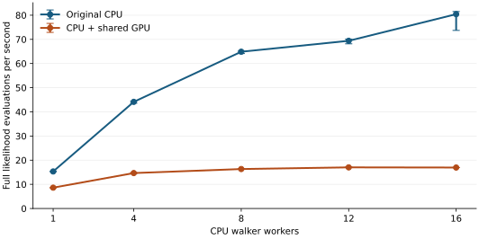

# Ada ensemble MCMC scaling

The highest original CPU median used **16 workers** and evaluated **80.42 likelihoods/s**. The highest shared-GPU hybrid median used **12 workers** and evaluated **17.02/s**. The hybrid timing ranges overlap at 12 and 16 workers. These measurements use the original detached-binary facet model and the public ELISa MCMC fit. Each row represents three fresh-process runs per backend on Ada on 18 November 2026.

| CPU walker workers | Original CPU fit, s (range) | CPU eval/s | Shared-GPU fit, s (range) | Hybrid eval/s | CPU time / hybrid time |
|---:|---:|---:|---:|---:|---:|
| 1 | 27.14 (27.05–27.23) | 15.33 | 48.22 (48.04–48.72) | 8.63 | 0.56× |
| 4 | 9.43 (9.37–9.54) | 44.14 | 28.37 (28.03–28.70) | 14.66 | 0.33× |
| 8 | 6.41 (6.39–6.49) | 64.88 | 25.48 (25.27–25.50) | 16.33 | 0.25× |
| 12 | 5.99 (5.94–6.10) | 69.40 | 24.44 (24.15–24.53) | 17.02 | 0.25× |
| 16 | 5.17 (5.10–5.64) | 80.42 | 24.53 (24.51–24.58) | 16.96 | 0.21× |

Times and rates are medians. Parentheses and chart error bars give the minimum and maximum. The CPU finished sooner at every matched worker count. From one worker to 16, CPU throughput increased **5.25×** and hybrid throughput increased **1.97×**. At 16 workers the CPU delivered **4.74×** the shared hybrid's throughput. These ratios apply to this short end-to-end fit, including device startup and transfers. [Individual results, commands and fit configuration](ada_validation/mcmc-scaling-results.json)



At 16 workers the sampling loop itself took a median **3.17 s** on the CPU and **20.42 s** on the shared hybrid. Geometry and reflection stay on the CPU. Each GPU phase requires an interprocess round trip, host/device transfer and synchronized return. These measurements group those costs together.

The pre-existing one-worker hybrid also ran. Its first control completed in 25.21 s with 417 GPU syntheses and zero CPU fallbacks. The 32 initial walker positions were the only coordinates shared with the reference. At those positions the maximum differences were 8.88e-16 in flux and 4.21e-11 in log posterior. Subsequent proposed coordinates diverged and the control accepted 191 moves to the CPU's 196. It failed the exact-trajectory check. A fresh serial control applied seed 814 directly to emcee after device initialization. All 416 proposal coordinates, retained chains and acceptance counts matched. The maximum flux and log-posterior differences were 8.88e-16 and 8.68e-11. This distinct serial implementation took **25.33 s** (16.42 evaluations/s, one run, 417 GPU syntheses, 0 CPU fallbacks).

## Matched workload

The input is a circular, detached, synchronously rotating, reflecting eclipsing binary with a 12° primary facet mesh, two reflection iterations, blackbody spectra and linear limb darkening. All 28 synthetic B, V and bolometric observations have nominal fractional uncertainty 10⁻⁴. Repeated phases, the original normalization, noise law, physical priors and secondary temperature constraint are retained. The six free coordinates are primary@surface_potential, primary@t_eff, system@inclination, system@mass_ratio, system@additional_light, nuisance@ln_f. The fixture supplies the measured fluxes and errors, full parameter definitions, numerical settings and every initial walker. [Frozen input](ada_validation/mcmc-scaling-fixture.json)

All runs used FP64, the same 32 walkers, 12 production steps, zero burn-in and the default emcee stretch move. The two red–blue halves each contain 16 walkers. The initial ensemble seed was 20261118. The matched runs seeded the NumPy random stream that emcee uses with 814. The timed call is ELISa’s public detached light-curve `fit`. Each fit made **416 full likelihood evaluations** (32 initial densities and 384 proposals). The 32 one-phase physical preflights and final R² prediction are paid for in wall time. The throughput numerator counts actual full likelihood calls captured from the fitter. Every run captured all proposal coordinates, predicted bands and posterior values, including proposed moves the sampler rejected.

The original CPU fitter parallelizes walker likelihoods with `NUMBER_OF_MCMC_PROCESSES=N`. Both paths use `NUMBER_OF_PROCESSES=1` and `NUMBER_OF_THREADS=1`. The shared hybrid uses the same ELISa pool, native facet routing, orbital calculations, reflection, radiance, visibility and eclipse coverage on the CPU. For each phase its workers send fresh selected face arrays to a single independently spawned GPU owner. The existing ordered FP64 surface kernel evaluates limb-darkening factors and integrates all three bands. The owner synchronizes the result and returns component totals. The original CPU observer applies third light, maps and normalizes observations and the original fitter evaluates the prior and density. Interprocess copies, transfers, synchronization and the final fit summaries are included. The shared GPU owner processed **5,838 synchronous phase packets per fit**, including the final R² prediction. Each hybrid case verifies its actual device execution. [Shared-device implementation](../src/elisa/experimental/gpu_walker_pool.py)

The benchmark targets this specified finite facet model. Milestone 30’s guarded curved-surface Metropolis timing uses a different physical discretization, eight resolution models and individual proposals. Its timing is excluded from every row.

## Accuracy and inference

Across the matched matrix the largest absolute difference in mapped normalized flux was **0** and the largest log-posterior difference was **0**. Every proposed position, retained chain coordinate and per-walker acceptance count matched the one-worker original CPU reference exactly. The initial ensemble accepted all 32 physical preflights. No nonfinite posteriors were recorded in the matched runs. The predeclared flux tolerances were 2e-12 absolute and 3e-13 relative. The absolute log-posterior tolerance was 1e-06. Candidate errors retain the original policy and emergency catch-all penalties are disabled. [Per-run parity and counters](ada_validation/mcmc-scaling-results.json)

The separate empirical mesh check evaluates the original 12°, 8° and 6° light curves on the actual observation phases and requires both distances to the finest calculation to be at most 0.1 in joint nominal-noise units. It ran at the generating point and initial walkers 0 and 31. The outcomes are listed below. A failed mesh check withholds the guarded density. Equivalent implementations of a finite mesh can reproduce one another while the physical discretization error exceeds the observational budget.

| Mesh check point | 12° vs 6° distance | 8° vs 6° distance | Result |
|---|---:|---:|---|
| generating point | 12.259 | 8.807 | budget failed |
| initial walker 0 | 12.264 | 8.808 | budget failed |
| initial walker 31 | 12.291 | 8.792 | budget failed |

After these three failures, an additional CPU audit evaluated the same 12°/8°/6° diagnostic at **every attempted reference coordinate** outside the timed runs. It reproduced the saved 12° fluxes and log posteriors. **0 of 416** satisfied both mesh distances. The 12°–6° distance ranged from 12.219 to 12.717 joint nominal sigmas. The absolute change in the original log likelihood using the fitted noise term ranged from 0.634 to 221.225. These results limit physical inference for this dataset at its supplied uncertainties. [All per-proposal accuracy results](ada_validation/mcmc-scaling-mesh.json)

Each reference ensemble accepted **196 of 384** production moves. The three repetitions replay the same seed for timing. Twelve steps are insufficient to establish convergence or estimate effective samples per second. ELISa’s default autocorrelation length tolerance is zero in this checkout. Its raw estimates range from 0.86 to 1.26 steps. Applying emcee’s 50-autocorrelation-time length check rejected the chain for all six parameters. The reported rate is likelihood evaluations per second.

## Timing and hardware

Ada has one AMD Ryzen 9 5950X with 16 physical cores and 32 logical threads. Linux topology identifies CPUs 0–15 as distinct cores and 16–31 as their SMT siblings. The device is an NVIDIA GeForce RTX 3080 Ti, 12,288 MiB, driver 595.99.02 (CUDA driver API 13.2). Python 3.12.4, NumPy 2.5.5, SciPy 1.18.1, emcee 3.1.6, JAX/jaxlib 0.12.0.1/0.12.0.1 and CUDA plugin 0.12.0.1 were used.

At 11:57 a.m. CST the 1/5/15-minute load averages were 4.95/3.07/3.11, the Ada ELISa milestone 31 compute unit owned the GPU, and the local Fifth42 search was checkpointed. The Fifth42 monitor was running and reported Boole and Cabbage running. The matrix obtained a dedicated ELISa allocation after that milestone's already-scheduled jobs finished. Every measured run used its own sequential, bounded unit and checked the original held Fifth42 checkpoint at both boundaries. Each launch verified an idle GPU, acquired the normal allocation locks and recorded background load. The search services and the active milestone were left to their normal schedules. [Hardware, allocation checks and package versions](ada_validation/mcmc-scaling-results.json)

For N workers, CPU affinity was 0 through N−1, one logical CPU per physical core. The shared GPU owner was pinned to logical CPU 16, the SMT sibling of walker CPU 0, at every N. This adds no physical core or duplicate walker GPU context. OS scheduling distributed the N walkers within their CPU mask. Each row used nice 10. OpenBLAS, OMP, MKL, BLIS, NumExpr, vecLib and TensorFlow intra/inter-op thread limits were one. OMP/MKL dynamic threading and XLA CPU multithreaded Eigen were disabled. JAX FP64 was enabled and device preallocation disabled. Actual Linux thread counts at the first posterior call were [1] for original walkers and [1] for shared-hybrid walkers. The live 16-worker check found all GPU-owner helper threads confined to logical CPU 16. Its thread snapshot and each run’s affinity are in the results.

The fit clock starts after parsing the frozen data, immediately before constructing the fitter and starting any device service. It stops after the fit returns and the service shuts down. It includes CPU pool startup/shutdown, initial physical checks, encountered GPU compilation, all proposals and synchronous outputs. The JSON also records sampling-loop time and the measured process wall including Python import, fixture parsing, validation and trace serialization. Each row ran in a fresh process with the same local filesystem/cache policy. The order alternated backends and varied worker order across repetitions.

## Reproduction

Use the repository checkout for this report, its test-data directory and the listed packages. From the repository root, the following commands create a fresh run directory, use the bundled tables and reproduce the 16-worker comparison and its serial CPU reference. The results file lists all 32 invocations and their driver hashes in execution order. The shared hybrid selects GPU 0 inside its device owner. The older serial control selects GPU 0 in the calling process. The second serial control adds `--pin-proposal-seed` to seed emcee after device initialization.

```bash
export PYTHONPATH="$PWD/src:$PWD"
run_dir=$(mktemp -d)
export ELISA_CONFIG="$run_dir/elisa.ini"
export XDG_CACHE_HOME="$run_dir/cache" MPLCONFIGDIR="$run_dir/cache/mpl" NUMBA_CACHE_DIR="$run_dir/cache/numba"
export JAX_PLATFORMS=cpu CUDA_VISIBLE_DEVICES=""
cat > "$ELISA_CONFIG" <<EOF
[general]
home = $run_dir/elisa-data
suppress_logger = true
[computational]
mesh_generator = trapezoidal
max_discretization_factor = 12
number_of_processes = 1
number_of_mcmc_processes = 1
number_of_threads = 1
[support]
ld_tables = $PWD/tests/data/light_curves/limbdarkening
castelli_kurucz_04_atm_tables = $PWD/tests/data/ck04
EOF
fixture=docs/ada_validation/mcmc-scaling-fixture.json
python -m scripts.benchmark_mcmc_scaling run --backend cpu --workers 1 --cpus 0 --fixture "$fixture" --output "$run_dir/reference"
python -m scripts.benchmark_mcmc_scaling run --backend cpu --workers 16 --cpus 0,1,2,3,4,5,6,7,8,9,10,11,12,13,14,15 --fixture "$fixture" --output "$run_dir/cpu16"
python -m scripts.benchmark_mcmc_scaling run --backend hybrid --workers 16 --cpus 0,1,2,3,4,5,6,7,8,9,10,11,12,13,14,15 --owner-cpu 16 --fixture "$fixture" --output "$run_dir/hybrid16"
python -m scripts.benchmark_mcmc_scaling compare "$run_dir/reference" "$run_dir/cpu16"
python -m scripts.benchmark_mcmc_scaling compare "$run_dir/reference" "$run_dir/hybrid16"
JAX_PLATFORMS=cuda CUDA_VISIBLE_DEVICES=0 python -m scripts.benchmark_mcmc_scaling run --backend serial-hybrid --workers 1 --cpus 0 --pin-proposal-seed --fixture "$fixture" --output "$run_dir/serial-replay"
python -m scripts.benchmark_mcmc_scaling mesh "$fixture" "$run_dir/mesh.json"
taskset -c 0-7 python -m scripts.audit_mcmc_scaling_mesh "$fixture" "$run_dir/reference" "$run_dir/all-mesh.json" --workers 8
```

Each run saves per-process proposal records, a compressed trace including the full chain, and machine-readable measurements. Recreate the seeded input with `python -m scripts.benchmark_mcmc_scaling fixture fixture.json`. The shared-owner regression test replays the original fitter with two walker processes and an independent JAX CPU owner, and compares its retained chain and densities. The matrix above separately exercised the actual GPU. [Benchmark driver](../scripts/benchmark_mcmc_scaling.py) · [Regression test](../tests/tests_experimental/test_gpu_walker_pool.py)
