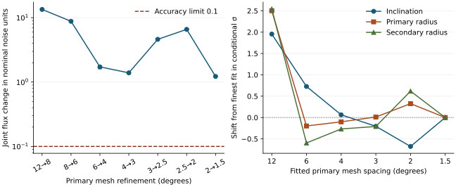

# Native ELISa mesh refinement on Ada

The generating system is the same detached reflecting binary used in the [original MCMC scaling experiment](ada_mcmc_scaling.md). Here the original CPU fitter evaluated finer triangular surfaces and both stellar radii were fitted in a controlled three-parameter experiment. The previous fastest fit used a 12° primary mesh. Its synthetic observations were themselves generated on that 12° mesh.

At the two finest primary spacings tested across the ensemble, 2° and 1.5°, **0 of 48** sampled positions met the pre-existing joint flux-change limit of 0.1 observational standard deviations. **0 of the first 16** simultaneous emcee decisions changed. The median joint distance was **1.224**. The finest calculation is a finite numerical reference. The table reports every adjacent refinement, including failures.

| Primary mesh, degrees | Generating point distance | 48 endpoints, min / median / max | Endpoints within 0.1 | Changed decisions / 16 |
|---|---:|---:|---:|---:|
| 12 → 8 | 13.459 | 13.41/13.46/13.67 | 0 | 4 |
| 8 → 6 | 8.807 | 8.762/8.801/8.862 | 0 | 4 |
| 6 → 4 | 1.736 | 1.608/1.723/1.751 | 0 | 1 |
| 4 → 3 | 1.376 | 1.35/1.392/1.425 | 0 | 0 |
| 3 → 2.5 | 4.618 | 4.509/4.617/4.755 | 0 | 1 |
| 2.5 → 2 | 6.586 | 6.5/6.591/6.695 | 0 | 3 |
| 2 → 1.5 | 1.225 | 1.207/1.224/1.241 | 0 | 0 |



The 48 points are the original 32 initial walkers and the first 16 simultaneously proposed positions. The first red–blue half step has identical parents, candidates, stretch factors and random thresholds at every resolution. Changes in these first decisions therefore apply to the actual start of each chain. The points cover a neighborhood of the original initial ensemble. We repeated the archived CPU fluxes, densities and first decisions and independently reproduced the published 12°/8°/6° likelihood changes at all 48 points. The distance uses all 28 mapped observations and their original nominal uncertainties, including repeated phases. Each decision uses the original posterior, with its fitted noise parameter and prior. [Pairwise distances, phase contributions, exact random thresholds and decisions](ada_validation/native-mesh-refinement.json)

The primary mesh spacing is the parameter supplied to native ELISa. It adjusts the secondary using the two stars’ radii and temperatures, subject to the original 3°/12° automatic limits. Actual primary/secondary spacings at the generating point were 12°/12.00°, 8°/12.00°, 6°/12.00°, 4°/12.00°, 3°/10.78°, 2.5°/8.98°, 2°/7.19°, 1.5°/5.39°.

Applying the full three-mesh rule, with both 2.5° and 2° compared against 1.5°, qualified **0 of 48** positions. The generating point failed the same test. A separate generating-point calculation reached 1° and served as the held-out source for the second synthetic dataset. Even at the finest mesh used for fitting, the distance to that 1° prediction at the generating point was 0.812. All centre-only levels and their measured memory use are in the results.

After the 1.25°/1° centre comparison exceeded the limit, an additional 0.9° centre calculation independently checked the 1° synthetic injection. Their joint distance was **0.414** against the same 0.1 limit. The 0.9° process used 12.20 GiB peak resident memory. This point has its own independent prediction and contributed no data to the conditional fits.

At the generating point we varied primary and secondary mesh spacing separately between 3° and 1.5°, using the actual companion spacings at each end. Both diagonal controls reproduced the ordinary predictions. The primary-only shift was 0.739, the secondary-only shift 1.315, and the interaction 0.024 joint noise units. The combined shift was 1.702. These are norms of signed flux vectors, so the separate norms do not add. The largest single contribution to the squared 2°/1.5° change across the 48 positions came from bolometric at the supplied phase 0.017 (18.3%).

The generating-point data showed larger changes between 3° and 2° than between 4° and 3°. Two follow-up calculations varied the stars separately across those intervening steps.

| Primary spacings | Primary alone | Secondary alone | Interaction | Both |
|---|---:|---:|---:|---:|
| 3° → 2.5° | 0.913 | 4.909 | 0.035 | 4.618 |
| 2.5° → 2° | 0.459 | 6.702 | 0.019 | 6.586 |

## Conditional recovery of inclination and stellar radii

Both datasets use the same 28 B, V and bolometric phases, raw Gaussian noise draw (seed 717), fractional uncertainty 0.0001, gravity and limb darkening, two reflections, atmosphere and normalization. The first dataset exactly reproduces m032. The second is independently synthesized at 1° from the same generating physical parameters and uses the same measurement noise. Both are synthetic. Fitted parameters are inclination and the two surface potentials. Other parameters, including mass ratio, temperature, third light and noise, are held at the generating values. Fitted radii are the Roche volume-equivalent radii divided by semimajor axis, measured with the same 0.5° contour integration at every fit resolution. Side radii, the 1° contour cross-check, all optimizer exits and covariances are in the results file.

| Data generated at | Fit mesh | Inclination (deg) | Primary radius / a | Secondary radius / a | χ² (28 points, 3 fitted) |
|---:|---:|---:|---:|---:|---:|
| 12° | 12° | 86.395862 | 0.1372311 | 0.0645548 | 24.031 |
| 12° | 6° | 86.387741 | 0.1370804 | 0.0644473 | 61.230 |
| 12° | 4° | 86.384703 | 0.1370819 | 0.0644556 | 61.712 |
| 12° | 3° | 86.383363 | 0.1370837 | 0.0644550 | 63.525 |
| 12° | 2° | 86.379504 | 0.1371116 | 0.0644913 | 64.173 |
| 12° | 1.5° | 86.383470 | 0.1370918 | 0.0644686 | 66.215 |
| 1° | 12° | 86.405616 | 0.1374114 | 0.0646674 | 90.255 |
| 1° | 6° | 86.398080 | 0.1372346 | 0.0645475 | 26.321 |
| 1° | 4° | 86.394001 | 0.1372409 | 0.0645601 | 23.587 |
| 1° | 3° | 86.392346 | 0.1372483 | 0.0645623 | 23.597 |
| 1° | 2° | 86.389449 | 0.1372688 | 0.0645939 | 23.781 |
| 1° | 1.5° | 86.393607 | 0.1372475 | 0.0645703 | 23.828 |

Generating inclination and radii were 86.400000°, 0.1371871 and 0.0645299. For the 1°-generated data the finest fit’s local conditional standard errors were 0.00614°, 0.0000655 and 0.0000382. The 12° fit put the two radii 2.50 and 2.54 conditional standard errors above the 1.5° fit. Changing the fit from 2° to 1.5° moved inclination, primary radius and secondary radius by **0.6768/0.3257/0.6182** times those respective uncertainties. These numbers describe sensitivity to the numerical model with the other parameters fixed. Their denominators use the local Jacobian and the specified measurement errors. Posterior convergence, marginalized uncertainties and effective samples per second would require longer chains and an accuracy-qualified likelihood.

Halving the numerical derivative steps on the fine-generated data changed these three fitted quantities by at most 0.08208 local standard deviations across the checked fits. Changing the common radius contour spacing from 1° to 0.5° changed any reported equivalent radius by at most 1.721e-06 in semimajor-axis units. All reported optimizations returned a successful solver exit and interior parameters.

## Cost of the native forward model

Ada used its Ryzen 9 5950X (16 physical cores, 32 logical threads). Its GeForce RTX 3080 Ti (12 GiB) was hidden. Each process used a single physical core, with ELISa curve, walker and numerical thread settings equal to one. Independent accuracy evaluations used up to eight cores in the reserved interval after the preceding development milestone finished. Each profile measured the full original circular reflected curve. The separate steady-state clock uses medians of three unprofiled predictions in one process.

| Primary mesh | Median warm prediction, s | Profile wall, s | Reflection | Eclipse/surface coverage |
|---:|---:|---:|---:|---:|
| 6° | 0.1100 | 0.1354 | 5.7% | 6.1% |
| 3° | 0.3884 | 0.4378 | 10.2% | 4.1% |
| 1.5° | 1.8836 | 2.0405 | 29.1% | 2.9% |

At 1.5° the original CPU spends 55.5% of profiled time constructing blackbody spectra on the passband grids, 29.1% in mutual reflection and 2.9% in the complete surface-coverage routine. The last routine includes the visible-area calculation. Eliminating its entire cost at this resolution would give at most 1.030× overall at the measured profile mix. The separately developed curved, resolution-checked physical model requires its own profile. [Full timings, memory, precision, joint-flux checks and fits](ada_validation/native-mesh-refinement.json)

## Batched CPU blackbody calculation in the full likelihood

An opt-in prototype reused ELISa’s existing passband sampler, evaluated the original FP64 Planck law over blocks of exact surface temperatures, and applied the same Simpson integration before mapping the radiances back to their faces. No temperature rounding or interpolated temperature table was used. Each side evaluated the same twelve distinct proposals at 1.5° in three fresh-process pairs. Each batch used one physical core and four proposals. Execution order alternated between pairs. The clock includes fitter setup, complete light curves, normalization, likelihoods and priors. Interpreter and module startup are outside this clock.

| Four-proposal batch | Original CPU, s | Batched CPU, s | Speedup |
|---|---:|---:|---:|
| 1 | 8.374 | 5.349 | 1.57× |
| 2 | 9.030 | 5.339 | 1.69× |
| 3 | 8.965 | 5.344 | 1.68× |

Across all twelve evaluations the original took **26.37 s** (0.455 likelihoods/s) and the batched CPU took **16.03 s** (0.749 likelihoods/s), a measured **1.64×**. The largest normalized-flux difference was 0 and the largest absolute log-posterior difference was 0. 12 of 12 predictions met both parity tolerances. A separate untimed comparison of 58,386 individual passband radiances from two proposals gave maximum relative difference 0 and passed the face-level tolerance. These are forward-likelihood timings on one mesh. The discretization failures above still apply. [Opt-in benchmark and spectral implementation](../scripts/benchmark_native_blackbody_blocks.py)


## Reproduction

Run from the repository root with the m032 Python environment and its configured ELISa tables. Use the [m032 report](ada_mcmc_scaling.md) to create the configuration and archived CPU reference. Set the module search path and keep CUDA hidden as shown there. The following shell commands generate all measured data for this layout. The `points` batches may be divided into contiguous ranges to use the local CPU budget. Reuse one matched dataset and keep independent timing experiments sequential.

```bash
fixture=docs/ada_validation/mcmc-scaling-fixture.json
out=$(mktemp -d)
export PYTHONPATH="$PWD/src:$PWD" JAX_PLATFORMS=cpu CUDA_VISIBLE_DEVICES=""
export OPENBLAS_NUM_THREADS=1 OMP_NUM_THREADS=1 MKL_NUM_THREADS=1 NUMEXPR_NUM_THREADS=1
for d in 12 8 6 4 3 2.5 2 1.5; do
  t=$(echo "$d" | tr . p)
  python -m scripts.study_native_mesh_refinement points "$fixture" "$d" "$out/centre-$t.json"
  python -m scripts.study_native_mesh_refinement points "$fixture" "$d" "$out/points-$t-0.json" --begin 1 --end 49
done
python -m scripts.study_native_mesh_refinement points "$fixture" 1.25 "$out/centre-1p25.json"
python -m scripts.study_native_mesh_refinement points "$fixture" 1 "$out/centre-1.json"
for d in 12 6 4 3 2 1.5; do
  t=$(echo "$d" | tr . p)
  python -m scripts.study_native_mesh_refinement recover "$fixture" "$d" "$out/recover-$t-from-12.json"
  python -m scripts.study_native_mesh_refinement recover "$fixture" "$d" "$out/recover-$t-from-1.json" --injection-centre "$out/centre-1.json"
done
for d in 6 3 1.5; do
  t=$(echo "$d" | tr . p)
  python -m scripts.study_native_mesh_refinement profile "$fixture" "$d" "$out/profile-$t.json"
done
for d in 3 1.5; do
  t=$(echo "$d" | tr . p)
  python -m scripts.study_native_mesh_refinement recover "$fixture" "$d" "$out/step-check-$t.json" --injection-centre "$out/centre-1.json" --step-scale 0.5
done
python -m scripts.study_native_mesh_refinement crossed "$fixture" 1.5 "$out/crossed.json" --coarse 3
python -m scripts.study_native_mesh_refinement crossed "$fixture" 2.5 "$out/crossed-extra-3-2p5.json" --coarse 3
python -m scripts.study_native_mesh_refinement crossed "$fixture" 2 "$out/crossed-extra-2p5-2.json" --coarse 2.5
python -m scripts.study_native_mesh_refinement points "$fixture" 0.9 "$out/post-holdout-0p9.json"
for i in 0 1 2; do
  modes="original blocked"
  if [ "$i" -eq 1 ]; then modes="blocked original"; fi
  for mode in $modes; do
    taskset -c 8 python -m scripts.benchmark_native_blackbody_blocks "$mode" "$fixture" 1.5 "$out/spectrum-$i-$mode.json" --begin "$((33+4*i))" --end "$((37+4*i))"
  done
done
taskset -c 8 python -m scripts.benchmark_native_blackbody_blocks radiance-check "$fixture" 1.5 "$out/spectrum-3-radiance-check.json" --begin 33 --end 35
python -m scripts.summarize_native_mesh_refinement "$fixture" "$out" "$run_dir/reference" "$out/summary.json"
```

The original fit has six sampled coordinates. The conditional recovery here estimates three geometric parameters with fixed noise, atmosphere and third light on synthetic observations.
