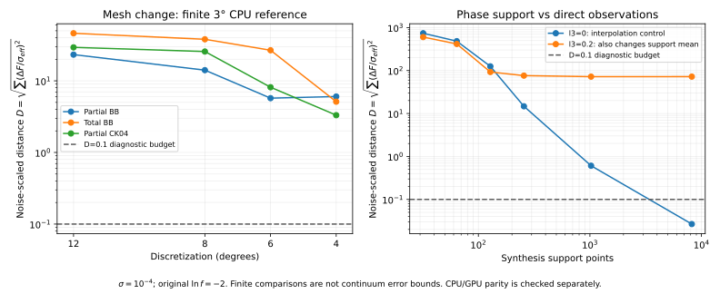

# Ada GPU development progress

Updated **2026-11-18T22:11:41.846256+00:00** on `codex/gpu-resident-roche-pipeline`. Fifth42 is held for ELISa.

## m036 — Direct cuBLAS spectra in the native physical sampler

On the 1.5° native mesh, the fastest configuration for both methods used 12 walker workers. The complete fit took **83.67 s with the CPU matrix product and 74.78 s with cuBLAS**, one run each. At 16 workers the two-run medians were 85.52 s and 75.81 s, respectively. All 16 short fits reproduced the same 96 six-parameter evaluations and all 64 move decisions, including 36 acceptances. The largest absolute differences from the original CPU fitter were 6.66e-16 in normalized flux and 9.85e-11 in log posterior. [Native spectral study and reproduction](ada_cublas_native_spectra.md)

The opt-in callback changes blackbody integration for B, V and bolometric light. ELISa still constructs the Roche surfaces, computes both reflection iterations, integrates eclipses, and applies the original phase mapping, normalization, third light, prior and noise law. Each complete fit clock includes the serial preflight of 32 initial walkers, emcee, the final summary curve, interprocess traffic, device transfers and synchronization. On the repeat sweep of twelve changing proposals on a single CPU core, the CPU matrix product took 14.95 s and cuBLAS took 14.08 s. The timings across walker counts and process boundaries are in the [hardware report](hardware_characterization.md).

Independent CPU and CUDA regression tests crossed the 256-temperature tile boundary, changed a passband response in place, and checked repeated and closely spaced temperatures against the original per-face radiance. Both implementations raised an error for unsupported wavelength units and invalid temperatures. All 38 bounded units verified the original Fifth42 checkpoint at entry and cleanup. [Regression tests](../tests/tests_experimental/test_native_cublas_spectra.py)

### Mesh sensitivity at every sampler evaluation

We compared each of the 96 positions on the 1.5° trajectory against original CPU predictions at 2.5° and 2°, using the same 28 observations. 48 positions had previously archived native predictions. The remaining 48 were evaluated at both coarser spacings. We reconstructed the original likelihood from the saved fine fluxes and replayed each stretch move from its actual parent at 1.5°, using the original stretch factor and random draw. Each coarser-mesh margin in this comparison is conditional on that fine-mesh history.

| Primary spacing vs 1.5° | Joint nominal-noise distance, min / median / max | Positions within 0.1 | Median absolute fitted log-posterior change | Changed decisions out of 64 |
| --- | ---: | ---: | ---: | ---: |
| 2.5° | 5.409 / 5.511 / 5.642 | 0 / 96 | 42.297 | 6 |
| 2° | 1.203 / 1.225 / 1.257 | 0 / 96 | 2.919 | 1 |

**0 of 96** met both finite-mesh distance checks. At step two, walker 28 accepted its proposal at 1.5° with a margin of +1.251 above its random threshold. The same proposal at 2° fell below the threshold by 1.256. The first 16 decisions matched the independently archived native replay at each resolution. The original native sampler used the selected finite mesh for its timing experiment. These two steps establish implementation and trajectory agreement for that workload. Mesh accuracy at the observational uncertainties and effective samples per second remain unqualified. The curved model retains its separate sixteen-model accuracy check. The next physical test will isolate the contributions of mean heating and within-face variation across the projected primary disk. [Per-position distances and move margins](ada_validation/background-m036-chain-mesh.json) · [Independent validation and clocks](ada_validation/background-m036.json)

Reproduce the mesh comparison from the branch root in the configured CPU environment.

```bash
python -m scripts.check_native_spectral_chain_mesh \
  docs/ada_validation/mcmc-scaling-fixture.json \
  docs/ada_validation/native-mesh-refinement.json \
  docs/ada_validation/cublas-native-spectra.json chain-mesh.json
```

## m035 — Deposited heat across primary eclipse faces

At proposal 0, the sixteen reflected models gave a nominal log-likelihood error bound of **0.018055**, compared with 0.019064 for the linear heating field. The largest measured change among the sixteen models was 0.009499. The fitter withheld the density under the original limits of 0.01 in log likelihood and 0.1 joint nominal-noise units. The 28 B, V and bolometric observations used the original phase mapping, third light, normalization and noise model. [Validation data](ada_validation/background-m035.json)

### Heating at the eclipse boundary

The experimental primary field fits the curvature of deposited heat using the final three irradiation samples from the face and nine from its three physical neighbors. It pairs edges across the full stellar surface before folding the quarter-symmetry indices. A constant correction restores each face’s deposited power. A common factor on the variation keeps all six quadratic Bernstein coefficients nonnegative. The original reflection iterations supply the means, and the emergent primary spectra use the ten-node cubic field.

The direct CPU comparison summed the individual emitting nodes on 192 visible primary rays per phase. Half were the closest to the shadow among the candidate rays. Both thermal meshes used the same observer rays. The table gives RMS differences from the direct heating at the corresponding mesh resolution, in units of primary effective temperature to the fourth power.

| Phase | Linear, level 2 | Quadratic, level 2 | Linear, level 3 | Quadratic, level 3 |
| ---: | ---: | ---: | ---: | ---: |
| 0.024 | 1.286e-07 | 4.096e-08 | 2.837e-08 | 4.333e-09 |
| 0.027 | 8.835e-08 | 5.620e-08 | 2.874e-08 | 6.920e-09 |

At phase 0.027 the direct three-node and sixteen-node area means differed by 3.112e-10 RMS across the 24 sampled fine parent assignments. The stored face means differed from the three-node direct sums by 4.330e-15 RMS. The individual-node donor sum provides an independent finite-emitter check. [Validation data](ada_validation/background-m035.json)

### Complete curves and fitting

The six-point and Duffy interior rules gave within-rule nominal log-likelihood bounds of 0.018011 and 0.018011. The combined joint distance was 7.077e-05 nominal-noise units. At the finest field, donor and eclipse resolutions, changing only the heating reconstruction gave a nominal likelihood bound of 5.563e-05 on identical serial CPU observer packets. Historical GPU packet hashes differed in 3 of the four depth/rule comparisons. The GPU parity tests compare each new curve against its serial reference. The largest backend differences in the checked curves and sampler draw were 6.66e-16 in normalized flux and 6.40e-10 in fitted log posterior. [Validation data](ada_validation/background-m035.json)

The pinned m031 serial CPU and GPU chains both accepted the fifth proposal after its eight-resolution check passed with a bound of 0.000817. Its log-posterior change was +0.218803 and its random log threshold was -0.883169. The available chain length leaves posterior mixing and effective samples per second open.

Four fresh depth-three curves and two diagnostic fitted densities took 297.49 s on serial CPU, 564.13 s on JAX CPU and 169.04 s on GPU. A second GPU process took 169.83 s. These clocks include compilation encountered, host/device transfers, synchronization and output. All 10 bounded GPU units verified the held Fifth42 checkpoint at entry and cleanup. [Timings](hardware_characterization.md) · [Reproduction](experimental_gpu_backend.md)

In a separate study of the original ELISa fitter, changing the primary mesh spacing from 2° to 1.5° gave a median joint flux change of 1.224 nominal-noise units across 48 positions. All 48 exceeded 0.1, even though the 16 replayed sampler decisions agreed. On that 1.5° mesh, batching the native CPU blackbody calculation cut the time for twelve complete likelihoods from 26.37 to 16.03 s with identical predictions. The report also gives conditional inclination and radius fits. [Native mesh refinement](ada_native_mesh_refinement.md)

The next native comparison times direct FP64 cuBLAS spectra on the same 1.5° proposals and replays short fits with matching CPU workers. On the curved model, the next accuracy test will separate the contribution of each primary face’s mean heating from the variation within that face over the projected stellar disk.

## m034 — Primary temperature and passband intensity through eclipse

At proposal 0, the primary’s ten-node cubic field reduced the fine-grid V-band intensity error at phase 0.027 from 2.671e-09 to 1.822e-11 RMS relative to a direct spectrum on the same rays. The complete three-band comparison exceeded the 0.01 nominal log-likelihood limit with a bound of **0.019064**. The previous quadratic primary gave 0.018026. The fit returns an accuracy stop at this proposal. [Validation data](ada_validation/background-m034.json)

The new opt-in calculation samples gravity on the curved Roche face at three vertices, six edge points and the centroid. It preserves the area-integrated intrinsic power and uses the three final irradiation samples to reconstruct deposited heat. Limiting the slope to keep heating nonnegative preserves its curved-area mean. Each optical node uses its own temperature, blackbody passband radiance and linear limb darkening. The secondary uses the existing six-node field. The reference evaluates Lagrange polynomials and the GPU evaluates Bernstein polynomials. Checks on the Bernstein coefficients enforce positive temperature and nonnegative emergent intensity throughout the face.

### Independent spectra near contact

For each phase and field level, the direct CPU calculation evaluated gravity and passband intensities on 192 visible primary rays, including the 96 nearest the secondary’s shadow among the tested rays. It held the sampled irradiation field fixed. The two columns give the relative RMS V-band intensity error.

| Field level | Eclipse phase | Six-node primary | Ten-node primary |
| ---: | ---: | ---: | ---: |
| 2 | 0.024 | 2.515e-08 | 3.104e-10 |
| 2 | 0.027 | 2.305e-08 | 2.884e-10 |
| 3 | 0.024 | 3.138e-09 | 2.069e-11 |
| 3 | 0.027 | 2.671e-09 | 1.822e-11 |

We then compared both thermal levels on the same fine-grid rays. At phase 0.027, exchanging the intrinsic field changed the direct V-band intensity by 8.738e-16 RMS, while exchanging deposited heat changed it by 9.802e-08. The exchanges average both orders of substitution through the nonlinear spectrum. On those same rays, direct summation over the opposing star’s individual emitting nodes changed the deposited power by 2.451e-09 RMS in units of primary effective temperature to the fourth power. The change in the reconstructed heating residual relative to direct summation was 9.369e-08. That residual includes the receiver interpolation and the donor grouping used in the forward model. These ray errors measure the primary emission locally. [Validation data](ada_validation/background-m034.json)

### Full curves and physical sampling

The two stellar-field resolutions, two donor resolutions, two eclipse depths and two interior rules produced sixteen complete models. All use the same primary and secondary geometry, two reflection iterations, third light, original normalization and mapping to the 28 B, V and bolometric observations at nominal uncertainty 10⁻⁴. The six-point and Duffy interior rules gave within-rule bounds of 0.019019 and 0.019019. The largest directly measured nominal log-likelihood change across all corners was 0.010461. The isolated thermal-field bound at the finest donor and eclipse resolutions was 0.018463. At those same resolutions the quadratic-to-cubic change alone had a likelihood bound of 9.219e-05. Across backends, the maximum normalized-flux difference was 7.77e-16 and the maximum fitted log-posterior difference was 1.92e-09. [Validation data](ada_validation/background-m034.json)

The CPU comparison used matching archived packet hashes. For the depth-four Duffy rule, a whole-orbit CPU repeat matched the archived whole-orbit hash and reproduced the two-block cubic calculation within its original tolerance. On the GPU, 2 of four archived depth/rule pairs had matching topology but different packet hashes. For each such pair, both optical fields were integrated again in one traversal on identical rays, projected areas and cosines. Both source models’ component fluxes reproduced their standalone GPU calculations within the original FP64 tolerance. [Validation data](ada_validation/background-m034.json)

The paired chain advanced on its pinned m031 sampled-heating model. Serial CPU and GPU both rejected its fourth in-prior draw after the eight-model check returned a bound of 0.000803. The log-posterior change was -10.292661 against a random log draw of -1.878737. Four transitions leave mixing and effective samples per second open.

A complete fresh-process calculation of four depth-three field/donor variants and two fitted densities took 296.93 s on serial CPU, 564.36 s on JAX CPU and 166.98 s on the RTX 3080 Ti. The clocks include compilation encountered, transfers, synchronization, host eclipse construction and serialization. The first JAX CPU integration test caught a host conversion of the primary temperature array before radiance evaluation. Preserving the device array fixed the handoff. One combined hardware test run reached its 245-second internal deadline. Both test files passed in separate bounded units. All 15 registered units verified the stopped Fifth42 checkpoint at both boundaries. [Matched timings](hardware_characterization.md) · [Reproduction](experimental_gpu_backend.md)

## m033 — Eclipse integration below the node cap

The primary eclipse at phase 0.005 on proposal 38 now fits within the existing 2,097,152-node limit. Its six-point interior rule used **1,683,774 nodes** and its independent seven-point rule used **1,870,197**. Both traced the same limb, shadow and 529 crossing parents. The previous nine-point calculation reached the cap. Its full node count on this topology would be 2,243,043. The six-point reduction is 24.9%. The curved slices retained their 12-by-3 rule.

The first seven-point rule exceeded the analytic disk-area tolerance in two coarse-grid cases. The worst error was 1.225e-07 of the unobscured disk. Subdividing planar triangles whose longest unit-direction chord exceeds 1/8 brought the worst error across both rules and all six contact configurations to 7.939e-09, within the original 1e-7 tolerance. In the two physical proposals, the largest parent chord on either star was 0.040012. Clipping and midpoint subdivision take positive barycentric combinations inside those same acute cones, so the width check preserves every physical integration panel used here.

### Finite-resolution likelihoods

Each point has 16 complete synthetic models spanning two thermal fields, two emitter resolutions, two eclipse depths and two interior rules. All models include both reflections, passband emission, limb darkening, both component fluxes, third light and the original observation mapping. The likelihood check uses all 28 B, V and bolometric observations at nominal uncertainty 10⁻⁴. It retains the 0.1 joint-distance limit and 0.01 absolute log-likelihood limit. The table reports nominal log-likelihood error bounds. A density is available only where both eight-model checks, the finest-curve comparison and the combined sixteen-model check passed.

| Proposal | Comparison rule | Six-point bound | Comparison bound | Finest curves alone | Combined bound | Density |
| --- | --- | ---: | ---: | ---: | ---: | --- |
| 0 | Duffy 3x3 | 0.017981 | 0.017981 | 4.462e-05 | 0.018026 | withheld |
| 38 | symmetric seven-point | 0.008637 | 0.008637 | 3.999e-07 | 0.008637 | passed |

The combined bounds enclose the directly evaluated nominal log-likelihood changes at every measured corner. The largest measured changes were 0.009512 and 0.004372 at proposals 0 and 38. Continuum accuracy and the rest of the parameter space remain open. Across the independent serial, JAX CPU and GPU checks, the largest normalized-flux difference was 7.77e-16 and the largest checked log-posterior difference was 7.35e-10. [Curves, numerical checks and timings](ada_validation/background-m033.json)

### Where the thermal field changes

On proposal 0 we held 96 incoming rays on each star fixed through the final cooler-first reflection sweep. Direct summation over individual emitter nodes separates changes in the sampled emitting surface (geometry, area, visibility and bolometric limb darkening), intrinsic power and re-emitted heat. The RMS differences below use deposited flux in units of the receiving star’s effective temperature to the fourth power. The individual terms add on each ray before taking the RMS.

| Receiving star | Emitting surface | Intrinsic power | Re-emitted heat | Total |
| --- | ---: | ---: | ---: | ---: |
| Primary | 1.733e-09 | 6.607e-11 | 2.119e-09 | 2.518e-09 |
| Secondary | 6.787e-08 | 1.441e-08 | 2.563e-09 | 6.799e-08 |

We also exchanged one star’s passband flux at a time between the two thermal resolutions on identical observer rays. Each exchange reapplied third light and normalization. Averaging the two exchange orders gives primary and secondary changes of 5.599e-05 and 1.342e-05 joint nominal-noise units. Their vector sum has norm 5.067e-05. At nominal noise, the signed log-likelihood shifts were -0.012204 from the primary and +0.002701 from the secondary. The primary’s largest single observation was Generic.Bessell.V at phase 0.02700. The finite likelihood check retains its conservative component-wise bound. [Curves, numerical checks and timings](ada_validation/background-m033.json)

### Complete-curve costs and physical sampling

At proposal 38 and selective eclipse depth three, a fresh process built four field/donor variants, synthesized 18 supplied phases (14 after symmetry reduction) in three passbands, and mapped the fine-field predictions to both donor-level fit densities. The six-point calculation took **280.69 s on serial CPU, 548.46 s on JAX CPU and 158.49 s on GPU**. Each clock includes startup, encountered compilation, CPU geometry and clipping, transfers, synchronization, fitting and output. These single runs used identical CPU affinity and priority. Computing both depths for a proposal, or auditing sixteen models, costs additional time. [Stage timings and matched nine-point controls](hardware_characterization.md)

The paired sampled-heating chain remained on its published m031 model. Serial CPU and GPU both rejected its third proposal. The eight-model bound was 0.001374, the log-posterior change was -105.74023 and the random log draw was -0.44883. Three transitions cannot establish mixing or effective samples per second. The passing suites recorded 151 test executions, including the corrected disk areas, parent identities, aggregate node cap and complete two-band eclipses with both interior rules. The phase-block join, rule identity and original prior checks stayed active. All 15 registered units verified the held Fifth42 checkpoint at entry and cleanup. [Reproduction and supported scope](experimental_gpu_backend.md)

## m032 — Parallel walkers in the original ELISa fit

The fastest median on Ada was **80.42 complete likelihoods/s with 16 original CPU workers**. The shared GPU path peaked at **17.02 likelihoods/s with 12 worker processes**. Each fit used 32 walkers for 12 steps, rebuilt the physical model for every proposal and evaluated 28 synthetic observations in B, V and bolometric light. The clock includes starting the fitter and worker processes, initial physical checks, encountered compilation, host/device transfers and shutdown.

| CPU workers | Original fit (s) | Shared GPU fit (s) | Original eval/s | Shared GPU eval/s |
| ---: | ---: | ---: | ---: | ---: |
| 1 | 27.14 | 48.22 | 15.33 | 8.63 |
| 4 | 9.43 | 28.37 | 44.14 | 14.66 |
| 8 | 6.41 | 25.48 | 64.88 | 16.33 |
| 12 | 5.99 | 24.44 | 69.40 | 17.02 |
| 16 | 5.17 | 24.53 | 80.42 | 16.96 |

The table gives medians from three sequential runs of each configuration. The GPU owner runs on the SMT sibling of walker CPU 0. Each walker computes the original orbit, stellar geometry, reflection, emission and eclipse coverage on CPU, then sends the selected faces to the owner for the FP64 surface sum. The native CPU performed that sum locally. These rates apply to the original 12° facet model. [Run distributions, implementation, hardware and reproduction](ada_mcmc_scaling.md)

Every matched run reproduced all 416 proposed parameter vectors, all 384 retained walker positions and the reference’s 196 accepted moves. The mapped fluxes and log posteriors matched exactly. The original 12°/8°/6° mesh check, with a joint limit of 0.1 nominal-noise units, withheld the guarded density at the generating point and both tested initial walkers. It then failed at all 416 distinct proposal coordinates. The 12°–6° distances ranged from 12.22 to 12.72 nominal-noise units, and changing the mesh shifted the original log likelihood by 0.634 to 221.225 in absolute value. [Per-proposal mesh comparisons](ada_validation/mcmc-scaling-mesh.json)

The older serial hybrid used a different emcee proposal stream on its first run. The 32 initial walkers were the only shared coordinates, and all reproduced CPU densities within tolerance. Setting the seed directly on emcee after device setup reproduced the entire CPU trace. All six parameters failed the 50-autocorrelation-time length check. Effective samples per second remain unmeasured.

### Continuing the resolution-checked physical chain

The sampled-heating CPU and GPU chains resumed from their published m031 model and seed 20261117. Both used the same proposal coordinates and uniform random draw. The second proposal’s eight-resolution log-likelihood bound was **0.000790** at nominal flux uncertainty 10⁻⁴, against the limit of 0.01. Both backends accepted the second proposal. Its log-posterior change was +23.40775. The log acceptance threshold was +0.00000 and the random log draw was -1.05843. The numerical model and noise settings stayed fixed throughout these two trials. At the same proposal and preceding position, the original 12°, 8° and 6° facets gave log-posterior changes of -3.157, +28.235, +22.589, respectively. The two distances to the 6° prediction were 12.28 and 8.83 on the same processed observations. [Per-depth CPU/GPU differences, bounds, checkpoint hashes and allocation checks](ada_validation/background-m032.json)

The ensemble adapter refactors the native surface integration entry point, a file included in the sampled-heating chain’s software fingerprint. Continue that chain from commit `60dbb2cde371f0e8feee5f594f477fa46e08388a` with the m031 environment. With its matching checkout active, run `python scripts/sample_receiver_heating.py evaluate --checkpoint sampled/state.json --step 2 --depth 3`, repeat at depth 4, then run `python scripts/sample_receiver_heating.py advance --checkpoint sampled/state.json --step 2`. Start from the matching backend’s step-one state. Execute GPU forward evaluations in registered bounded units with `--verified-bounded-gpu-window`.

The matrix ran in an isolated checkout based on m030. The integrated development checkout independently replayed the eight-worker original and shared-GPU ensembles against the frozen reference. All 31 integrated regression test executions passed, including native whole-CPU fallback, component reductions and the shared-owner replay. The shared adapter propagates unsupported device integration outside the physical prior. Fifth42’s original stopped checkpoint verified at each recorded unit boundary. [Integrated source fingerprints](ada_validation/background-m032-source-hashes.json)

Proposal 38’s retained ordinary-depth primary packet at phase 0.005 used 1,687,131 nodes. Of these, 1,272,087 evaluated ordinary triangles and 415,044 evaluated curved edge triangles. The deeper shadow calculation at that phase exceeded the 2,097,152-node cap. At proposal 0, the measured field contribution on shared rays was 0.01743 against the 0.01 total likelihood budget. The next comparison will vary interior quadrature and the irradiation field independently, retaining the curved boundary and all eight resolution checks.

## m031 — Irradiation sampled within each receiving face

The reflected light-curve calculation now retains the heat deposited at each illuminated point of the three-point receiving-face rule. On the standalone level-3 illumination check, reconstructing the field from those samples gave an RMS difference of **1.86e-07** on the secondary, compared with **2.04e-06** using adjacent face means. Both are measured in deposited T⁴/T_eff⁴ against direct summation over the curved emitting surface.

With sampled heating and an extra eclipse subdivision at shadow crossings, the combined finite log-likelihood bound was **0.01798** at proposal 0. At proposal 38 the same selective calculation stopped at the packet limit. Its separate ordinary-depth calculation gave **0.00943**. The acceptance limit is 0.01 at nominal flux uncertainty 10⁻⁴. The sampled-heating sampler completed its generating-point check. Posterior convergence and effective samples per second remain open.

### Heating and eclipse errors

| Proposal and model | Field | Emitter | Depth | Combined bound | Gate |
| --- | ---: | ---: | ---: | ---: | ---: |
| 0 · m030 heat, ordinary depth | 0.022007 | 0.000008 | 0.011558 | 0.033573 | Stop |
| 0 · sampled heat, ordinary depth | 0.017425 | 0.000008 | 0.011558 | 0.028992 | Stop |
| 0 · sampled heat, deeper shadow crossings | 0.017425 | 0.000008 | 0.000547 | 0.017981 | Stop |
| 38 · m030 heat, ordinary depth | 0.011068 | 0.000004 | 0.001439 | 0.012511 | Stop |
| 38 · sampled heat, ordinary depth | 0.007990 | 0.000004 | 0.001439 | 0.009434 | Pass |
| 38 · sampled heat, deeper shadow crossings | — | — | — | — | Node limit |
| Generating point | 0.000718 | 0.000000 | 0.000366 | 0.001085 | Pass |
| First physical trial | 0.000802 | 0.000000 | 0.000248 | 0.001050 | Pass |

Each bound compares eight calculations spanning field levels 2/3, emitting-group levels 1/2 and eclipse depths 3/4. The bound includes their interactions, third light, phase mapping, repeated observations and per-band normalization. The nominal noise sets the resolution limit independently of the sampled noise parameter. A failed comparison withholds the density. At proposal 0, changing only the heating on byte-identical serial observer rays changed the combined bound by -0.004581. Refining the shadow crossings then changed it by -0.011011. These are measured resolution differences in this model and fixture. The continuum error remains unmeasured.

The largest contributions at proposal 0 came from the following observations. The repeated rows keep their measured fluxes and original weights.

| Band | Observation index | Observation phase | Residual / nominal error | Contribution |
| --- | ---: | ---: | ---: | ---: |
| V | 3 | 0.027 | -118.0 | 0.001625 |
| B | 1 | 0.024 | -106.3 | 0.001538 |
| B | 9 | 0.024 | -105.2 | 0.001523 |
| bolometric | 1 | 0.027 | -123.4 | 0.001508 |

The two cooler-first reflection sweeps retain their original donor grouping, horizon treatment, emitting-face luminosities and interaction cap. On each half-sweep the solver evaluates the absorbed power at each selected receiver ray and forms its curved-area-weighted face mean for the next star. The final update for each star also supplies its three local samples for the optical field. Each sample is matched to its physical Roche ray. Excluded receiver nodes retain zero deposited power. The visibility mask and its original area fractions apply on partially illuminated faces.

For the symmetric three-node rule, the linear slope between two angular corners is twice the difference between their sampled powers. The reconstruction subtracts its mean under the order-four curved-area weights and adds the iterated face mean. If extrapolation reaches negative heating at a corner, a common factor limits the three slopes while preserving the mean. The six thermal and spectral nodes then use the existing quadratic intrinsic gravity field, blackbody spectra and linear limb darkening.

| Receiver | 0 selected nodes | 1 node | 2 nodes | 3 nodes | Slope limited |
| --- | ---: | ---: | ---: | ---: | ---: |
| primary | 4641 | 23 | 20 | 3956 | 150 |
| secondary | 3955 | 18 | 20 | 4647 | 143 |

These counts are for the symmetric base quarter of the level-3 surface at proposal 0 with the finer donor grouping. Across the measured complete profiles the largest per-face relative T⁴ closure error was 1.33e-15. The largest reflection sweep used 197,947,666 of the allowed 268,435,456 interactions. The largest eclipse packet used 2,019,582 of 2,097,152 nodes. The experiment retains the tested circular detached scope. The original CPU synthesis and its fallback remain available.

| Star | Face mean RMS | Neighbor slope RMS | Individual sample RMS | Conservative field RMS |
| --- | ---: | ---: | ---: | ---: |
| primary | 4.441e-06 | 8.393e-08 | 4.365e-15 | 1.472e-11 |
| secondary | 1.334e-04 | 2.038e-06 | 1.745e-12 | 1.858e-07 |

The local comparison uses the last donor temperatures in each star’s cooler-first update and direct ungrouped emission onto 128 fully sampled faces per star. The physical regression tests also checked the selected slots and face means against a separate second-order emitter expansion for both temperature orderings. A deliberately insufficient pair cap raised the unsupported-model exception. All 24 regression test executions passed. Across complete matched curves, the maximum normalized flux or mapped prediction difference was 7.77e-16. The largest checked log-posterior difference was 1.33e-09. [Finite grids, native receiver checks and curves](ada_validation/background-m031.json)

### Fitting and sampler checks

The generating point's combined bound was 0.001085. The first Gaussian draw on seed 20261117 also passed, with a bound of 0.001050. CPU and GPU both rejected it. Each new-model checkpoint reproduced byte for byte after a missing or corrupted depth result was restored. The change in log posterior was -20.27111 and log(u) was -0.06851. The Metropolis threshold margins ranged from -20.20290 to -20.20226. The decision agreed at every tested resolution. Including checkpoint I/O, its two evaluations and advance took 630.5 process seconds on serial CPU and 264.8 on GPU. These runs used separate affinities. The matched-affinity measurements appear below.

The two established checkpointed chains each evaluated a fifth physical proposal.

| Seed | Completed trials | Fifth-trial bound | Fifth-trial decision | Accepted trials | Final log posterior |
| --- | ---: | ---: | ---: | ---: | ---: |
| 20261117 | 5 | 0.002008 | Accept | 2, 5 | 172.35706 |
| 20261118 | 5 | 0.001883 | Reject | 2, 3, 4 | 196.29178 |

These are the m029 and m030 physical chains using their established three-node source and first-order emitter model. Each resumed from its own four-trial checkpoint, with the original random state, prior and six proposal widths. Every in-prior proposal rebuilt all eight finite curves. The paired CPU and GPU restart replays compared the saved checkpoint bytes. The deeper shadow packet also exceeded the node cap at the generating point. The separate local comparison above used sampled heating with ordinary eclipse depths 3 and 4 throughout. The same model and all eight resolutions were used for the start and every eligible physical draw.

| Seed | Facet angle | Accepted on own path | Fifth decision on curved-chain coordinates | Native proposal calls (s) |
| --- | ---: | ---: | ---: | ---: |
| 20261117 | 12° | 5 | Accept | 0.337 |
| 20261117 | 8° | 2, 4, 5 | Accept | 0.426 |
| 20261117 | 6° | 2, 5 | Accept | 0.610 |
| 20261118 | 12° | none | Reject | 0.364 |
| 20261118 | 8° | 2, 3, 4 | Reject | 0.437 |
| 20261118 | 6° | 2, 3, 4 | Reject | 0.578 |

Each native ELISa facet call evaluates one resolution. The fixture contains 28 synthetic B, V and bolometric observations from the 12° model. Under a separate correlated-noise sensitivity check, the accepted draws conditional on the curved-chain coordinates were 2, 5 for seed 20261117 and 2, 3, 4 for seed 20261118. The within-band exponential covariance used fraction 0.25 and a correlation length of 0.01 in unwrapped phase. These data and the circular blackbody model have different passband and limb-darkening assumptions from the published TESS fits.

### Matched cost

| Backend | Depth 3 (s) | Depth 4 (s) | Likelihood check (s) | Total (s) |
| --- | ---: | ---: | ---: | ---: |
| Serial CPU | 234.78 | 378.77 | 1.56 | 615.10 |
| JAX CPU | 445.43 | 813.38 | 1.57 | 1260.39 |
| RTX 3080 Ti | 101.38 | 170.07 | 1.59 | 273.04 |

At proposal 38 the timed runs used the ordinary eclipse rule with the updated heating at both depths. Each process rebuilt the stars and all four field/donor combinations, then summed both stellar components and applied third light, distance and full-grid normalization. The original fitter then mapped all 28 measurements and checked all eight resolutions. Setup, encountered compilation, CPU work, transfers, synchronization, output and likelihood replay are included. Each total is one sequential observation with the same host affinity and nice level. The serial curved CPU/GPU ratio was **2.25** for the eight-model check. Original ELISa’s 12° CPU facet model evaluated one density at this same proposal in 0.086 s in m028. Its likelihood uses one fixed mesh. At proposal 0, the deeper eclipse calculation used two GPU phase blocks. Their mean-heating reductions differed by one FP64 ULP. The join checks these means at the existing field-solver tolerance, both blocks’ closure errors, exact topology and component fluxes on all four repeated folded phases. The complete reassembled curves matched unsplit serial depth-4 synthesis. At proposal 38 the selective calculation returned no depth-4 curve. Serial CPU independently encountered the packet limit on the primary at orbital phase 0.005. The validation ledger retains this stop and the successful selective depth-3 measurement. All 18 executed bounded GPU units verified the held Fifth42 checkpoint at entry and cleanup. [Hardware and stage costs](hardware_characterization.md)

### Reproduction

Use the m028 reflected fixtures below. For a proposal fixture stored as `0-2-3.json`, the selective serial comparison uses the following commands. Use distinct files per backend and the registered bounded-unit flag for GPU synthesis.

```bash
export JAX_PLATFORMS=cpu JAX_ENABLE_X64=True
python scripts/validate_receiver_heating.py evaluate 0-2-3.json --depth 3 --selective-shadow --output depth3.json
for p in 0 1; do
  python scripts/receiver_phase_parts.py evaluate 0-2-3.json --depth 4 --part "$p" --output "phase-$p.json"
done
python scripts/receiver_phase_parts.py join 0-2-3.json phase-0.json phase-1.json --output depth4.json
python scripts/validate_receiver_heating.py assess depth3.json depth4.json --selective-shadow --output budget.json
python scripts/check_receiver_samples.py 0-2-3.json --sampled --output receivers.json
```

For the timed proposal 38 comparison, use `38-2-3.json` with the ordinary rule in both evaluations and the assessment. For an unsplit control, use `validate_receiver_heating.py evaluate` at both depths. Supply `--selective-shadow` to both evaluations and the assessment when testing the extra subdivision. Omitting the option uses the m030 eclipse rule with the new heating. For the generating point, use `truth-2-3.json` in the same two unsplit ordinary-depth evaluations, saving `truth-depth3.json` and `truth-depth4.json`. For the sampled-heating chain, initialize with `python scripts/sample_receiver_heating.py init --backend reference --initial truth-depth3.json truth-depth4.json --checkpoint sampled/state.json` from the two ordinary-depth profiles. Run `evaluate --checkpoint sampled/state.json --step 1 --depth 3` and repeat at depth 4, then `advance --checkpoint sampled/state.json --step 1` with the same script. For GPU use a separate checkpoint with its own generating profiles and bound each forward evaluation. Each depth and the chain state are individually checksummed. The script verifies the model, prior, observations, source fingerprint, proposal and complete finite grid before committing an in-prior decision and the new random-number state. To extend the earlier physical chains, use m029’s `evaluate` and `advance` commands with step 5 on the saved seed-specific states. [Tested source fingerprints](ada_validation/background-m031-source-hashes.json)

## m030 — Quadratic emission across each face and independent physical chains

On the reflected binary, the six-node source reduced the level-3 primary star's RMS error in intrinsic thermal emission by **77.9×** against independently evaluated Roche gravity. With the finer eclipse rule, the combined log-likelihood bound was **0.03357** at proposal 0 and **0.01251** at proposal 38. The limit is **0.01** for the 28 synthetic observations at nominal flux uncertainty 10⁻⁴.

CPU and GPU also repeated the checkpointed physical comparison with a second independent random stream. Both accepted trials **2, 3, 4** in that stream. Across the two seeds, all eight proposed transitions passed the combined accuracy check and each backend made the same decision at every transition. These runs test decisions and restart reproducibility on the established three-node source. Posterior convergence, uncertainties and effective samples per second require longer chains and a larger region of qualified models.

### Thermal and eclipse errors

| Proposal and model | Field bound | Emitter bound | Depth bound | Combined bound | Likelihood gate |
| --- | ---: | ---: | ---: | ---: | ---: |
| 0 · Three source nodes, original eclipse rule | 0.01683 | 0.00000837 | 0.01156 | 0.02840 | Stop |
| 0 · Six source nodes, original eclipse rule | 0.02201 | 0.00000837 | 0.01156 | 0.03358 | Stop |
| 0 · Six source nodes, finer eclipse rule | 0.02201 | 0.00000837 | 0.01156 | 0.03357 | Stop |
| 38 · Three source nodes, original eclipse rule | 0.00735 | 0.00000368 | 0.00143 | 0.00878 | Pass |
| 38 · Six source nodes, finer eclipse rule | 0.01107 | 0.00000368 | 0.00144 | 0.01251 | Stop |

The three-node calculation passed at proposal 38. The six-node calculation exceeded the combined limit there. Its density is available for diagnostics. A failed grid cannot supply a sampler density. The emitter approximation uses the same second-order donor positions as m029 for every row. The thermal field and observer refinements are varied separately at proposal 0. Both donor groupings and both field levels share each fresh eclipse packet at a given depth. At the original eclipse settings, the serial source-only comparisons used byte-identical observer rays. Changing the temperature and optical interpolation on the same observer rays *increased* the measured reflected-field bound from 0.01683 to 0.02201. Replacing the slice and junction rule then changed the combined bound by -2.09e-06. The field comparison includes both intrinsic emission and deposited heat. Changing both approximations at field level 3, donor level 2 and depth 4 shifted the original fitted log posterior by -0.00099 at proposal 0 and +0.00085 at proposal 38. The four observations contributing most to the final proposal-0 bound account for 41.9% of it. The repeated B observations at phase 0.024 have different measured fluxes. Both retain their full weight. The residuals in the table use the nominal observational errors before the sampled noise term.

| Band | Observation index (zero based) | Folded phase | Residual / nominal uncertainty | Contribution to bound |
| --- | ---: | ---: | ---: | ---: |
| B | 1 | 0.024 | -106.3 | 0.00470 |
| B | 9 | 0.024 | -105.2 | 0.00465 |
| V | 3 | 0.027 | -118.0 | 0.00248 |
| bolometric | 1 | 0.027 | -123.4 | 0.00223 |

The ledger gives all 28 contributions, physical inputs, mixed contrasts and measured corner densities. [Finite curves and likelihood checks](ada_validation/background-m030.json)

For each original receiving face, the new model also solves for Roche gravity at its three edge midpoints. The quadratic interpolant adds the difference between the midpoint gravity-darkening power and the mean of its two endpoint values. A constant correction preserves the face's post-irradiation area mean of T⁴ under the original order-four curved-area rule. The stellar reflection iterations and the linear reconstruction of deposited heat use the existing models. Each of the six temperatures and gravities enters a fresh blackbody passband and linear limb-darkening calculation. Reference integration uses Lagrange shape functions. Device integration uses the equivalent Bernstein polynomial. Its control values also give a positivity check throughout each face. The new path supports the tested circular detached geometry with blackbody spectra and linear limb darkening.

| Thermal field level | Primary linear RMS | Primary quadratic RMS | Secondary linear RMS | Secondary quadratic RMS |
| --- | ---: | ---: | ---: | ---: |
| 1 | 3.783e-06 | 1.934e-07 | 6.722e-07 | 3.353e-08 |
| 2 | 9.445e-07 | 2.424e-08 | 1.678e-07 | 4.202e-09 |
| 3 | 2.361e-07 | 3.032e-09 | 4.194e-08 | 5.256e-10 |

These RMS differences are in T⁴/Teff⁴. An independent order-five quadrature sampled Roche gravity on the same angular cells with irradiation disabled. The comparison normalized the reference T⁴ field with those independent area weights. The largest relative error in the order-four area mean of reconstructed T⁴ in the complete profiles was 1.33e-15. The largest reflection sweep used 197,947,666 interactions under the 268,435,456 cap.

On the last cooler-first sweep, an independent CPU check integrated each original emitting node onto all three receiver samples of up to 128 selected faces per star. It used the donor temperatures in force at that exact half-iteration. At field level 3 the neighbor-reconstructed heating differed from direct summation by 8.39e-08 RMS on the primary and 2.04e-06 on the secondary, in deposited T⁴/Teff⁴. The same calculation using the face mean alone gave 4.44e-06 and 1.33e-04. This diagnostic measures local illumination on fully sampled faces. Translating that difference into a likelihood requires a new complete curve.

### An additional check at shadow crossings

The finer complete-curve rule increases the number of Gaussian samples along a curved slice from 8 to 12 and the additional subdivision depth at a limb/shadow junction from 3 to 4. A separate test goes one subdivision deeper on original angular faces whose seven probes straddle the foreground shadow. Every other face keeps the full existing visibility and eclipse calculation. The B changes below compare that extra step with the fine depth-4 complete curve at proposal 0, field level 3 and donor level 2. Each difference is expressed in parts per billion of the mean full-synthesis-grid component sum before third light and normalization.

| Observed phase | Primary B change (ppb) | Secondary B change (ppb) |
| --- | ---: | ---: |
| 0.024 | -0.0229 | +0.0000 |
| 0.037 | -0.0719 | +0.0000 |
| 0.027 | -0.0000 | +0.0000 |
| 0.533 | +0.0000 | -0.0016 |
| 0.267 | +0.0000 | +0.0000 |

At the five selected phases, the largest change in a B component was 0.0719 parts per billion of the full-grid mean flux. The calculation covers both eclipses and an out-of-eclipse control. Its largest component packet used 1,766,610 of the 2,097,152 allowed nodes. A separate parent-by-parent comparison checked projected flux, the parent map and the aggregate cap. These five selected phases supply a depth sensitivity check. The likelihood bound above uses all observations at its two declared depths.

### Independent chains and cost

| Seed | Accepted trials | Minimum finite bound | Maximum finite bound | Final log posterior |
| --- | ---: | ---: | ---: | ---: |
| 20261117 | 2 | 0.001997 | 0.003276 | 172.13825 |
| 20261118 | 2, 3, 4 | 0.001417 | 0.002360 | 196.29178 |

These chains used 28 synthetic B, V and bolometric observations from the reflected 12° facet fixture, with per-band mean normalization and the original noise and third-light laws. Both chains started at the same generating parameters with separately seeded PCG64 streams and a Gaussian width of 0.0006 in each of six original normalized fitting coordinates. They use the m029 first-order donor model. Every finite trial rebuilt the physical system, crossed its two field levels and two donor groupings at both eclipse depths, and replayed the original density. The second CPU and GPU checkpoints were each restored and replayed byte for byte from incomplete and corrupt depth records. The following native ELISa facet calculations use the second random stream, observations, priors and proposal widths. The conditional column evaluates the facet densities at the trial and current coordinates of the curved chain. The timings sum four proposal calls after initialization. Each native call computes a single resolution.

| Original ELISa facets | Accepted trials on own path | Accepted on curved-chain coordinates | Four native proposal calls (s) |
| --- | ---: | ---: | ---: |
| 12° | none | none | 0.247 |
| 8° | 2, 3, 4 | 2, 3, 4 | 0.307 |
| 6° | 2, 3, 4 | 2, 3, 4 | 0.442 |

The 8° and 6° facet models agreed with all four curved-chain decisions. The 12° model rejected all four. Across matched complete curves and chain trials the maximum normalized flux or mapped prediction difference was 6.66e-16, and the largest checked log-posterior difference was 1.21e-09.

| Backend | Depth 3 (s) | Depth 4 (s) | Original fitter and gate (s) | Total (s) |
| --- | ---: | ---: | ---: | ---: |
| Serial CPU | 236.95 | 381.02 | 1.53 | 619.50 |
| JAX CPU | 496.60 | 821.93 | 1.54 | 1320.08 |
| RTX 3080 Ti | 104.85 | 170.46 | 1.55 | 276.86 |

Each timing evaluates the same proposal 0 with six spectral samples per face, both reflections, all eight finite model corners and the original mapped likelihood. The totals sum wall times from two fresh synthesis processes and one CPU readback/likelihood assessment process. These include initialization, encountered compilation, transfers, synchronization, CPU geometry work and file output. The accuracy check withheld the density at this proposal. The timing therefore measures the cost of a guarded evaluation through that decision. All used cores 16–19 at nice 19, single-thread BLAS and the existing filesystem/compiler caches. The **2.24×** speedup compares GPU with the serial CPU implementation of the same curved, eight-model evaluation at this one proposal. Each original facet call returns one density and has a different computational cost. All 16 completed GPU units verified the exact held Fifth42 checkpoint at entry and cleanup. An additional unit stopped during the supervisor interruption, before it produced a scientific result. Its cleanup verified the checkpoint, and its replacement supplied the depth-3 timing. [Hardware and stage measurements](hardware_characterization.md)

The next test will reconstruct deposited heat from the irradiating flux at individual receiver samples. Its qualification requires repeating the eight-model comparison on full curves and measuring the contribution from selective eclipse refinement.

### Reproduction

Use the m028 generating-point and proposal fixtures and the pinned FP64 environment documented below. The following commands reproduce the two source and observer comparisons on serial CPU. Use separate output files per backend and run GPU evaluations in registered bounded units with `--verified-bounded-gpu-window`.

```bash
export JAX_PLATFORMS=cpu JAX_ENABLE_X64=True
for pair in "0 original" "0 refined" "38 refined"; do
  read -r p rule <<< "$pair"
  for d in 3 4; do
    python scripts/validate_quadratic_source.py evaluate "$p-2-3.json" --backend reference --depth "$d" \
      --boundary "$rule" --output "source-$p-$rule-$d.json"
  done
  python scripts/validate_quadratic_source.py assess "source-$p-$rule-3.json" "source-$p-$rule-4.json" \
    --output "budget-$p-$rule.json"
done
python scripts/measure_source_curvature.py 0-2-3.json --output intrinsic.json
python scripts/check_receiver_samples.py 0-2-3.json --output receiver.json
python scripts/check_shadow_refinement.py 0-2-3.json --backend reference --depth 4 --output shadow.json
```

The measured original-eclipse six-node comparison is at proposal 0. To reproduce both sampler streams, follow m029's four-step `init`, `evaluate`, `advance` and restart procedure in a distinct checkpoint directory for each backend and seed, using seeds 20261117 and 20261118. Compare the resulting checkpoints with the following command.

```bash
python scripts/compare_reflected_chains.py --pair ref17/state.json gpu17/state.json \
  --pair ref18/state.json gpu18/state.json --output chains.json
```

The complete-curve regression compared both components, raw flux and normalized flux at inclinations 78° and 90°, including phases around both eclipses and a repeated phase one cycle later. Those tests used a cooler primary at 4,900 K and a secondary at 6,400 K. The CPU fallback and prior-versus-resolution exception regressions passed. The assessment also rejected duplicated corners, inconsistent observer rays, changed observations, mixed eclipse rules and changed physical proposals. During development two complete-curve tests exposed a host array passed to the device radiance interface. The corrected path retains the device temperature array across spectral evaluation and passed these cases on JAX CPU and GPU. [Tested source fingerprints](ada_validation/background-m030-source-hashes.json)

## m029 — Checkpointable physical Metropolis comparison

Serial CPU and GPU completed **four physical Metropolis trials with identical decisions**, accepting trial 2 after starting at the synthetic generating parameters. Each trial rebuilt the binary and evaluated all eight field, emitter and eclipse-depth combinations before the chain could advance. The combined log-likelihood bounds ranged from **0.00200 to 0.00328** at nominal flux uncertainty 10⁻⁴, inside the 0.01 limit. The separate in-prior trial with a 0.06 proposal width gave a combined bound of **0.04344**. The accuracy exception preserved the checkpoint and its next random draw byte for byte on both backends. The wider proposal contributed zero chain steps. Four trials establish transition and restart parity. Mixing, posterior agreement and effective samples per second require longer chains.

### Physical trials and resolution sensitivity

| Trial | Primary T (K) | Inclination (°) | Mass ratio | Combined bound | Δ log posterior | log u | Decision |
| --- | ---: | ---: | ---: | ---: | ---: | ---: | ---: |
| 1 | 6499.451 | 86.40286 | 0.6999525 | 0.002511 | -20.2711 | -0.0685 | Reject |
| 2 | 6501.027 | 86.39103 | 0.6999530 | 0.001997 | +23.4078 | -1.0584 | Accept |
| 3 | 6500.556 | 86.39743 | 0.6999918 | 0.003276 | -105.7404 | -0.4488 | Reject |
| 4 | 6501.069 | 86.38895 | 0.6999012 | 0.002118 | -10.2927 | -1.8787 | Reject |

The trial kernel draws a symmetric Gaussian step with standard deviation 0.0006 in each of the six original normalized fitting coordinates. The seed is 20261117. Primary temperature and potential, inclination, mass ratio, third light and the noise parameter all change. The secondary temperature follows the original constraint. These widths define a reproducible local comparison. The data were generated using the original 12° facet calculation with reflection enabled. They comprise 28 synthetic B, V and bolometric observations with the original ordering and repeats, per-band mean normalization, prior and noise law. The finest density uses field level 3, donor level 2 and eclipse depth 4. The measured error bound includes mixed changes across field levels 2/3, donor groupings 1/2 and depths 3/4. Convergence beyond these tested resolutions is open. The finite accuracy test uses the nominal errors independently of the sampled noise parameter.

All four decisions were stable even when the proposed and current densities were independently taken from any of the eight measured resolutions. The smallest distance from the log acceptance threshold over these comparisons was **1.05843**. An independent replay recovered the proposed coordinates, uniforms, decisions and final random-number state. Across the matched full-curve checks, the largest absolute difference in normalized flux or mapped prediction was **6.66e-16**, and the largest log-posterior difference was **1.17e-09**.

At each depth the observer now constructs one set of eclipse packets for all four field and donor combinations. Each field builds its own irradiated stellar surfaces. At the generating point the paired calculation reproduced the independently computed single-donor results from m028 at both depths. The two depth files and the chain have separate checksums. A step commits its position, density and random-number state together after both files pass the combined test. For both backends, restoring with a missing part, corrupting a part, repairing it and retrying a committed step reproduced the uninterrupted final checkpoint byte for byte. The original prior retains its outside-bounds rejection. Unsupported synthesis and accuracy exceptions propagate before a chain write.

### Sensitivity to the physical model and noise

| Original ELISa facets | Accepted trials in independent run | Accepted if evaluated on curved path | Four proposal calls (s) |
| --- | ---: | ---: | ---: |
| 12° | none | 4 | 0.301 |
| 8° | 2, 4 | 2, 4 | 0.316 |
| 6° | 2 | 2 | 0.447 |

The independent original facet runs started at the same position with the same random stream, priors, observations and proposal widths. The conditional column compares each facet density at the exact trial and current coordinates of the curved run. Each original call returns one facet density. Each facet timing sums four proposal calls after setup. The 6° facet run made the same four decisions as the curved run. Changing to 8° added an accepted fourth trial, and 12° accepted none on its independent path. These model differences exceed the measured CPU/GPU differences on this fixture.

For a separate sensitivity check, the same curved predictions and marginal observational variances were evaluated with a within-band exponential covariance. A fraction 0.25 of each marginal variance has correlation length 0.01 in unwrapped orbital phase, or 0.03 days at this fixture's period. The remaining fraction is independent. A zero-correlation check reproduced the original densities. At these four visited transitions the conditional correlated calculation accepted trials **2** and the original noise model accepted **2**. The covariance parameters were chosen for this sensitivity calculation. The data were generated with independent noise before mean normalization. Estimating a correlation time from astronomical data and fitting the published systems require their own observations and model options. In particular the V505 Per pixel-based reproduction uses TESS and quadratic limb darkening. The present blackbody fixture uses a fixed linear coefficient of 0.4. [Transitions, finite curves and residuals](ada_validation/background-m029.json)

### Quadratic correction at the two failed proposals

| Proposal | Previous emitter bound | Quadratic emitter bound | Field bound | Eclipse depth bound | Previous combined | Quadratic combined | Gate |
| --- | ---: | ---: | ---: | ---: | ---: | ---: | ---: |
| 0 | 0.03364 | 0.00000837 | 0.01683 | 0.01156 | 0.06228 | 0.02840 | Stop |
| 38 | 0.01479 | 0.00000368 | 0.00735 | 0.00143 | 0.02368 | 0.00878 | Pass |

For groups strictly inside both horizons the new opt-in solver retains terms through second order in each emitting node's displacement from its group centre. It forms the directional polynomial coefficients from the native Roche positions, normals and linear limb-darkening coefficients, then weights them with the current emitter luminosities on every cooler-first update. Near either horizon it integrates every native node as before. The interaction cap and the individual-node nonlinear limb-darkening path still apply. A separate face-by-face expansion checked the two-sweep heating on both stars with the primary hotter and cooler. The quadratic runs have their own model identity. All four sampler transitions above used the established first-order model.

At proposal 0 the four largest contributions to the quadratic bound account for 44.1% of the total. The two B observations at folded phase 0.024 each contribute more than 0.004. The next two are V observations at phases 0.037 and 0.027. The ledger lists all 28 contributions, including repeated observations. These phases provide a direct test of further field and eclipse refinement.

### Complete cost of one guarded trial

| Backend | Depth 3 (s) | Depth 4 (s) | Guard and original fitter (s) | Sum of process times (s) |
| --- | ---: | ---: | ---: | ---: |
| Serial CPU | 183.44 | 304.23 | 1.60 | 489.27 |
| JAX CPU | 321.51 | 643.86 | 1.59 | 966.95 |
| RTX 3080 Ti | 83.91 | 146.33 | 1.61 | 231.85 |

These timings use the first six-parameter trial with identical two-depth output and the original fitter replay. Each depth ran in a fresh process. The timed processes include setup, encountered compilation, CPU work, transfers, synchronization, returned curves and output. The final process verifies the eight-model gate and evaluates the original density. The totals sum the three sequential wall times on cores 16–19 at nice 19. The matched serial CPU time divided by GPU time was **2.11**. Each backend ran the timed trial once. Processes were fresh and used the existing filesystem and compiler caches. The ledger also records the checkpointed run, including saving intermediate depth results and committing the chain decision. Every one of the 19 registered, executed units verified the exact held Fifth42 checkpoint at entry and cleanup. [Hardware and timing boundaries](hardware_characterization.md)

### Reproduction

Start with the original generating-point profiles from the m028 reproduction. Supply four individual profiles or both paired depth results, all from the selected backend. Use a separate checkpoint directory per chain. These commands reproduce the serial CPU path.

```bash
export JAX_PLATFORMS=cpu JAX_ENABLE_X64=True
python scripts/sample_reflected_binary.py init --backend reference --seed 20261117 --scale 0.0006 \
  --checkpoint reference/state.json --initial truth-1-3.json truth-1-4.json truth-2-3.json truth-2-4.json
for step in 1 2 3 4; do
  for depth in 3 4; do
    python scripts/sample_reflected_binary.py evaluate --checkpoint reference/state.json --step "$step" --depth "$depth"
  done
  python scripts/sample_reflected_binary.py advance --checkpoint reference/state.json --step "$step"
done
python scripts/verify_reflected_restart.py reference/state.json --initial truth-1-3.json truth-1-4.json truth-2-3.json truth-2-4.json
python scripts/audit_reflected_noise.py reference/state.json truth-2-4.json --output noise.json
```

Initialize the GPU chain from its own generating-point profiles. Run each GPU `evaluate` inside a registered, hold-aware bounded unit with `--verified-bounded-gpu-window`. Use `compare_reflected_transitions.py reference/state.json gpu/state.json --output transitions.json` to check decisions and rerun the original facet fits. To repeat the wide trial, initialize a separate chain with `--scale 0.06` and the same seed. For matched timings, run this example once per backend with its own output directory. The GPU evaluation requires the bounded-unit flag and allocation.

```bash
backend=reference
for depth in 3 4; do
  python scripts/benchmark_reflected_transition.py evaluate --backend "$backend" --step 1 --depth "$depth" \
    --checkpoint reference/state.json --output "bench-$backend-$depth.json"
done
python scripts/benchmark_reflected_transition.py finish --backend "$backend" --step 1 \
  --checkpoint reference/state.json --parts "bench-$backend-3.json" "bench-$backend-4.json" --output "bench-$backend-fit.json"
```

For the independent quadratic comparison, use `validate_quadratic_binary.py evaluate BASELINE --backend reference --depth 3 --output q3.json` with the proposal's m028 file, then repeat at depth 4 into `q4.json`. Run `validate_quadratic_binary.py assess q3.json q4.json --output resolution.json` for its finite likelihood bound. GPU synthesis uses the same bounded units. [Tested source fingerprints](ada_validation/background-m029-source-hashes.json)

## m028 — Irradiation from curved emitting faces

Integrating over the emitting area during both reflection iterations reduced the combined log-likelihood error bound from **0.22859 to 0.06228** at proposal 0 and from **0.09775 to 0.02368** at proposal 38. At the parameters used to generate the observations, the bound was **0.00243**, inside the **0.01** limit for the 28 synthetic fluxes at nominal uncertainty 10⁻⁴. The two other proposals still exceeded the limit. An inference run needs to apply the accuracy check at each proposed physical state.

### Finite-resolution likelihood

| Physical parameters | Field bound | Emitter bound | Eclipse depth bound | Combined bound | Combined distance (σ) | Signed all-low versus all-high Δlog L |
| --- | ---: | ---: | ---: | ---: | ---: | ---: |
| Proposal 0 | 0.01687 | 0.03364 | 0.01156 | **0.06228** | 0.000272 | +0.009993 |
| Proposal 38 | 0.00736 | 0.01479 | 0.00143 | **0.02368** | 0.000228 | -0.007616 |
| Generating parameters | 0.00069 | 0.00137 | 0.00037 | **0.00243** | 0.000254 | -0.000283 |

Each row crosses field levels 2 and 3, emitter grouping levels 1 and 2, and eclipse integration depths 3 and 4. At fixed depth the comparison integrates each field on the same observer rays. The GPU regenerated the geometry and replayed 28 stellar packets for each donor comparison. The bound includes measured mixed differences, third light, observation order and repeats, and the original per-band mean normalization. The accuracy test uses the nominal observation errors. The density uses the fitted noise parameter. Both backends passed at the generating parameters and stopped at the other two points under the combined test.

At proposal 0 with donor level 2 and eclipse depth 3, the old and new irradiating fields were integrated on identical CPU observer rays. The largest change in normalized flux was 3.73×10⁻⁸ at field level 2 and 9.32×10⁻⁹ at level 3. The fine mapped V prediction moved by at most 1.10×10⁻⁸, and the log posterior shifted by +0.00608.

The same injected observations were used for all three rows. The original 12° facet observer at the generating parameters, the seeded Gaussian noise and the fitter's mean normalization reproduced all 28 input fluxes and uncertainties. With effective temperatures of 6500 and 5000 K, mass ratio 0.7, inclination 86.4°, third-light fraction 0.2 and ln f = −2, the original 12°, 8° and 6° facet log posteriors were **219.69, 129.68 and 152.13**. The experimental curve with field level 3, donor level 2 and eclipse depth 4 gave **148.73**. At depth 3 its maximum flux difference from the original facets fell from **5.16×10⁻⁴** at 12° to **9.82×10⁻⁵** at 6°. The generating point passes a comparison between the eight tested curved models. Facet sensitivity and the two failed physical proposals limit the inference that can be drawn from that point. Replaying the original fitter on all eight curved models gave a maximum absolute log-posterior shift of **0.000333** from the finest model at the generating point, **0.01946** at proposal 0 and **0.00808** at proposal 38. The replay returns a usable density only when the combined finite check passes. It raises an accuracy exception at both failed points, including proposal 38 where the measured scalar changes alone are smaller than 0.01. The passing point is available to initialize a checkpointable physical comparison. Posterior agreement, mixing and effective samples per second remain open.

### Reflection integral and independent checks

Each visible emitting face now contributes three positive quadrature weights on the Roche surface. The weights use the local surface Jacobian and sum to the original face area. The face supplies its current temperature and original bolometric limb-darkening coefficient at all three points. Every cooler-first update uses the latest deposited flux from the other star. For linear limb darkening, groups fully visible to a receiver use directional moments and a first-order correction for source position. Conservative bounds at both ends of the ray identify groups near either horizon. Those groups are integrated from their individual nodes with exact incidence, emission angle and distance. Nonlinear laws use individual nodes throughout. The solver checks the complete interaction count, including explicit horizon nodes, before allocating the sparse index. The opt-in engine raises for unsupported geometry or an exceeded interaction cap. Regression tests verified full-CPU routing at the established fallback entry point and propagation of accuracy stops outside prior penalties.

At proposal 0, field level 3 and donor level 2, resolving horizons used **27,242,403** extra native-node evaluations per sweep. The total was **197,443,303** interactions under the **268,435,456** cap. Pairing every receiving point with every curved emitting node would require **1,336,222,368** interactions. CPU and GPU agreed to **6.66e-16** in normalized flux or mapped prediction and **8.19e-10** in log posterior over the matched profiles. Six complete light-curve cases cover both stars, unequal masses and spins, a small occultor, CK04 and three limb-darkening laws. A separate test sampled both eclipses through 57 contact phases. Independent CPU and device tests expanded the linear spatial derivative and every clipped native contribution, checked all final temperatures after two sweeps, and exercised the nonlinear and interaction-cap routes.

Emitter grouping contributes the largest single-axis bound at both failed proposals. In a separate CPU diagnostic, each of 96 receiving rays per star saw all native emitter nodes at the final update. At proposal 0 and donor level 2, adding the quadratic positional term reduced RMS error in deposited T⁴/Teff⁴ from **3.68×10⁻⁸ to 1.78×10⁻¹²** on the secondary, and from **2.31×10⁻¹⁰ to 4.09×10⁻¹⁵** on the primary. It reduced RMS error in all eight star, donor-level and proposal combinations. The complete curves in the table use first-order positions. The quadratic result applies only on the sampled rays. [Finite curves, budgets and test evidence](ada_validation/background-m028.json)

### Transfer-inclusive performance

| Changing proposals | Serial CPU first / warm (s) | JAX CPU first / warm (s) | GPU first / warm (s) | Warm serial CPU/GPU | Whole-process serial CPU/GPU |
| ---: | ---: | ---: | ---: | ---: | ---: |
| 4 | 41.68 / 41.66 | 95.40 / 66.19 | 58.30 / 25.20 | 1.65× | 0.98× |
| 8 | 82.13 / 81.74 | 163.96 / 128.34 | 85.27 / 46.89 | 1.74× | 1.22× |

The serial and JAX CPU implementations and the Ada GPU evaluated identical physical proposals, synthesized two complete reflected curves per proposal and applied the original prediction, prior, density and accuracy checks. The coarse batches used field levels 0/1, donor level 0 and eclipse depth 1 on all backends. The table shows one first and one changed warm batch per process. The complete call includes fresh stellar systems, host work, device transfers and synchronization. The complete-process ratios also include imports, initialization and output. The B8 JAX CPU run used the same cores at a lower scheduling priority. In separate synchronized stage measurements at field level 3, the four irradiation updates for proposal 0 took **1.64 s on GPU and 10.13 s on CPU**. Including curved-surface preparation, grouping, transfers and returning temperatures brought the reflection stage to **4.21 s and 11.05 s**, respectively. At the fine settings (levels 2/3, donor level 2, depth 3), one complete first proposal took **147.23 s on the serial CPU and 67.51 s on GPU**.

Original ELISa at 12° facets took **0.48 s** summed over its eight warm single-density calls on the same changed proposals. Its likelihood returns one facet calculation per proposal. The matched CPU/GPU ratio above applies to the more expensive paired curved calculation with its resolution check. All 25 executed units verified the held Fifth42 checkpoint at entry and cleanup. [Reflection-stage timings and hardware measurements](hardware_characterization.md)

### Reproduction

Use the pinned FP64 environment and table fixtures. These commands reproduce the two proposal grids, the generating point and the local quadratic diagnostic on CPU.

```bash
export JAX_PLATFORMS=cpu JAX_ENABLE_X64=True
for p in 0 38 truth; do
  for c in 1 2; do
    for d in 3 4; do
      if [ "$p" = truth ]; then
        python scripts/validate_reflected_injection.py --backend reference --depth "$d" --donor-level "$c" --output "$p-$c-$d.json"
      else
        python scripts/validate_gpu_reconstructed.py --backend reference --engine emitting-area --levels 2 3 \
          --integration-level 3 --receiver-points 3 --donor-level "$c" --depth "$d" --slice-order 8 \
          --iteration-start "$p" --batch 1 --repeats 0 --output "$p-$c-$d.json"
      fi
    done
  done
  python scripts/compare_reflection_resolution.py "$p-1-3.json" "$p-2-3.json" "$p-1-4.json" "$p-2-4.json" --output "bounds-$p.json"
  python scripts/compare_reflected_posteriors.py "$p-1-3.json" "$p-2-3.json" "$p-1-4.json" "$p-2-4.json" --audit --output "densities-$p.json"
  for deg in 12 8 6; do
    python scripts/compare_original_facet_fit.py "$p-2-3.json" --facet-degrees "$deg" --output "facet-$p-$deg.json"
  done
done
python scripts/validate_patch_positions.py 0-2-3.json --output position-0.json
python scripts/validate_patch_positions.py 38-2-3.json --output position-38.json
python scripts/profile_emitting_area.py 0-2-3.json 38-2-3.json --backend reference --output reflection-times.json
```

For GPU synthesis, select the GPU backend and run each call in a registered, hold-aware unit with `--verified-bounded-gpu-window`. For proposals 0 and 38, run `validate_common_donor_rays.py` with the matching previous GPU profile, `--engine emitting-area` and a new per-proposal, per-depth packet directory. Record at donor level 2 and replay at level 1. For the generating parameters, `validate_reflected_injection.py` accepts the same `--mode record|replay` and `--packets` options. Omit the posterior replay’s `--audit` option to require the combined gate before returning any density. Packet serialization and independent geometry regeneration belong to the accuracy checks. The throughput driver uses fresh synthesis without packet I/O. Use `validate_gpu_reconstructed.py --engine emitting-area --levels 0 1 --integration-level 1 --depth 1 --slice-order 4 --donor-level 0 --repeats 1`, select 4 or 8 with `--batch`, and use each of the three backends for the measured batch contract. [Source fingerprints](ada_validation/background-m028-source-hashes.json)

## m027 — Individual emitter positions in the reflection integral

Accounting for the positions of grouped emitting faces reduced the absolute log-likelihood error bound from **0.37079 to 0.22859** at the original proposal and from **0.16087 to 0.09775** at the second proposal. The field resolution now contributes the largest term. Both bounds exceed the fitting limit of **0.01** for the 28 synthetic observations at nominal flux uncertainty 10⁻⁴. Physical fitting and MCMC remain gated on these cases.

### Eclipse likelihood and CPU comparison

| Proposal | Field bound | Emitter bound | Eclipse depth bound | Combined bound | Combined distance (σ) | Signed all-low versus all-high Δlog L |
| --- | ---: | ---: | ---: | ---: | ---: | ---: |
| 0 | 0.18368 | 0.03323 | 0.01156 | **0.22859** | 0.00132 | -0.00729 |
| 38 | 0.08166 | 0.01461 | 0.00143 | **0.09775** | 0.00122 | -0.00667 |

The two proposals have mass ratios of 0.6960 and 0.7112 and inclinations of 85.520° and 86.432°. Each comparison crosses field levels 2/3, donor caps 1/2 and eclipse depths 3/4. At a given depth all four field/emitter combinations use the same observer rays. The combined bound includes mixed differences, the original observation mapping, third light and per-band normalization. The signed diagonal changes are smaller than the limit at both proposals. The individual field and emitter bounds exceed it at both. At the original proposal, changing just the emitter cap moves the signed log likelihood by +0.01061.

Against the independent serial implementation of the same finite model, the largest CPU/GPU difference across the matched profiles was 6.66e-16 in normalized flux or mapped prediction and 1.60e-09 in log posterior. Adaptive eclipse records matched. Six complete test systems cover both stars, unequal spins and masses, a small occultor, CK04 atmosphere tables and linear, logarithmic and square-root limb darkening. A separate 57-phase test follows both eclipses through contact. The unmodified ELISa fitter using its original 12° facets on the same observations differed from the depth-3 curved calculation by up to 5.44e-04 and 5.23e-04 in normalized prediction at the two proposals. Refining the original facets to 8° reduced these maxima to 3.37×10⁻⁴ and 3.65×10⁻⁴. At 6° they fell to 1.08×10⁻⁴ and 9.74×10⁻⁵. The original 12° single-density calls took 0.072 s and 0.066 s. They use one mesh and return one density. The curved validation batches also return component fluxes and test two field resolutions.

The independently run GPU donor caps at depth 4 on proposal 38 produced equal adaptive counts and different packet digests. The original eight-model comparison rejected them. A second calculation wrote the complete observer rays, projected cosines, areas and parent indices for one cap. The other cap regenerated the geometry, checked its topology and numerical values, then integrated its freshly computed stellar fields on those same saved arrays. All 28 component packets were fingerprinted. Every newly regenerated ray, projected cosine, area and parent index had zero numerical difference from its saved value in this repeat. The initial runs saved only their digests, which prevents locating the original byte difference. The shared-packet result gave 0.09775 on GPU. Across the two caps, substituting common packets changed the separately generated normalized curves or mapped predictions by at most 3.33e-16. The different digests from the original runs remain in the evidence.

### Reflection physics

The opt-in `SpatialReflectedLightCurve` includes the first derivative of each emitting face’s contribution with respect to its displacement from the group’s area-weighted centroid. The derivative includes inverse-square dilution, the receiving normal projection, the emitting normal projection and bolometric limb darkening. Luminosity-weighted moments of the displacements and normals supply these terms on the GPU. The moments use the updated stellar emission at each step of the original cooler-first reflection iteration.

Groups whose emitting normals can change sign retain the m026 native-face treatment. On the receiving star, a support box first identifies groups that could cross a particular sample’s tangent plane. A test of the individual positions then selects the crossing or tangent groups. At these pairs the exact native terms replace the shared-ray approximation. Host code builds this sparse index once per proposal and field level. The device evaluates the indexed flux in bounded tiles during irradiation. At the original proposal, field level 3 and donor cap 2, the calculation expanded **969,257** native interactions, giving **167,479,188** distinct receiver/emitter interactions per sweep under the **268,435,456** cap. This count measures physical pairs. Forming and applying their moments and classifying horizons also costs time.

An independent test expanded the derivatives face by face on both stars under two luminosity distributions. It checked the serial and device updates, native horizon replacement and the pair-limit exception. The nonlinear laws retained individual emitters. In the collocated limit, both reproduced original three-iteration reflection temperatures on the tested fixture. Both raised the resource exception at field level 3. The existing full-CPU fallback and accuracy-stop tests passed.

### What remains in the field error

A separate CPU diagnostic held 96 receiving positions and normals fixed on each star and integrated the *emitting* area of each original visible face. Its total luminosity and bolometric LD coefficient stayed fixed. At the original proposal, the secondary’s RMS change between field levels 2 and 3 was 6.71×10⁻⁷ with one emitting point, 6.83×10⁻⁸ with three area samples and 2.71×10⁻⁸ with sixteen, in units of deposited T⁴/Teff⁴. On the primary the same changes were 1.59×10⁻⁸, 1.74×10⁻⁹ and 3.29×10⁻¹⁰. Both stars improved at the second proposal as well. These are first-update measurements on fixed rays. Integrating curved emitting patches in both reflection iterations under the interaction cap and repeating the eclipse likelihood comparison is the next test. [Per-ray diagnostics, finite curves, bounds and timing samples](ada_validation/background-m027.json)

### Transfer-inclusive cost

| Changing proposals | Serial CPU first / warm (s) | JAX CPU first / warm (s) | GPU first / warm (s) | Warm serial CPU/GPU | Whole process serial CPU/GPU |
| ---: | ---: | ---: | ---: | ---: | ---: |
| 4 | 40.88 / 41.05 | 94.63 / 65.72 | 52.63 / 21.18 | 1.94× | 1.09× |
| 8 | 81.29 / 81.16 | 158.93 / 124.11 | 74.70 / 39.48 | 2.06× | 1.40× |

The preceding shared-position solver took 30.48 s on its warm eight-proposal GPU batch. Including the positional correction took 39.48 s on the same workload. Each backend rebuilt the changing stellar systems, synthesized two complete reflected curves per proposal, returned the predictions to the host and evaluated the density and accuracy controls. The coarse batches used field levels 0/1, donor cap 0 and eclipse depth 1, with one physically changed warm batch per process. Warm means the process and solver were reused. Compilation for any new proposal-dependent shape stays inside the timer. The fine depth-3 comparison at field levels 2/3 and cap 2 took 140.48 s on the serial CPU reference and 87.21 s on GPU for the first complete call. The fine GPU timing overlapped auxiliary CPU accuracy checks on sibling hardware threads. The coarse serial CPU/GPU timing pairs followed those checks. A supplementary CPU packet check briefly overlapped B4 JAX CPU. The B8 JAX CPU measurement used a lower scheduling priority. These costs include the host geometry and boundary work, allocation, transfers and synchronization. All 22 executed units verified the held Fifth42 checkpoint at entry and cleanup. [Hardware measurements](hardware_characterization.md)

### Reproduction

Use the pinned FP64 environment and table fixtures. The following commands reproduce each serial eight-model comparison. Select the GPU backend and add `--verified-bounded-gpu-window` for each GPU synthesis inside a registered hold-aware unit.

```bash
export JAX_PLATFORMS=cpu JAX_ENABLE_X64=True
for p in 0 38; do
  for c in 1 2; do
    for d in 3 4; do
      python scripts/validate_gpu_reconstructed.py --backend reference --engine spatial-reflection \
        --receiver-points 3 --levels 2 3 --integration-level 3 --donor-level "$c" --depth "$d" \
        --slice-order 8 --iteration-start "$p" --batch 1 --repeats 0 --output "p$p-c$c-d$d.json"
    done
  done
  python scripts/compare_reflection_resolution.py "p$p-c1-d3.json" "p$p-c2-d3.json" \
    "p$p-c1-d4.json" "p$p-c2-d4.json" --output "bounds-$p.json"
  python scripts/validate_emitting_cell_area.py "p$p-c2-d3.json" --output "emitting-area-$p.json"
  for deg in 12 8 6; do
    python scripts/compare_original_facet_fit.py "p$p-c2-d3.json" --facet-degrees "$deg" --output "facet-$p-$deg.json"
  done
done
```

For a GPU donor contrast across separate processes, the original eight-model comparator requires matching packet hashes. The following repeats the depth-4 comparison at proposal 38 using the two GPU profile files and one new packet directory. Run each synthesis inside its own bounded unit, then use `common2.json` and `common1.json` for the deep inputs in the eight-model comparison. This diagnostic includes disk I/O and independent regeneration. The throughput measurements use ordinary fresh synthesis.

```bash
python scripts/validate_common_donor_rays.py p38-c2-d4.json --verified-bounded-gpu-window \
  --mode record --packets shared38 --output common2.json
python scripts/validate_common_donor_rays.py p38-c1-d4.json --verified-bounded-gpu-window \
  --mode replay --packets shared38 --output common1.json
```

For throughput, set `--levels 0 1 --integration-level 1 --depth 1 --slice-order 4 --donor-level 0 --repeats 1`, choose a batch of four or eight, and run each of the three backends. [Tested source fingerprints](ada_validation/background-m027-source-hashes.json)

## m026 — Directional emission from grouped donor faces

Resolving the directions of the emitting faces reduced the combined absolute log-likelihood error bound from **0.93999 to 0.37079** on the m025 reflected eclipse fixture. The emitter-resolution contribution fell from **0.89230 to 0.21247**. The field-resolution contribution rose from **0.02884 to 0.14482**. At flux uncertainty 10⁻⁴ the fitting limit is **0.01**. CPU and GPU reproduced the same finite curves. The accuracy check still stops physical fitting and MCMC on this case.

### What changed in the reflection integral

The opt-in calculation covers circular, detached, symmetric stars without spots or pulsations. The donor list and bolometric coefficient ordering come from the original ELISa reflection calculation. For each group in that list, the solver bounds the sign of every child face’s projected normal over a box containing every selected receiving point on the companion. It checks the ray from each native source position and the ray from the group’s area-weighted centroid. If the signs differ across children, or any sign could change, the code uses the original position and normal of every child in that group. A strict floating-point margin places near-tangent cases in this individually resolved set.

For sign-stable groups with linear limb darkening, the angular factor is proportional to `(1−a)μ + aμ²`, where `a` is each face’s own bolometric coefficient and `μ` is its projected normal. The first and second moments of the native normals therefore give the exact sum of their directional emission along a shared ray. The solver recomputes these moments from the current luminosities at each cooler-first reflection update. The common source position still approximates the individual ray directions, inverse-square distances and cosine at the receiver. Logarithmic and square-root laws use the individual native sources and the same interaction cap.

At field level 3 and emitter cap 2, the code opened 485 groups on the primary and 948 on the secondary. The sweep used **166,509,931** receiver/emitter interactions against the **268,435,456** limit. Evaluating every native pair would require **445,407,456**. Both nonlinear laws raised the resource error at field level 3 on their tested fixture. At level 1 they reproduced original collocated reflection temperatures and the ungrouped three-point calculation through three iterations.

### Complete eclipse likelihood

The m025 comparison at mass ratio 0.696 and inclination 85.52° used the same 28 unevenly sampled B, V and bolometric observations, normalized uncertainties, third light and noise model. Within each eclipse depth, all field and emitter choices used the same observer rays. The eight models cross field levels 2/3, donor caps 1/2 and eclipse depths 3/4 at integration level 3 and slice order 8.

| Quantity at the original proposal | m025 projected groups | m026 directional groups |
| --- | ---: | ---: |
| Field-only absolute log-likelihood bound | 0.02884 | 0.14482 |
| Emitter-only bound | 0.89230 | 0.21247 |
| Eclipse-depth bound | 0.01156 | 0.01156 |
| All eight corners and measured interaction terms | 0.93999 | **0.37079** |
| Combined distance in units of σ | 0.00562 | 0.00222 |
| Signed all-low versus all-high Δlog L | +0.03308 | +0.00880 |

The signed diagonal change now falls below 0.01. Changing only the emitter cap gives **+0.03187**, which exceeds the limit. The eight-corner check retains these individual changes and the measured mixed differences. At field level 2 and donor cap 2, both algorithms use native emitters. At this level the old and new curves matched bit for bit on each backend. Repeated depth-3 serial references also gave identical curves and densities at both donor caps. A separate replay of the m025 observer matched its archived serial CPU results exactly. The GPU replay matched its archived predictions and posterior, with coarse-field differences at the scale of roundoff seen between archived GPU runs. [Finite curves, per-band bounds and validation records](ada_validation/background-m026.json)

A second full eight-corner comparison used proposal 38, chosen in advance for its proximity to the synthetic generating temperatures and inclination. It has a 6,494 K primary, inclination 86.432°, mass ratio 0.7112 and third light 0.2064. The RMS residuals were 26.9σ in B, 24.0σ in V and 25.1σ in bolometric flux. At this proposal the combined bound was **0.16087**, with field, emitter and depth bounds of 0.06398, 0.09450 and 0.00143. The all-low to all-high signed change was -0.01758. Both parameter comparisons use the same original synthetic observations at their nominal uncertainties. This proposal also exceeds the fitting limit.

### Independent checks on the emission model

An independent CPU calculation expanded each group into its individual ELISa emission terms at 128 receiving samples per star. It used intrinsic luminosities and a separate spatially varying deposited heat pattern. The largest absolute difference from the moment sum was 1.41e-16 in deposited T⁴/Teff⁴. Against individually positioned native emitters, the RMS error decreased **3.4–6.7×** across the two stars, two donor caps and two heat patterns. The maximum matched difference was 6.66e-16 in normalized flux or mapped prediction and 1.31e-09 in log posterior. The adaptive records and finite-model metadata matched. Six complete-curve cases include unequal rotations, two mass ratios, a small occultor, CK04 tables and three limb-darkening laws. A separate 57-phase test checked both eclipses through ingress and egress.

On the secondary at cap 2, the RMS deposited-heat error fell from 7.36×10⁻⁷ to 2.00×10⁻⁷ with intrinsic luminosities. A local spatial diagnostic then resolved groups whose children crossed the **receiving** tangent plane and included the first derivative with respect to child position in the other groups. Its RMS error was 2.73×10⁻⁸ on the same rays. Across the four star/cap comparisons, the local first-order calculation reduced the remaining RMS error by **7.3–16.4×**. It expanded individual children to measure the derivative. The complete curves and timings in this report use the shared-position rule. Incorporating the positional correction under the pair cap and retesting both the surface field and eclipse depth is the next physics step.

### Transfer-inclusive performance

| Changing proposals | Warm calls per process | Serial CPU first / warm (s) | JAX CPU first / warm (s) | GPU first / warm (s) | Warm serial CPU/GPU | Whole process serial CPU/GPU |
| ---: | ---: | ---: | ---: | ---: | ---: | ---: |
| 1 | 3 | 10.28 / 10.17 | 44.48 / 16.14 | 35.35 / 4.45 | 2.29× | 0.82× |
| 4 | 1 | 40.97 / 40.83 | 90.74 / 61.71 | 54.13 / 18.71 | 2.18× | 1.09× |
| 8 | 1 | 81.84 / 81.58 | 154.62 / 118.90 | 67.20 / 30.48 | 2.68× | 1.64× |

Each call rebuilds the physical systems, runs both reflection iterations, returns two complete finite curves per candidate and applies the original observation mapping, likelihood and accuracy checks. These throughput cases use field levels 0/1, donor cap 0 and eclipse depth 1, so the finer field exercises grouped angular emission. B4 and B8 have one changed warm batch each. B1 has three. At field levels 2/3, donor cap 2 and eclipse depth 3, the first complete call took 159.67 s on the matched serial CPU reference and 73.66 s on GPU. The matched B4 GPU comparison took 16.89 s warm using one projected normal per group and 18.71 s using the individual directional moments and horizon splitting. Serial CPU times were 40.88 s and 40.83 s, respectively. Supplementary JAX CPU B1 and B8 used lower scheduling priority. The published ledger records timings by process, affinity, transfers, native kernels and host work. Rates apply to finite validation workloads. Posterior agreement, mixing and effective samples per second require a qualified fit. [Hardware measurements](hardware_characterization.md)

### Reproduce

Use the pinned FP64 environment and table fixtures. On Ada, run each GPU synthesis in a registered hold-aware unit with `--backend gpu --verified-bounded-gpu-window` and GPU FP64 enabled. The following reproduces both CPU parameter comparisons.

```bash
export JAX_PLATFORMS=cpu JAX_ENABLE_X64=True
for iteration in 0 38; do
  for cap in 1 2; do
    for depth in 3 4; do
      python scripts/validate_gpu_reconstructed.py --engine angular-reflection --backend reference \
        --levels 2 3 --integration-level 3 --depth "$depth" --slice-order 8 --donor-level "$cap" \
        --receiver-points 3 --iteration-start "$iteration" --batch 1 --repeats 0 \
        --output "p$iteration-cap$cap-depth$depth.json"
    done
  done
  python scripts/compare_reflection_resolution.py "p$iteration-cap1-depth4.json" \
    "p$iteration-cap1-depth3.json" "p$iteration-cap2-depth4.json" "p$iteration-cap2-depth3.json" \
    --output "bounds-$iteration.json"
done
python scripts/validate_angular_donors.py --profile p0-cap2-depth3.json --output angular.json
python scripts/validate_donor_positions.py --profile p0-cap2-depth3.json --output positions.json
```

For the throughput comparison use `--levels 0 1 --integration-level 1 --depth 1 --slice-order 4 --donor-level 0` and run each batch on the reference, CPU and GPU backends. Set batch/repeats to 1/3, 4/1 or 8/1. The m022 Colab and paper reproductions below retain their original models and datasets. All 24 bounded units verified the held Fifth42 checkpoint at entry and cleanup. [Tested source fingerprints](ada_validation/background-m026-source-hashes.json)

## m025 — Area-integrated stellar irradiation

Three samples across each receiving face lowered the local RMS error in deposited heat by **19–103×** across eight comparisons. At a fixed emitting-star resolution, this reduced the complete curve’s field refinement bound from **0.72381 to 0.02884**. Refining the emitting star independently revealed the larger error. Together, the receiving field, emitter and eclipse-depth changes gave an absolute log-likelihood error bound of **0.93999** on 28 synthetic observations with flux uncertainty 10⁻⁴. The fitting limit is **0.01**. CPU and GPU agree on the finite curves. Physical fitting and MCMC on this fixture remain gated.

### Irradiation at every reflection iteration

The opt-in observer evaluates three positive quadrature weights per receiving triangle. It projects the sample directions onto the two Roche surfaces and evaluates the surface normal, incident direction, projected area and limb-darkened incident flux at each sample. Each weight includes the local curved area. A sample outside the original visibility limit contributes zero to the full-face mean. The original albedo and integrated bolometric limb-darkening factor convert the mean to deposited T⁴. Each cooler-first sweep then uses the updated luminosity when that star irradiates its companion. The calculation retains both iterations, the m024 surface reconstruction, fresh spectra, limb darkening and curved eclipse integration.

The emitting-star resolution can be varied independently. At levels above the selected donor cap, the code groups the original visible descendants of each parent. It sums their current area-weighted luminosities and limb-darkening moments, then evaluates their directional emission at one projected position and normal per group. The luminosity sum is conserved at a common angle. The variation in angle across the group still needs to be resolved.

An independent serial CPU calculation formed a face-to-face coupling matrix using 64 curved-area receiver samples per face, original emitting faces and the ELISa directional law. It repeated both irradiation iterations on blackbody and CK04 systems, at two field levels, for both stars. The three-point rule reduced the area-weighted RMS error in all eight cases. With one receiving point and individual emitting faces, the full depth-3 CPU curves, observation predictions and density reproduced m024 bit for bit. Separate tests checked the original reflection temperatures across zero through three iterations, reversing which star was cooler and covering a temperature tie.

### What controls the likelihood

The test binary has mass ratio 0.696, inclination 85.52°, component temperatures 6,380 and 4,880 K, and third light 0.176. Each model used the same 14 symmetry-reduced observer positions, restored all 18 phase entries, then applied the original B, V and bolometric reducers, third light, normalization and noise model. Models with different emitters shared exactly the same eclipse rays at each depth. The comparison used field levels 2 and 3, emitter caps 1 and 2, integration level 3, Duffy order 3, slice order 8 and eclipse depths 3 and 4.

| Change from the finest tested corner | Absolute log-likelihood bound | Signed Δlog L |
| --- | ---: | ---: |
| Receiving and radiating field, level 3 to 2 | 0.02884 | −0.01407 |
| Emitting-star cap, level 2 to 1 | 0.89230 | +0.05845 |
| Eclipse depth, 4 to 3 | 0.01156 | −0.00958 |
| All three changes, direct endpoint comparison | 0.87148 | +0.03308 |
| All eight measured corners and mixed terms | **0.93999** | — |

The eight-corner calculation accumulates absolute component envelopes on the three axes plus the measured two-way and three-way interactions. It evaluates the residual-weighted likelihood change after observation mapping. The resulting distance is 0.00562σ against a 0.1σ limit. The separate fixed-emitter field/depth bounds are 0.05326 at emitter cap 1 and 0.04040 at cap 2. Of the 0.93999 combined bound, 0.38597 comes from the ten B observations, 0.38394 from the thirteen V observations and 0.17007 from the five bolometric observations. The largest mapped change from the emitter cap alone is 1.42×10⁻⁷ in V. At this proposal the RMS residuals in B, V and bolometric flux are 59.9σ, 57.3σ and 67.8σ. Their size makes the likelihood sensitive to small changes in predicted flux. The signed endpoint difference benefits from cancellation across observations. These tests measure finite changes on this proposal. A continuum estimate and any posterior bias still require further refinement.

With the fine receiving field at depth 3, changing three samples to one at emitter cap 2 gave a signed Δlog L of −0.13589. With one sample per receiving face, resolving all emitters in place of cap 2 gave −0.00840 on the same rays. Three receiving samples with all native field-3 emitters would require **445,407,456** interactions per two-star sweep. The original limit of **268,435,456** stopped that calculation. Cap 2 used **113,220,892** interactions at field level 3.

To locate the emitter error, a separate CPU calculation perturbed emitter positions and normals independently at 128 fixed receiving samples on each star, holding each native emitter’s first-iteration luminosity and limb darkening fixed. At cap 2, the RMS change in deposited T⁴/Teff⁴ on the secondary was 6.88×10⁻⁷ for normals alone and 2.13×10⁻⁷ for positions alone. The primary values were 1.77×10⁻⁸ and 2.71×10⁻⁹. The next step is to retain the angular distribution of emitting normals and resolve groups that cross the donor’s apparent limb. The depth contribution also exceeds the likelihood limit on its own.

### Implementation parity and cost

All ten reflection controls passed in the GPU validation units and again with JAX forced to CPU. Six compared complete curves, three checked original iteration order and one exercised input and resource errors. Seven more CPU controls covered donor luminosity and LD conservation, three-way error cancellation, the default observer, fallback and accuracy stops. The matched profiles agreed within **6.66e-16** in normalized flux or mapped prediction and **1.62e-09** in log posterior. The complete adaptive records matched. The corrected test fixtures supplied an inclination, both logarithmic coefficients and a table-supported case with variable linear limb darkening. All comparisons used the original tolerances. [Machine-readable curves, tests and finite controls](ada_validation/background-m025.json)

| Changing proposals | Warm calls per process | Serial CPU first / warm (s) | JAX CPU first / warm (s) | GPU first / warm (s) | Warm serial CPU/GPU | Whole process serial CPU/GPU |
| ---: | ---: | ---: | ---: | ---: | ---: | ---: |
| 1 | 3 | 10.27 / 10.17 | 44.40 / 16.14 | 35.58 / 4.51 | 2.25× | 0.81× |
| 4 | 1 | 40.63 / 40.79 | 90.91 / 61.77 | 48.41 / 16.92 | 2.41× | 1.22× |
| 8 | 1 | 80.93 / 80.56 | 154.43 / 118.28 | 67.22 / 30.85 | 2.61× | 1.61× |

The table uses field levels 0 and 1, depth 1 and changed physical proposals at every warm call. At these levels cap 2 keeps every visible native emitter. The level-3 scientific run exercises grouped emitters. Each enclosing time includes both finite curves, source construction, compilation when encountered, CPU bridges, device transfers, synchronization, returned predictions and original likelihood checks. The whole-process ratio also includes startup. Serial CPU and GPU timing pairs had identical CPU affinity, thread limits and scheduling priority. The additional JAX CPU runs at batch sizes 1 and 8 used the same cores with lower scheduling priority. At scientific field levels 2 and 3, depth 3, cap 2 and three receiving samples, the matched first complete calls took **137.52 s on serial CPU** and **76.57 s on GPU**. The warm batch rates measure numerical validation workloads. Posterior sampling and effective samples per second still require a qualified case. [Hardware timeline and sample counts](hardware_characterization.md)

### Reproduce

Use the pinned environment and table fixtures, with CPU FP64 enabled. The following produces the four reference profiles containing all eight curves. To reproduce the GPU calculation on Ada, run one profile per registered, hold-aware unit with `--backend gpu --verified-bounded-gpu-window` and GPU FP64 enabled. Use the same input files within each backend for the comparison.

```bash
export JAX_PLATFORMS=cpu JAX_ENABLE_X64=True
python scripts/validate_reflection_area.py --output receiver-64.json
for cap in 1 2; do
  for depth in 3 4; do
    python scripts/validate_gpu_reconstructed.py --backend reference --engine area-reflection \
      --receiver-points 3 --donor-level "$cap" --levels 2 3 --integration-level 3 \
      --depth "$depth" --slice-order 8 --batch 1 --repeats 0 --output "cap$cap-d$depth.json"
  done
done
python scripts/validate_emitter_groups.py --profile cap2-d3.json --output emitter-geometry.json
python scripts/compare_reflection_resolution.py cap1-d4.json cap1-d3.json \
  cap2-d4.json cap2-d3.json --output combined.json
```

Repeat depth 3 with `--receiver-points 1` and donor caps 2 and 3 for the collocated controls. For transfer-inclusive costs, use `--levels 0 1 --integration-level 1 --depth 1 --slice-order 4`. Set batch and repeats to 1 and 3, 4 and 1, or 8 and 1. Run the same proposals separately with the reference, CPU and GPU backends. The foreground paper reproductions and the m022 Colab run retain their existing scopes. All 19 executed bounded units verified the Fifth42 checkpoint at entry and cleanup. [Tested source fingerprints](ada_validation/background-m025-source-hashes.json)

## m024 — Irradiation across receiving faces and deeper eclipse integration

The new receiver calculation lowered the local RMS heating error by **6.1–15.4×** against independently refined cells. The complete reflected curve moved farther from numerical qualification on the same 28 synthetic observations. Refining field levels 2 and 3 together with eclipse depths 3 and 4 gave a nominal log-likelihood error bound of **0.82247**, above the **0.01** limit at flux uncertainty 10⁻⁴. The deeper eclipse calculation completed under the original node cap on both CPU and GPU. Physical fitting and MCMC on this fixture remain gated.

### Irradiation on the curved surface

Each candidate runs the two original cooler-first reflection iterations. The experimental observer takes the pre- and post-irradiation T⁴ difference of each face. It fits a tangent-plane gradient to differences from its three edge neighbours on the closed stellar mesh, including across quarter-star symmetry seams. At the three corners it subtracts the curved-area mean of the slope and limits its amplitude if necessary to keep deposited heat nonnegative. This preserves the original face's mean heat. The reconstructed heating and local intrinsic emission feed fresh passband spectra and limb darkening at each corner. The measured steps include host stencil construction, device thermal and spectral work, and the full observer and likelihood. The original CPU observer is still the default.

The local reference independently recomputed the two-iteration reflection on a grid with four children per parent. It evaluated the parent prediction at every child centre and weighted the squared residual by child area. All eight blackbody/CK04 comparisons improved, across both stars and both parent levels. The result measures local deposited T⁴/Teff⁴. The following table measures its effect on observations after the original phase mapping, third light, normalization and band reducers.

| Receiving field | Heating | Depths | Field bound | Depth bound | Combined bound | Combined D (σ) | Signed diagonal Δlog L |
| --- | --- | ---: | ---: | ---: | ---: | ---: | ---: |
| Face-constant deposit (m023) | On | 2–3 | 0.39183 | 0.09042 | 0.48226 | 0.001774 | +0.20314 |
| Reconstructed deposit | On | 2–3 | 0.81091 | 0.09042 | 0.90133 | 0.004355 | -0.49012 |
| Reconstructed deposit | On | 3–4 | 0.81091 | 0.01156 | 0.82247 | 0.004198 | -0.42172 |
| Reconstructed deposit | Off | 3–4 | 0.00825 | 0.01147 | 0.01972 | 0.000072 | -0.01656 |

The proposal has mass ratio 0.696, inclination 85.52°, component temperatures 6,380 and 4,880 K, and third light 0.176. The observer used integration level 3, Duffy order 3 and slice order 8. It evaluated 14 symmetry-reduced positions and restored the 18 requested phase entries before the B, V and bolometric observation reducers. Every row uses the same physical proposal and synthetic data. The combined bound includes the measured interaction at the fourth corner. At depth 3 the signed contribution from refining the irradiation response changed from +0.28818 in m023 to -0.40507, while the intrinsic contribution was -0.00707. With heating disabled, the m023 and m024 serial CPU curves, predictions and posterior at depth 3 match bit for bit. Reducing local heating error alone did not establish convergence of the normalized likelihood.

A separate CPU calculation fixed all 8,640 receiving positions per base quarter at field level 3 and switched the emitting star from level 2 to 3. It reproduced the original deposited T⁴/Teff⁴ at both unmixed resolutions within 1.7×10⁻¹⁵. For the secondary, the RMS change from moving to child receiving points with the coarse donor was 1.70×10⁻⁴. The RMS change from refining the donor at those same points was 5.11×10⁻⁷. Their signed area means were −2.07×10⁻⁷ and −2.83×10⁻⁷, respectively. These pre-spectral finite differences show that both sides contribute to changes in mean heating. The next calculation should integrate deposited heat over receiver area and separately refine the donor sum in the reflection iterations.

### Boundary work, implementation parity and cost

Depth 4 processes at most 8,192 original angular faces per temporary subdivision. Each block retains its actual star and full foreground shadow geometry. The observer restores the original parent indices and checks the total quadrature-node count before assembling the final ray packet. The largest block produced 429,486 nodes. The largest complete component packet used 1,319,694 of the 2,097,152 allowed nodes. An independent split-versus-whole test checked per-parent flux moments and adaptive counts and exercised a failing aggregate cap. The depth contribution fell to 0.01156 with heating and 0.01147 without heating.

All eight new tests passed on CPU. Three additional CPU regressions reproduced the default observer and the archived finite model, and checked that accumulated likelihood failures propagate outside prior penalties. All ten controls selected in hardware units passed, covering the two components, unequal masses/spins, eclipse geometries, CK04 and three limb-darkening laws. The maximum normalized curve or mapped-prediction difference was 6.66e-16 and the maximum posterior difference was 1.42e-09 across the matched profiles. Physical proposals, complete adaptive records and rule metadata matched. The tables distinguish finite-model implementation parity from the field/depth accuracy needed by a fit.

| Changing proposals | Warm calls per process | Serial CPU first / warm (s) | JAX CPU first / warm (s) | GPU first / warm (s) | Warm CPU/GPU | Complete process CPU/GPU |
| ---: | ---: | ---: | ---: | ---: | ---: | ---: | ---: |
| 1 | 10 | 10.25 / 10.20 | Unmeasured | 32.96 / 3.97 | 2.57× | 1.45× |
| 4 | 1 | 40.77 / 40.83 | 91.28 / 61.59 | 46.11 / 16.84 | 2.43× | 1.26× |

Each timed call returns two complete finite curves per candidate, their components and the mapped density, with parameter construction, host work, compilation where encountered, transfers, synchronization and accuracy checks included. The throughput cases use field levels 0/1 and depth 1. B1 warm costs are medians of ten changed calls. B4 has one changed warm call per backend. On the scientific field-2/3 comparison at depth 4, the single cold complete call took 291.49 s on the serial CPU reference and 124.37 s on GPU. The depth-4 CPU control used the private CPU-only worker on cores 16–19 and could overlap other validation on the host. At depth 3, matched bounded-unit settings on cores 0–15 gave 138.88 s on the serial reference and 64.36 s on GPU for the first complete call. All BLAS thread counts were one. [Hardware timeline and Paul's m022 Colab A100 comparison](hardware_characterization.md)

### Reproduce

Use the pinned environment and table fixtures for this revision. Run the following commands with `JAX_PLATFORMS=cpu` and `JAX_ENABLE_X64=True`. For GPU parity, select `--backend gpu --verified-bounded-gpu-window` within a registered, hold-aware bounded unit.

```bash
python scripts/validate_receiver_irradiation.py --output local-heat.json
for depth in 2 3 4; do
  for heat in on off; do
    flags=()
    if [[ $heat == off ]]; then flags+=(--without-irradiation); fi
    python scripts/validate_gpu_reconstructed.py --backend reference --engine receiver-source \
      --levels 2 3 --integration-level 3 --depth "$depth" --slice-order 8 \
      --batch 1 --repeats 0 "${flags[@]}" --output "d$depth-$heat.json"
  done
done
python scripts/validate_receiver_donor.py --profile d3-on.json --output crossed-donors.json
python scripts/compare_gpu_rectangle.py --deep d4-on.json --shallow d3-on.json --output rectangle.json
python scripts/compare_gpu_irradiation.py --heated d4-on.json --intrinsic d4-off.json --output response.json
```

All 15 bounded units verified the production hold at entry and cleanup. The measured speedups apply to these changing synthetic proposals. The foreground V505 Per, AI Phe and NT Aps observation checks retain the calibration, selection and model limits recorded below. [Scientific evidence](ada_validation/background-m024.json) · [Tested source fingerprints](ada_validation/background-m024-source-hashes.json)

## m023 — Passband intensity and limb darkening within source cells

Evaluating the spectrum and limb darkening within each curved source cell reduced the combined log-likelihood error bound from **2.765 to 0.482** on the same reflected eclipse test. The limit is **0.01** at nominal flux uncertainty 10⁻⁴. The largest remaining signed change from refining the surface field comes from irradiation. The measured curves agree across CPU and GPU. This fixture still fails numerical qualification for physical fitting and MCMC.

### From local gravity to observed flux

The new opt-in observer samples the true Roche gravity at each of the three corners of every source cell in the base quarter of each star. It normalizes the gravity-darkening law over the star using 16 curved-area quadrature points per cell. Within each cell, it adds the resulting T⁴ slope to the post-irradiation T⁴ from m022, subtracting the slope's curved-area mean. That construction preserves each cell's existing deposited energy. Irradiation is still calculated per face. Each corner then gets a fresh passband surface flux, same-band optical-depth correction and limb-darkening coefficients at its temperature and surface gravity. On each accepted eclipse ray, the observer interpolates the moments I₀, I₀a and, for two-coefficient laws, I₀b in that ray's angular parent and evaluates the declared angular law. Adjacent faces can have different corner values because they received different heating.

An independent CPU calculation sampled 64 interior points per source cell with irradiation off. It recomputed the stellar temperature normalization on this finer quadrature and evaluated gravity, spectrum and directional intensity at each point. The table covers both stars, V and bolometric flux, and direction cosines 0.2, 0.7 and 1.0. The blackbody case uses unequal spins and the CK04 case uses the repository's tabulated atmosphere and limb-darkening fixtures. Each RMS is the square root of the curved-area-weighted mean of (I / I_direct − 1)². All 48 comparisons improved. The table reports a local source test. The full eclipse and likelihood results follow separately.

| Atmosphere | Field level | Reduction in area-weighted RMS intensity error | Largest remaining relative RMS |
| --- | ---: | ---: | ---: |
| Blackbody | 0 | 13.03–13.36× | 1.38e-05 |
| Blackbody | 1 | 26.31–26.94× | 3.44e-06 |
| CK04 | 0 | 13.00–13.27× | 7.30e-07 |
| CK04 | 1 | 26.24–26.77× | 1.81e-07 |

### Field refinement, eclipse depth and irradiation

| Passband source | Heating | Field bound | Eclipse-depth bound | Combined bound | Combined D (σ) | Actual diagonal Δlog L |
| --- | --- | ---: | ---: | ---: | ---: | ---: |
| Face constant | On | 2.67445 | 0.09042 | 2.76488 | 0.011365 | -1.64010 |
| Face constant | Off | 2.92395 | 0.08975 | 3.01371 | 0.012290 | -1.94703 |
| Face-local linear | On | 0.39183 | 0.09042 | 0.48226 | 0.001774 | +0.20314 |
| Face-local linear | Off | 0.00825 | 0.08975 | 0.09800 | 0.000364 | -0.08456 |

All four finite corners use the same physical proposal, synthetic observations and reducers, including repeated phases, original third light and normalization. Both temperature prescriptions use the m022 curved-area thermal mean. The comparison changes the within-cell passband representation. Within each backend and depth the adaptive records and quadrature bytes match exactly across heating and both source representations. This synthetic fitting fixture supplies fixed limb-darkening coefficients, so its within-face variation comes from spectral intensity. The CK04 comparison above separately exercises spatially varying tabulated coefficients. The field levels are 2 and 3 on common observer grid 3. Eclipse depths are 2 and 3, with Duffy order 3 and slice order 8. Both the distance limit D ≤ 0.1 and the accumulated nominal likelihood limit ≤ 0.01 apply outside the prior. The signed diagonal compares coarse/shallow to fine/deep. The bounds cover the computed curves.

At depth 3, switching to locally evaluated emission changes the **signed intrinsic refinement contribution** from -1.85161 to -0.00707. The **irradiation response** changes from +0.28946 to +0.28818. On the new model the cross term is +2.65e-08, giving a total field change of +0.28111. The largest absolute mapped intrinsic perturbation is 9.20×10⁻¹⁰. The largest perturbation from the irradiation response is 5.34×10⁻⁸ in V at phase 0.267. With irradiation off, the field-only bound is 0.00825, inside the 0.01 budget for this proposal. The combined unheated bound is 0.09800 because the eclipse-depth term still exceeds the budget. The two terms use the same heated fine residual within each representation and include the effects of passband and observation normalization. The original CPU depth-4 attempt reached the existing 2,097,152-node cap during curved-edge subdivision. It returned no curve or density. Higher boundary accuracy will require bounded integration of smaller work units.

### Implementation parity and elapsed cost

All 18 distinct hardware tests passed, including nine new controls. They cover two independent component checks of cell energy and gravity, six full systems including device CK04 and tabulated limb darkening, and a uniform-source reference over 57 contact-focused phases. All nine new cases passed on CPU. The original constant-source CPU regression passed, and the previous conservative reconstruction reproduced two published CPU proposals bit for bit. The largest normalized curve or mapped prediction difference across matched backends was **6.66e-16**. The largest log-posterior difference was **1.49e-09**.

| Proposals | Serial CPU reference (s) | JAX CPU (s) | GPU (s) | Warm CPU/GPU | Complete process CPU/GPU |
| ---: | ---: | ---: | ---: | ---: | ---: |
| 1 | 10.27 / 10.07–10.17 | 45.60 / 14.91–16.38 | 33.36 / 3.92–5.24 | 2.27× | 0.85× |
| 4 | 40.71 / 40.87 | 91.03 / 60.96 | 45.89 / 16.71 | 2.45× | 1.27× |
| 8 | 81.20 / 80.93 | Unmeasured | 64.84 / 30.67 | 2.64× | 1.66× |

Cells give cold / changed warm seconds on the field-0/1, depth-1 timing protocol. Each candidate rebuilds two finite fields and complete curves, including the original observation mapping, prior, density, resolution checks, all transfers and synchronization. B1 has three changed warm calls plus an independent repeat. B4 and B8 each have one changed call in these CPU/GPU pairs. The full cold process on the field-2/3, depth-3 scientific protocol took 141.58 s on CPU and 68.57 s on GPU (2.06×, one proposal). Actual Colab throughput and posterior ESS/sec remain unmeasured. [Hardware timings and trace](hardware_characterization.md)

### Reproduce

Use the Python environment and fixture assets from this revision. The following Bash commands reproduce the CPU reference. Select `--backend gpu --verified-bounded-gpu-window` with the GPU platform inside a registered hold-aware unit for the GPU counterpart.

```bash
export JAX_PLATFORMS=cpu JAX_ENABLE_X64=True
python scripts/validate_nodal_emission.py --output interior.json
for depth in 2 3; do
  for heat in on off; do
    flags=()
    if [[ $heat == off ]]; then flags+=(--without-irradiation); fi
    python scripts/validate_gpu_reconstructed.py --backend reference --engine nodal-source \
      --levels 2 3 --integration-level 3 --depth "$depth" --slice-order 8 \
      --batch 1 --repeats 0 "${flags[@]}" --output "d$depth-$heat.json"
  done
done
python scripts/compare_gpu_irradiation.py --heated d3-on.json --intrinsic d3-off.json --output irradiation.json
python scripts/compare_gpu_rectangle.py --deep d3-on.json --shallow d2-on.json --output rectangle.json
```

All 23 registered units preserved the same Fifth42 checkpoint. The next physical test is to evaluate the variation of irradiating flux across a receiving face, with the same observations and accumulated likelihood checks. The V505 Per, AI Phe and NT Aps observational controls described under m022 retain their data-release, selection and model limits. [Scientific ledger](ada_validation/background-m023.json) · [Tested source fingerprints](ada_validation/background-m023-source-hashes.json)

## m022 — Intrinsic temperature and irradiation on common eclipse rays

The opt-in GPU path now integrates intrinsic bolometric emission across each source cell before computing the reflected multi-band light curve. This improves individual cell temperatures against a higher-order CPU calculation. **It increases the combined likelihood-error bound on this test from 1.106 to 2.765.** The acceptance limit is 0.01 at nominal flux uncertainty 10⁻⁴. The complete reflected curve agrees across backends. Physical fitting and checkpointable MCMC on this fixture still fail the resolution gate.

### What changes the light curve

For each fresh candidate, the new option accumulates area and area-weighted gravity raised to the gravity-darkening exponent at the same 16 curved-surface nodes. It divides the integrated intrinsic emission by cell area, normalizes the star to its specified effective temperature and takes the fourth root. The independent CPU calculation uses original ELISa gradients and polar-temperature normalization. Original face-based irradiation, passband evaluation and limb darkening consume that fresh state. Geometry, receiver normals and observer quadrature are common to both temperature rules.

On the unequal-spin, mass-ratio 0.7 test with 135 cells per quarter surface, the RMS temperature difference against an independent 64-node-per-cell reference at exponent 0.32 falls from 0.0168 to 3.85×10⁻⁸ K on the primary and from 0.00316 to 9.04×10⁻⁹ K on the secondary. Both nonuniform exponents (0.32 and 1) improve, and the uniform exponent-zero test recovers the input temperature. The integrated T⁴ closure error stays below 10⁻¹⁵ on this CPU fixture. Spectral intensity and irradiation still use one temperature and one local state per cell.

### Does irradiation account for the likelihood error?

We evaluated both temperature rules with irradiation on and off at field levels 2 and 3 and eclipse depths 2 and 3. Each comparison used identical synthetic observations, uncertainties, physical parameters, phase reducers, third light and normalization. The observer uses common integration grid 3, order 3 and slice order 8. The adaptive records and quadrature bytes match exactly for each backend at a given depth across both thermal rules and both irradiation settings. Two preliminary CPU profiles generated different observational data when irradiation was switched off. We excluded them and reran those comparisons with fixed observations.

| Intrinsic temperature | Irradiation | Field bound | Depth bound | Combined bound | Combined D | Signed diagonal Δlog L |
| --- | --- | ---: | ---: | ---: | ---: | ---: |
| Cell centre | On | 1.01534 | 0.09042 | 1.10577 | 0.004836 | -0.44814 |
| Cell centre | Off | 1.14365 | 0.08975 | 1.23341 | 0.005153 | -0.74462 |
| Curved-area mean of T⁴ | On | 2.67445 | 0.09042 | 2.76488 | 0.011365 | -1.64010 |
| Curved-area mean of T⁴ | Off | 2.92395 | 0.08975 | 3.01371 | 0.012290 | -1.94703 |

Each bound applies to the four **computed** finite curves for one physical candidate. D is in observational sigma units. Both D ≤ 0.1 and the nominal component-based likelihood bound ≤ 0.01 are required. The signed change compares coarse/shallow to fine/deep. The field term dominates. The fine/deep heated area-averaged model has residual RMS of 59.9, 57.3 and 67.8 nominal σ in B, V and bolometric flux at this proposal. These residuals amplify small flux differences in the likelihood.

| Source temperature | Intrinsic Δlog L | Irradiation response Δlog L | Gaussian cross term | Total field Δlog L |
| --- | ---: | ---: | ---: | ---: |
| Cell centre | -0.65804 | +0.28787 | +5.715e-06 | -0.37016 |
| Curved-area mean of T⁴ | -1.85161 | +0.28946 | +1.460e-05 | -1.56213 |

The second table holds boundary depth at 3 and sums over 28 mapped measurements. Intrinsic means the coarse-minus-fine change with heating off. The irradiation response is the extra change when heating is enabled, including its effect on passband intensity, limb darkening and normalization. Both signed likelihood terms use the same fine heated residual. Their quadratic cross term gives the exact finite Gaussian change. For the area-averaged source the largest absolute mapped intrinsic change is 4.85×10⁻⁷ and the largest change in irradiation response is 5.36×10⁻⁸. The two effects partly cancel. All three passbands reach their largest mapped intrinsic change at phase 0.267, away from eclipse. That makes the direction-dependent emission and the observation normalization worth testing alongside contact integration.

### Validation and costs

79 distinct hardware controls passed, including all 15 new tests, six system fixtures, the CK04 table bridge, three limb-darkening laws, the small occultor, 57 contact phases and the resource/accuracy behavior. All 15 new tests and the original CPU golden case passed under CPU-only execution. The original heated centre model reproduced the preceding CPU fine outputs bit for bit at both depths, including quadrature, component curves and density. On GPU the adaptive decisions and quadrature bytes also matched exactly. Across the two GPU revisions the largest difference in normalized flux was 4.44×10⁻¹⁶ and the largest log-posterior difference was 4.07×10⁻¹⁰, within the existing parity tolerances. Across matched CPU, JAX CPU and GPU comparisons, the largest normalized curve or prediction difference was 6.66e-16 and the largest log-posterior difference was 1.61e-09.

| Proposals | Serial CPU reference (s) | JAX CPU (s) | GPU (s) | Warm CPU/GPU | Complete process CPU/GPU |
| ---: | ---: | ---: | ---: | ---: | ---: |
| 1 | 9.31 / 9.14–9.27 | 42.15 / 14.78–16.20 | 29.21 / 3.96–5.47 | 2.04× | 0.83× |
| 4 | 37.08 / 37.10 | 87.82 / 61.40 | 41.34 / 16.88 | 2.20× | 1.24× |
| 8 | 73.90 / 73.83 | Unmeasured | 60.10 / 30.79 | 2.40× | 1.59× |

The table gives first complete call / changed warm calls on the less expensive field 0/1, depth-1 protocol. Each proposal constructs two fresh finite models, returns all curve outputs and evaluates the original prior, observation mapping, likelihood and accuracy controls. Warm ratios use median times. Equal-count process ratios include initialization, compilation and all transfers. B1 has three changed calls and an independent repeat. B4 and B8 have one changed call per backend. Julian-date inputs were checked separately. For the scientific field-2/3, depth-3, slice-order-8 calculation, a separate matched cold process took 123.03 s on CPU and 60.81 s on GPU (2.02×, one proposal on each). These ratios measure proposal evaluation on Ada. Real Colab execution and posterior ESS/sec remain pending. [Hardware measurements](hardware_characterization.md)

### Reproduce the finite comparison

Run in the pinned environment with the released fixture assets. Use Bash for the commands below. Select `--engine fused` to reproduce the centre comparator. For Ada GPU execution, run with the GPU platform in a registered hold-aware unit and select `--backend gpu --verified-bounded-gpu-window`.

```bash
export JAX_PLATFORMS=cpu JAX_ENABLE_X64=True
for depth in 2 3; do
  for heat in on off; do
    flags=()
    if [[ $heat == off ]]; then flags+=(--without-irradiation); fi
    python scripts/validate_gpu_reconstructed.py --backend reference --engine area-thermal \
      --batch 1 --repeats 0 --levels 2 3 --integration-level 3 --depth "$depth" \
      --slice-order 8 "${flags[@]}" --output "d$depth-$heat.json"
  done
done
python scripts/compare_gpu_irradiation.py --heated d3-on.json --intrinsic d3-off.json --output contrast.json
python scripts/compare_gpu_rectangle.py --deep d3-on.json --shallow d2-on.json --output rectangle.json
```

Independent observational checks are available for later comparisons. The V505 Per calibrated-pixel extraction (DR73, 30-pixel aperture, 3,150 eclipse samples, JKTEBOP v43) gives 0.49634 mmag RMS and radius ratio 0.97754. The sum of fractional radii differs from the published value by 7.3 quoted standard deviations, with different data release, trend selection and software version. AI Phe's figure-derived conditional timing agrees within 0.31 s of rounded Run A, with per-cadence errors unavailable. NT Aps's 20 s SPOC photometry recovers the published half-period on the cited frequency grid. Each constrains a different observable. The synthetic numerical tests above use their own inputs. [V505 Per study](https://arxiv.org/abs/2106.04323) · [AI Phe study](https://arxiv.org/abs/2003.09295) · [NT Aps study](https://doi.org/10.1017/pasa.2024.122)

All 29 registered units preserved the same stopped Fifth42 checkpoint. The next measurement should resolve intrinsic passband emissivity and limb darkening within a source cell on shared observer rays, retaining the irradiation control and the accumulated likelihood test. [Scientific ledger](ada_validation/background-m022.json) · [Source fingerprints](ada_validation/background-m022-source-hashes.json)

## m021 — Conserved intensity moments on curved eclipse packets

A continuous reconstruction now runs through complete reflected curves and the original mapped likelihood. On the fine test, it conserves each surface-integrated intensity moment and agrees with the independent CPU calculation. **Refining the field changes the likelihood more with continuous moments than with cell-constant emission on this fixture.** The established cell-constant path remains the default for these experimental engines. Both representations exceed the 0.01 accumulated log-likelihood budget at nominal uncertainty 10⁻⁴. Physical fits and MCMC remain unqualified.

### What changed in the observer calculation

For each passband the opt-in engine takes fresh original fields on both stars and forms the moments I₀, I₀a and, for a two-coefficient limb-darkening law, I₀b. A 16-point curved-area integral weights the contributions of incident faces to each shared vertex. The positive weights make the nodal field continuous across triangle edges and preserve each moment's integral under that area rule. At every accepted eclipse quadrature ray the engine interpolates these moments in its source triangle, applies the declared limb-darkening law and reduces the flux for all bands together. The vertex arrays stay on device across a candidate's phases. Candidate changes rebuild the fields. Each engine rejects a second batch before it can disturb the active candidate. The original reflection iterations, passband and limb-darkening inputs supply the face values.

The safety checks cover source area agreement, moment closure, parent-cone membership, memory bounds and FP64. The maximum moment closure error across both stars and fields in the deep GPU run is 3.55e-16 relative to the absolute source integral. CPU adaptive clipping, topology, precision decisions, table bridges and host packet construction still contribute to the complete cost. Unsupported geometry retains the existing explicit error and full-CPU routing semantics.

### Four computed resolution combinations

Both field levels used common integration grid 3, Duffy order 3 and slice order 8. Both boundary depths used the same physical proposal, 28 mapped observations across B, V and bolometric flux, third light and original normalization. The rectangle computes all four curves. Its bound adds the magnitude of the measured mixed difference to the two one-axis component envelopes and applies the nominal Gaussian likelihood test. It also requires the direct diagonal component-envelope check to pass. Both budgets use the nominal observational uncertainties independently of the fitted noise parameter.

| Representation | Field 2↔3 | Depth 2↔3 | Combined bound | Combined D | Actual Δlog L¹ |
| --- | ---: | ---: | ---: | ---: | ---: |
| Cell-constant | 1.01534 | 0.09042 | 1.10577 | 0.004836 | -0.44814 |
| Continuous moments | 8.33911 | 0.09042 | 8.42954 | 0.038381 | -3.77180 |

¹ Signed change from fine/deep to coarse/shallow under the nominal Gaussian likelihood. Field, depth and combined bounds are absolute. D is in observational sigma units. The unchanged acceptance limits are D ≤ 0.1 and absolute log-likelihood bound ≤ 0.01. These controls cover only the computed rectangle and this physical proposal.

With bitwise-identical quadrature packets within each backend, switching from cell-constant to continuous moments changes the largest mapped flux by 1.40×10⁻⁶ at field level 2 and 3.52×10⁻⁷ at level 3 (depth 3). The continuous field's mixed distance is 1.07e-09 in sigma units. Its field-axis likelihood bound receives 3.329, 3.175 and 1.835 from B, V and bolometric observations. The largest terms occur at phases 0.767 and 0.267 in this residual-weighted comparison. Positive averaging preserves the integral while changing the spatial distribution of emission. The observed sensitivity motivates evaluating the thermal and irradiation source fields more accurately. Continuum accuracy remains open.

### Implementation parity and complete costs

The milestone exercised **105 distinct hardware controls**, including 22 new cases and 83 regressions for affected paths. Ten case executions repeated controls while validating the CPU optimization and candidate ownership. All 22 new controls also passed under CPU-only execution. The six system fixtures, 57 contact-focused phases, physical changes, three limb-darkening laws, CK04 table bridge, small occultor and original CPU observer round-trip are covered. A standalone CPU golden check reproduced the preceding cell-constant reference's component, raw and normalized curves and posterior bit for bit for two changed proposals. On the first field-2/3, depth-2, slice-8 proposal, the CPU and GPU cell-constant results each reproduced the corresponding m020 output bit for bit, including quadrature bytes. The final independent CPU solve reuses the source face's condition number. B1 and B4 CPU output comparisons before and after this optimization were bitwise identical.

Maximum normalized curve or mapped prediction difference across the comparisons was **7.77e-16** and maximum posterior difference was **1.37e-09**. The full adaptive records and finite metadata matched, including an independent Julian-date run. These comparisons use the same declared finite field representation on each backend. The CPU reference evaluates the original ELISa physics routines with independent curved roots, interpolation solves and flux integration. The default facet observer also has its own preservation test.

Each table entry gives seconds for the cold complete call / changed warm call(s). A call rebuilds both finite fields and complete curves per candidate and includes host outputs, transfers, synchronization, original density and resolution checks.

| Proposals | Serial CPU reference | JAX CPU | GPU |
| ---: | ---: | ---: | ---: |
| 1 | 9.84 / 9.80–9.88 | 48.13 / 15.80–17.45 | 32.44 / 3.87–5.20 |
| 4 | 38.88 / 38.99 | 91.48 / 62.22 | 45.79 / 16.80 |
| 8 | 77.57 / 77.24 | Unmeasured | 63.72 / 30.29 |

Warm serial-CPU/GPU ratios for B1/B4/B8 were 2.22× / 2.32× / 2.55×. Ratios for equal-length complete processes, including initialization, compilation and the measured 3/1/1 changed warm calls, were 0.84× / 1.21× / 1.61×. B4 and B8 each have one warm call per backend. B1 also has an independent repeat. The separate JAX CPU measurement and per-stage costs are in the hardware ledger. The CPU reference is serial with vectorized NumPy operations. Production posterior throughput, ESS/sec and Colab speed require separate measurements. The earlier handoff notebook remains pinned to its tested revision. Real Colab execution is pending.

### Reproduce

Use the pinned private environment or the equivalent published dependencies and the repository fixtures. Force the CPU platform for reference/CPU runs. On Ada, GPU invocations belong inside registered hold-aware bounded units. Select `--backend gpu --verified-bounded-gpu-window` there. Use `--engine fused` for the cell-constant comparator and `--jd` for Julian dates.

```bash
JAX_PLATFORMS=cpu JAX_ENABLE_X64=True python scripts/validate_gpu_reconstructed.py \
  --backend reference --batch 4 --repeats 1 --output batch.json
for depth in 2 3; do
  JAX_PLATFORMS=cpu JAX_ENABLE_X64=True python scripts/validate_gpu_reconstructed.py \
    --backend reference --batch 1 --repeats 0 --levels 2 3 --integration-level 3 \
    --depth "$depth" --slice-order 8 --output "depth-$depth.json"
done
JAX_PLATFORMS=cpu JAX_ENABLE_X64=True python scripts/compare_gpu_rectangle.py \
  --deep depth-3.json --shallow depth-2.json --output rectangle.json
```

The ledger contains the four finite curves for each backend and representation, input hashes, individual timings, test counts, proof of checkpoint preservation and profiler interval summaries. All 30 registered units preserved the same stopped Fifth42 checkpoint. The development branch remains separate. Next, isolate intrinsic and irradiated source-field errors on shared rays, test a more accurate source-field evaluation, and repeat the field/depth likelihood controls before fitting. [Scientific results](ada_validation/background-m021.json) · [Source manifest](ada_validation/background-m021-source-hashes.json) · [Hardware measurements](hardware_characterization.md)

## m020: native nested roots and joint likelihood error controls

`FusedObserverLightCurve` composes native FP64 nested edge/Roche/shadow roots
with the existing complete reflected curves and original mapped physical
likelihoods. **31 new hardware controls pass without skips**, including all six
curve fixtures, changing physical/LOS batches and 57 contact-focused phases.
Independent CPU coverage also passes 31 controls, retaining unchanged passing
cases and rerunning corrected new fixtures. All 639 previous scientific source/
data files are byte-identical. The 616 earlier hardware controls are retained:
647 additive cases, not a fresh 647-case suite. Original CPU/default behavior,
priors and explicit unsupported/full-CPU routing retain their behavior.

The GPU tile keeps all 80 radial bisections, 12 shadow Newton updates and outer
edge iterations inside native bounded loops. Explicit round-to-nearest FP64
scalar stages retain the physical equations and strict gates. The original
trigonometric CPU reference remains independent. Pallas/Triton in pinned
JAX 0.12.0.1 is validated on Ada; its deprecation warning means future compiler
upgrades require migration and new validation. No packages or drivers changed.

Each lane saves its bracket and iteration before its first 128-eps ambiguity
or branch seam. Original CPU arithmetic resumes from there; otherwise the
predeclared last two decisions stay CPU. Original final-bracket checks and full
replay on disagreement remain measured. This cuts redundant replay while
preserving exact finite adaptive traces. CPU topology/clipping, standalone
observer samples/fields/shadows and LD/table bridges remain. The full observer
controller still visits candidates/phases serially; native root grids support
changing physical/LOS rows. This remains a hybrid, with fresh state per proposal.

### Complete curves, original likelihoods and measured costs

Raw/component/normalized curves, original observations/JD-compatible mapping,
third light, mean normalization, noise, prior and density semantics retain
separate parity gates. The six fixtures include partial/total eclipses,
unequal masses/spins, three LD laws, real CK04 tables and a tiny occultor.
The full original adaptive traces match, including maximum slice shifts.
Maximum normalized curve/prediction difference in the matched batch comparisons is **6.66134e-16** and maximum
posterior difference **1.3315e-09**, within the unchanged gates.

The CPU reference uses original ELISa primitive equations on the current finite
curved/field protocol; it is not the default facet-model discretization.
Each timed batch rebuilds q, potential, temperatures, inclination, l3 and ln_f.
It returns two finite field curves per candidate plus required host diagnostics,
original densities and accuracy controls. Enclosing times include CPU bridges,
transfers, synchronization and host outputs. Fixed input/constructor and process
startup/exit costs are separate; first calls include encountered compilation.
These are comparison-workload costs, not qualified production MCMC throughput.

| Proposals | Original CPU cold / warm | JAX CPU cold / warm | Native GPU cold / warm |
| --- | --- | --- | --- |
| 1 | 9.265 / 9.061–9.201 s | 42.112 / 14.725–16.266 s | 28.457 / 3.914–5.219 s |
| 4 | 37.138 / 37.303–37.561 s | 87.390 / 60.561–60.561 s | 41.653 / 15.726–16.894 s |
| 8 | 74.953 / 74.675–74.675 s | not measured | 59.775 / 30.453–30.453 s |

Warm original-CPU/GPU median ratios are **2.069× / 2.295× / 2.452×**
for B1/B4/B8. Matching full processes, including setup/imports, cold call and the
observed 3/2/1 changed warm calls,
give **0.854× / 1.473× / 1.626×**.
Cold compilation therefore materially changes the result. Conditional additional
warm batches needed to offset the observed cold excess are
5 / 1 / 0;
new shapes or proposals can change that projection. JAX CPU remains a separate,
slower baseline for this workload. Earlier V505 multiprocess evidence describes
a different model/contract; current CPU baselines are serial.

The unchanged earlier observer GPU path has B1 warm costs 7.060–8.445 s.
Both native fusion and checkpointed CPU continuation changed here, so the full
improvement is not assigned solely to launch elimination. Independent current
CPU and GPU processes expose order/cache drift; B1 has three warm samples per
process, B4 one/two and B8 one. These are preliminary ranges, not stable-tail,
whole astronomical analysis or ESS/sec estimates.

### Numerical errors still stop physical inference

`JointInferenceBudget` applies the same nominal D<=.1 and Gaussian logL<=.01 gates
to the sum of field and boundary envelopes about one common anchor, including
quadratic cross terms. Original observation reducers/normalization/l3 are used;
ln_f cannot inflate the gate. Analytic tests show individually passing axes can
fail jointly. An accuracy stop remains outside physical-prior penalties.

Complete fine controls compare field 2→3 on common grid 3, slice order 4→8 and
boundary depth 1→2. The common anchor is field 3/depth 2/slice 8. Joint nominal
log-likelihood bounds are **1.37755–1.3794**, above .01.

| Finite change | Nominal D bound | Absolute logL bound | Result |
| --- | --- | --- | --- |
| Field 2→3 | 0.00464519–0.00466849 | 0.955826–1.01535 | accuracy stop |
| Slice 4→8 | 3.37508e-06–5.94456e-06 | 0.000695926–0.0010346 | passes finite pair |
| Depth 1→2 | 0.0015202–0.00220198 | 0.361503–0.422539 | accuracy stop |
| Sum envelope | 0.0054451–0.00577433 | 1.37755–1.3794 | accuracy stop |

CPU/GPU complete curves, original densities and joint controls agree; these
finite-resolution failures are distinct from implementation parity.
**1e-4 physical fitting/MCMC remains unqualified.** The sum envelope certifies
only the computed finite perturbations, not uncomputed cross-axis interactions,
combined resolutions, a continuum or model adequacy. No convergence/ESS claim.

The [hardware ledger](hardware_characterization.md) includes a fresh complete
CUDA/NVTX graph-node trace. Its warm range has 31,799 kernel
and 6,112 copy events versus 260,556/12,681 in the prior experiment.
Recorded CPU boundary references and device activities are separately attributed;
remaining host work/gaps and unavailable DRAM/L2/occupancy/FP64 counters stay
unknown. No particular future-processor speedup is predicted.

All 28 bounded units preserved the exact active Fifth42 hold. Four development
trials failed at API, instrumentation/refactor or new-fixture setup; their held
cleanup and failed evidence are retained. Final scientific gates pass without
changing an oracle or tolerance. No production restart or merge occurred.
The pinned [Colab notebook](../notebooks/elisa_observer_batches.ipynb) retains its
validated m019 source; actual Colab execution and a native-backend upgrade remain
pending. No tenfold analysis result is claimed.

Next: continue field/boundary convergence and explicit combined-resolution
controls, and port remaining observer/controller work before qualified physical
fits and checkpointable MCMC/ESS assessment. Keep the current intersection
algorithm; a converged fine triangle mesh remains a valid numerical option.

[Scientific arrays, timings and controls](ada_validation/background-m020.json),
[source manifest](ada_validation/background-m020-source-hashes.json),
[API/reproduction details](experimental_gpu_backend.md#native-nested-observer-roots-and-a-joint-finite-inference-budget).

## Previous milestone: device observer geometry and guarded eclipse roots

`ObserverDeviceLightCurve` now composes fresh device observer rays, normals,
curved Jacobians and conditioned silhouette solves into complete reflected
curves and original mapped physical likelihoods. Nested limb/shadow edge
prefixes run on device; the original CPU topology, clipping and guarded final
bisection decisions remain explicit. **144 hardware controls pass without skips.**
CPU validation passes 124 with 20 explicit GPU skips. Another 472 unaffected
hardware controls are retained: 616 additive cases, not a fresh 616-case suite.
Original CPU/default synthesis and priors retain their behavior.

This is a substantive hybrid port, **not an all-GPU observer or qualified MCMC
backend**. Internal rays retain 80 bounded radial bisections, now optionally
unrolled 8 at a time; the default remains unroll 1. The shadow uses the original
12 Newton updates and 64 eps stationary gate in conditioned star-local coordinates.
Shape-bucketed node batches avoid recompilation at every adaptive leaf count.
The pure kernels also support changing physical-row/LOS batches; the complete
CPU controller still visits each candidate/phase. Proposal field geometry and
thermal state remain resident from m018.

The original finite protocol is especially sensitive at exact seams. CPU
arithmetic resolves near-zero limbs and inscribed/outer shadow branch seams.
The last 8 edge/slice decisions remain CPU, and any precision-ambiguous device
prefix or disagreeing final CPU bracket is replayed in original arithmetic.
These are counted work/transfer boundaries, never discarded patches, prior cuts
or cached predictions. The original positive-weight, cone, topology, singular
source, physical-domain and resource guards remain active. CPU development
caught a potential-sign transcription and two branch/zero-plateau cases; all
were resolved before hardware acceptance without changing an oracle or tolerance.

### Complete curves, likelihoods and costs

Six representative cases retain partial/total eclipse, unequal masses/spins,
three LD laws, CK04 tables and a tiny occultor. Both stars' fields, component,
raw and normalized curves pass. The full original adaptive traces match,
including the maximum slice shift. Final packet byte hashes may differ under
device arithmetic; the independent gates remain 3e-13 relative/zero raw/component
absolute allowance and 3e-13/2e-12 normalized. Maximum complete normalized curve or
prediction difference is **7.77156e-16**; maximum posterior difference is
**1.70985e-09**, under the unchanged 1e-6 absolute density gate.

Every complete batch changes q, potential, temperatures, inclination, l3 and ln_f and
uses original phase/JD mapping, uneven/repeated observations, normalization,
noise, prior and density. Both paths compute the same two finite field curves
per candidate and return all host comparison outputs. No fixed physical
prediction is reused. Enclosing timers include planning, CPU bridges, transfers,
synchronization, host outputs and accuracy checks. Constructor and fixed setup
are separate; first calls include encountered compilation and changed warm calls
may encounter new bucket shapes. One/two warm samples per complete shape are
preliminary ranges, not stable-tail or MCMC-throughput estimates.

| Complete comparison batch | Original CPU cold / warm | JAX CPU cold / warm | GPU cold / warm |
| --- | --- | --- | --- |
| 1 proposal | 10.731 / 10.520–10.541 s | 48.524 / 20.751–22.251 s | 35.967 / 7.500–9.045 s |
| 4 proposals | 42.357 / 42.452–42.452 s | 112.445 / 85.519–85.519 s | 60.224 / 32.259–32.259 s |
| 8 proposals | 84.045 / 84.077–84.077 s | not measured | 92.765 / 59.513–59.513 s |

Warm median original-CPU/GPU ratios are **1.273× / 1.316× /
1.413×** for B1/B4/B8 respectively. These are finite comparison-batch
costs, not a complete scientific-analysis or single-model sampler speedup. Cold
setup/compilation can erase a warm gain. JAX CPU is retained as its own measured
baseline, not assumed faster. Repeated independent CPU/GPU processes record
order/cache drift. Current baselines are serial; earlier V505 multiprocess CPU
evidence remains a separate model/contract.

### Finer controls, hardware and continued work

The additional field 2→3/common 3 comparison recomputes full original/GPU densities.
Its nominal accumulated log-likelihood enclosures span **0.955841–1.01537**.
The strict nominal D<=.1 and logL<=.01 guards remain independent of ln_f.
**1e-4 physical fitting/MCMC remains unqualified.** A numerical accuracy stop
remains outside prior penalties. Implementation parity is separate from finite
convergence, uncomputed continuum error and observational model adequacy.
No converged chain, posterior stability or ESS/sec result is claimed.

The [hardware ledger](hardware_characterization.md) adds active-load context,
original/vectorized NumPy/JAX CPU/GPU silhouette sweeps through B128 × 2048 nodes,
compiler/allocator versus sampled memory, and a focused complete-call CUDA/NVTX/
OSRT graph-node trace with an independent unprofiled run. The inherited timer
formerly called CPU geometry is **mixed CPU/GPU** here; m018's 97.8% CPU fraction
no longer describes this path. Copy duration, dispatch, synchronization and
unassigned gaps are not DRAM bandwidth or achieved FP64. Missing counter and
critical-path attribution are labeled; no new-processor speedup is predicted.

The [runnable Colab notebook](../notebooks/elisa_observer_batches.ipynb) pins
scientific code commit `a3a83b6` and 55 tested runtime dependencies. Its five pipeline,
configuration, runtime and archive cells passed on Ada in window137; a read-only
CPU-identification cell was added and exercised separately, with the earlier
cell hashes unchanged. Network installation was skipped using the pinned private
environment. [Execution evidence](ada_validation/colab-observer-ada.json) records
actual hardware, complete original/JAX CPU/GPU costs, source/dependency checks,
parity and the retained accuracy stop. **Real Colab execution is pending**;
no tenfold complete-analysis result is claimed.

All 25 bounded units, including notebook execution, preserved the exact active Fifth42 checkpoint hold. Nothing
was resumed or merged. Next: fuse the numerous device root/launch steps and
continue field/boundary convergence before qualified physical inference/MCMC.

[Curated samples/report](ada_validation/background-m019.json),
[source manifest](ada_validation/background-m019-source-hashes.json).

## Previous milestone: batched resident Roche geometry in complete curves

`BatchedRocheGeometry` now solves fresh changing-parameter Roche roots, gradients,
normals, curved Jacobians and Duffy areas on the GPU. `ResidentGeometryLightCurve`
composes these with gravity and intrinsic temperatures in one resident graph,
then runs the existing reflection, fresh radiance, observer and flux pipeline.
**36 new hardware controls and 36 CPU controls pass, with no skips.** All 626
previous source/data files are byte-identical; 556 earlier hardware controls are
retained, giving 592 cases of additive coverage, not a fresh 592-case suite.
Original CPU/default behavior and existing unsupported-case/fallback routes are
unchanged. These new APIs are opt-in and raise outside their declared domain.

The independent oracle retains the original trigonometric potential and 56
bisections, original gradients/thermal/reflection/radiance/flux formulas. The port
uses the same Roche equation in Cartesian arithmetic and 80 bounded bisections.
Existing 3e-13 relative gates, strict endpoint/inner-branch checks and FP64 remain.
Complete raw/component/normalized curves, both stars' fields/radiance, identical
CPU quadrature hashes/traces and original mapped likelihoods all pass. The six
fixtures include partial/total eclipse, unequal masses/spins, three LD laws,
CK04 and the tiny-occultor case. Additional tests cover changing actual angular
rays/topology, bounded waves, exact original Observer behavior before/after,
resident composition without callbacks, refined fields and 57 contact phases.

This is still a hybrid. Original CPU topology and nested vertex roots generate
fresh per-candidate angular meshes; observer roots, adaptation, eclipse clipping,
ancestry and hashing remain CPU work. LD/table bridges still download required
state. Reflection and radiance remain candidate-specific. No result is reused
across physical proposals; all proposals are evaluated, with shape groups and
bounded waves controlling allocations. No padding changes a physical prior.

### Matched performance and the next bottleneck

The following medians include fresh host input, synchronization and required
host output. Geometry-stage rows have ten changing batches each. Original CPU
and vectorized NumPy share 56 trigonometric bisections; JAX CPU/GPU share the
80-step Cartesian port. Algorithm/batching gains and hardware gains are distinct.
Private CPU profiles use cores16–19/nice19, while bounded device profiles and
original CPU baselines within them use cores0–15/nice10. BLAS/OMP/MKL/NumExpr
environment counts are one; actual JAX/XLA pool size is unmeasured. This shared-machine comparison is preliminary.

| Geometry stage / component | Proposals × nodes | Original CPU | Vectorized NumPy | JAX CPU | GPU |
| --- | --- | --- | --- | --- | --- |
| sample/primary | 128 × 2048 | 242.514 ms | 216.928 ms | 122.759 ms | 10.407 ms |
| sample/secondary | 128 × 2048 | 245.512 ms | 211.194 ms | 125.882 ms | 10.494 ms |
| area/primary | 128 × 2048 | 271.289 ms | 214.895 ms | 130.017 ms | 5.553 ms |
| area/secondary | 128 × 2048 | 269.406 ms | 222.019 ms | 130.348 ms | 5.600 ms |

Area rows mean 128 angular faces ×16 nodes per proposal. These are geometry
stages with supplied angular topology, not whole-curve speedups. Sweeps retain
batch1/32/128, sample512/2048 and area8/128 faces, first shape calls, constructor
costs, individual samples, nested transfer/dispatch/synchronization intervals,
interleaved backend ordering and compiler/allocator memory accounting.

Complete costs below compute **two finite field curves per candidate**, original
uneven/repeated observation mapping, phase/third-light/mean/noise semantics,
prior and density, all CPU bridges/transfers/host outputs and accuracy checks.
q, potential, temperatures, inclination, l3 and ln_f change in every batch.
Fixed observation setup and engine construction are recorded separately; cold
first calls include encountered compilation. Each warm range has only two
samples: it does not establish a stable tail or MCMC throughput.

| Complete comparison batch | Original CPU cold / warm range | JAX CPU cold / warm range | GPU cold / warm range |
| --- | --- | --- | --- |
| 1 proposals | 10.939 / 10.701–10.721 s | 15.344 / 10.942–10.967 s | 16.156 / 10.839–10.901 s |
| 4 proposals | 42.724 / 42.508–42.643 s | 47.506 / 43.490–43.629 s | 48.247 / 43.528–43.670 s |

Maximum complete normalized curve/prediction difference is **6.66134e-16**;
maximum posterior difference is **1.70257e-09** (unchanged absolute gate1e-6).
Original phase and JD callbacks both pass. Repeated original CPU baselines after
the device runs retain process/order drift evidence in the report.

The GPU does **not** speed up these complete likelihood batches. In the same warm
executions, CPU observer geometry/clipping/hash occupies **97.74–97.86%**
of enclosing batch wall time. Removing every other cost while keeping that CPU
work fixed gives only **1.023×** as a conditional upper ceiling.
This is not a limit after porting the observer stage or a future GPU prediction.
It is why the geometry-stage gains do not translate into current full-model gains.

### Hardware evidence and remaining scientific gates

Active-load samples observe **PCIe generation4, width8**, consistent with the
upstream port's advertised maximum width8. Idle generation1 is not active link
capability. Pageable fresh-buffer transfer calibration, active clock/power/thermal
samples, an independent stage process and a focused CUDA/NVTX/OSRT trace are
retained in the [hardware characterization](hardware_characterization.md).
Dispatch/synchronization API intervals are not pure link bandwidth. DRAM bytes,
L2, occupancy and achieved FP64 counters remain unavailable; no memory-bandwidth
or computation bottleneck is inferred from utilization or allocation bytes.

**Physical fitting/MCMC remains unqualified at1e-4.** The unchanged strict gate
requires nominal D<=.1 and accumulated Gaussian log-likelihood enclosure<=.01,
independently of ln_f. The complete coarse field comparisons have nominal log-likelihood enclosures
9.54–16.96 and still trigger accuracy stops. They are numerical diagnostic failures, not prior penalties or
CPU/GPU implementation discrepancies. Earlier finer field/boundary failures
remain in the preceding reports. No continuum solution, observational adequacy,
optimized fit, converged chain or ESS/sec claim follows from the port.

All successful bounded units preserve the active Fifth42 hold and exact checkpoint;
the initial shape-error-message test failure also left the hold intact. Nothing
was resumed or merged. Next: port/batch the measured CPU observer root/shadow and
boundary work, and continue field/boundary refinement against the accumulated
likelihood budget before any qualified physical sampler assessment.

[Curated results and samples](ada_validation/background-m018.json),
[source manifest](ada_validation/background-m018-source-hashes.json).

## Preceding milestone: curved eclipse edges and accumulated likelihood safeguards

`CurvedEdgeLightCurve` synthesizes complete reflected curves using implicit
curved-edge quadrature and the preceding curvature-consistent thermal,
irradiation and radiance fields. **All 84 hardware tests passed without skips**:
27 new cases and 57 affected legacy cases. CPU validation passed 64 with 20
explicit GPU skips. Another 472 unaffected controls remain under byte-identical
source/data: **556 cases of additive coverage**, not a fresh 556-case suite.
Only a protected packet hook changed an existing experimental file; its default
remains the preceding routine. Original CPU/default physics, kernels and fitters
retain their behavior.

Implementation parity passes, and finite edge changes are much smaller than
the preceding chord studies. **Strict accumulated-likelihood controls still
block 1e-4 fitting/MCMC qualification.** This milestone adds an explicit nominal
likelihood-error stop rather than treating a distance pass as sufficient.
No optimized curvature-field fit, converged chain or ESS/sec claim follows.

### Curved boundaries with positive weights

For boundary endpoints a,b and visible vertex c, E(s)=(1-s)a+s b. At each Gaussian
slice solve the original implicit limb/shadow for C(s)=E+lambda(s)(c-E), then
integrate v=(1-t)C+t c. The solid-angle Jacobian is
abs(det(a,b,c))*(1-t)*(1-lambda)**2/abs(v)**3: the lambda-prime term cancels.
No contour finite difference or signed strip correction is needed. True Roche
normals/area Jacobians are evaluated at the nodes; positive finite weights and
membership of contour/interior points in the original source cone are checked.

Profiles use order4 interior quadrature and order8 along curved slices. Junctions
receive a prescribed extra subdivision. A fan without a supported radial graph
uses explicitly counted finer chords on its **whole original source leaf**;
all earlier fragments of that source are removed to prevent overlap or a lost
crescent. Junction and singular depths are separately controlled. Exact zero
endpoints are preserved, and only exact duplicate/zero-measure fragments are
removed. No positive patch is discarded by a tolerance.

This remains a finite rule with empirical topology probes. Chords persist at
junctions/singular fans, and no interval topology or uncomputed-limit certificate
is given. CPU roots/adaptation/clipping, ancestry and original LD/table bridges
remain. Existing device point-gravity/thermal/tiled-irradiation/fresh BB/flux
kernels remain active; CK04 explicitly uses original CPU radiance/LD. This is
a hybrid. Both implementations rebuild the same actual packet independently;
packet hashes and full adaptive traces must match.

The original bounded circular detached, unspotted/nonpulsating q/spin/radius
domain and explicit resource/error semantics remain. Field/common levels0–3,
40000 faces per component, phase/band and node caps stay active. Slice order4–12
and junction/singular depths0–4 are declared before evaluation. Explicit slice
and singular-allocation guards never silently coarsen or cut physical priors.
The node cap does not bound compiler/allocator peak memory.

### Independent geometry and complete-curve controls

Analytic projected uniform-sphere tests use an independent circle-intersection
formula: annular, partial, grazing, outside contact, total and tiny-occultor
cases. The fixed target is 1e-7 of the unobscured disk, or .001 sigma at 1e-4 for
one point. Maximum refined absolute error is **7.05369e-09**. The report retains
all 18 order/depth controls, including **4 coarse target failures**.
CPU development corrected skipped small-shadow brackets and exact-zero seam
slivers; near-tangent graphs use the declared finer rule. Failure evidence stays
private; no oracle or tolerance was loosened.

Per-face original-equation controls and all raw/component/normalized host
curves pass existing gates. Maximum complete-curve normalized/raw/component-
relative differences are **4.44089e-16 /
1.24077e-24 W/m² /
1.46184e-15**. Existing gates remain 3e-13
relative with zero absolute allowance for raw/component flux and 3e-13/2e-12 for
normalized curves. Maximum intrinsic luminosity-ratio error is
5.55112e-16; this is not reflected-energy closure.

The partial fixture retains 57 contact-focused phases and V/bolometric bands.
Finite field comparisons use the same packet at each field level. Actual D uses
sigma1e-4 with original ln_f=-2; qualification uses nominal sigma independently
of nuisance noise and the unchanged conservative component enclosure D<=.1:

| Case | Field levels | Common level/depth | Actual D | Nominal component enclosure D |
| --- | --- | --- | --- | --- |
| partial_bb | 1→2 | 2/1 | 0.0307391 | 0.0448765 |
| partial_bb | 1→2 | 2/2 | 0.0307391 | 0.0448765 |
| partial_bb | 2→3 | 3/1 | 0.00809803 | 0.0113974 |
| total_bb | 1→2 | 2/1 | 0.0351378 | 0.0483437 |
| partial_ck04 | 1→2 | 2/1 | 0.00555747 | 0.00574603 |
| small_occultor | 1→2 | 2/2 | 0.0653255 | 0.0664032 |

Fixed-field integration controls separate ordinary depth from common partition:

| Fixed field | Integration control | Actual D | Nominal enclosure D |
| --- | --- | --- | --- |
| curvature_field1 | depth1→2 | 0.00152391 | 0.00154714 |
| curvature_field2 | depth1→2 | 0.00152378 | 0.00154701 |
| curvature_field2 | common2/depth2→common3/depth1 | 6.14713e-05 | 6.24525e-05 |

The curated report also compares the new and preceding chord integration at
fixed curvature fields. That is a numerical-method control, not an unchanged
original faceted whole-curve equivalence or an implementation-parity test.

### Original observation callbacks and stricter inference controls

Base/changed/JD proposals retain original physical serializers, constraints,
priors, phase/JD mapping, reducers/repeats, third light, mean normalization and
noise/density. Maximum mapped prediction/posterior differences are
**4.44089e-16 /
2.2701e-09**, inside the original 1e-6 density
gate. Out-of-prior vectors retain original -inf before synthesis. No physical
prediction is cached across candidates.

`InferenceBudget` retains nominal D<=.1 and requires the data-dependent absolute
Gaussian log-likelihood enclosure sum(abs(r)*E+E²/2)<=.01 by default. This
predeclared finite-pair diagnostic limits the computed nominal likelihood ratio
to exp(±.01), about1%; it is not a universal astronomy criterion or posterior-bias
guarantee. Both gates ignore nuisance ln_f. Failure raises
`ResolutionNotQualifiedError` outside candidate penalties, even with
PENALIZE_ALL_EXCEPTIONS. Original fitters/defaults are unchanged.

The following nominal controls use common level3, fields2/3 and edge depths1/2,
with separate bounded complete coarse/fine studies. The coarse control does not
qualify its own boundary. All costs count; the original effective-noise controls
are also retained separately in the machine report.

| Proposal | Finite control | Nominal enclosure D | Nominal delta logL | Absolute logL enclosure | Strict preflight |
| --- | --- | --- | --- | --- | --- |
| base | field2→3 | 0.00478513 | 1.35148 | 2.72661 | abort |
| base | edge depth1→2 | 0.00139386 | 0.459784 | 0.544025 | abort |
| changed | field2→3 | 0.00357479 | 0.192131 | 2.6194 | abort |
| changed | edge depth1→2 | 0.00115091 | 0.123396 | 0.593811 | abort |
| jd | field2→3 | 0.00478513 | 1.35148 | 2.72661 | abort |
| jd | edge depth1→2 | 0.00139386 | 0.459784 | 0.544025 | abort |

At fixed ordinary depth2/order4/slice8, a separate prescribed-chord refinement
changes only junction and singular depths3→4:

| Control at fixed common3/depth2/slice8 | Nominal enclosure D | Nominal delta logL | Absolute logL enclosure | Strict preflight |
| --- | --- | --- | --- | --- |
| junction/singular depth3→4 | 3.5097e-09 | -6.1757e-07 | 2.27516e-06 | pass finite pair |

Passing a finite distance gate still does not ensure negligible accumulated
likelihood error. Uncomputed finer boundaries/fields and observational/model
adequacy remain open; no fitter/sampler backend is automatically registered.

### Matched transfer-inclusive costs

These are **two-field comparison batches**, including constructors, all fresh
fields, CPU geometry/area/ancestry/clipping/hash, compilation incurred, every
transfer and raw/normalized/component host outputs. Both paths run in the same
unit, affinity 0–15, Nice 10, one thread, FP64. Code/response/shape caches can warm.
Single measurements are not distributions or ordinary one-model MCMC throughput.
Different integration/resolution contracts cannot isolate a hardware speed ratio.

| Case | Field levels; common level/depth | CPU reference batch s | GPU hybrid batch s |
| --- | --- | --- | --- |
| partial_bb | 1,2; 2/1 | 28.3603 | 32.9063 |
| partial_bb | 1,2; 2/2 | 46.9311 | 52.1705 |
| partial_bb | 2,3; 3/1 | 74.2358 | 73.6229 |
| total_bb | 1,2; 2/1 | 34.9193 | 39.7373 |
| partial_ck04 | 1,2; 2/1 | 28.801 | 33.1247 |
| small_occultor | 1,2; 2/2 | 52.4405 | 58.6584 |

Each callback includes physical serialization/constraints/construction, prior,
original prediction and density, and computes both fresh comparison models.
Fine curves pass through original mapping. Same-candidate mapping-only oracles
are outside those timers and never count as fresh synthesis. Paired totals are:

| Proposal | Coarse CPU/GPU s | Fine CPU/GPU s | Summed CPU/GPU s | Summed study wall s |
| --- | --- | --- | --- | --- |
| base | 49.4992 / 47.4673 | 76.5364 / 75.0327 | 126.036 / 122.5 | 249.025 |
| changed | 48.6126 / 46.56 | 75.6721 / 75.2489 | 124.285 / 121.809 | 246.585 |
| jd | 49.6718 / 47.2285 | 76.3805 / 74.8654 | 126.052 / 122.094 | 248.637 |

The extra base junction/singular study also counts: all three base studies total
**202.367s CPU /
197.762s GPU** callbacks
and **400.869s** combined study
wall. Study walls start after imports; command walls include startup and
serialization. Allocation/probe/checkpoint operations are separate. Private CPU
development timings are excluded from matched GPU evidence. No qualified
full-fit/MCMC speedup is inferred.

### Realistic workloads and current allocation policy

[The new analysis report](analysis_workloads.md) curates the completed independent
foreground work: three pinned current TESS products, original/JAX CPU and a
four-process CPU baseline, six preliminary ellc fits and failed refinement
controls. On all 3,150 V505 eclipse-window observations, retained median changed
calls were 2.30s original serial, 3.27s JAX CPU and 1.26s original four-process.
These are separate models/cost boundaries from the Roche quadrature experiment.
All four ellc finite refinement pairs fail D<=.1, including the finest at
D=.161 for sigma1e-4. No real-data GPU, final posterior or ESS/sec result is claimed.

The published pinned-input CPU driver reproduces two full observation proposals:
original arrays match retained and four-process outputs bit for bit; JAX CPU
passes existing curve/density gates. Those smoke checks do not replace the
retained eight-proposal timing study. Raw FITS/NPZ and operational logs remain
private; curated scientific figures and reports are linked from the analysis page.

Fifteen <=300s systemd units used 270s internal deadlines and unconditional
boundary verification. Before the user changed allocation policy, windows076–082
restored the exact original production service with durable advances of
**40,960, 43,008, 42,240, 43,008, 43,008, 43,008, 43,008 cells**. Windows083–090 instead preserve the **active user-requested
Fifth42 hold**, verifying the exact stopped checkpoint and strict latest
receipt/witness/endpoints at every entry/cleanup. Source/config/plan/service pins
remain unchanged. This is latest-evidence verification, not a historical re-audit.
The controlled supervisor restart preserved completed results and science source.
Current production state is **paused_for_elisa**. The supervisor restores the
original service with durable advancement only after genuine ELISa completion.
Test command sums range from 64.025 to 181.820s;
no unit exceeded its bounded allocation.

Frozen source/data: **626 files**, aggregate SHA256
`d585fbade92fec032e354719399c8f70ee2df0857cf221de3fef37ae2e53dde7`. Four files added; one experimental packet
dispatch changed; all other 621 baseline files remain byte-identical. See
[curated science and boundary evidence](ada_validation/background-m017.json),
[source manifest](ada_validation/background-m017-source-hashes.json), and
[API/reproduction/limits](experimental_gpu_backend.md#curved-eclipse-edges-and-accumulated-likelihood-controls).

Next prioritize the ready **batched Roche geometry GPU port**: review/integrate
it, run actual GPU controls and matched original/vectorized NumPy/JAX CPU/GPU
physical-proposal batches, then compose resident geometry into complete fresh
fields, curves and likelihoods. Keep the remaining field/boundary likelihood
stops active. No cached-curve nuisance-only substitute, physical-fit/MCMC
qualification or whole-assignment completion is claimed.

## Previous milestone: curvature-consistent fields and reflected comparison curves

`CurvatureFieldLightCurve` now uses actual Roche cell centres, point normals and
SI gravity, curved cell areas and area-consistent thermal normalization through
full mutual irradiation and fresh radiance. Complete reflected curves and original
physical likelihood callbacks pass CPU/GPU implementation checks. All **29 new
hardware tests passed without skips**; CPU validation passed 21 with eight GPU
skips. The preceding 500 hardware controls remain under byte-identical 619
baseline files: **529 cases of additive coverage**, not a fresh 529-case suite.
Original CPU/default engines, kernels, fitters and fallback routes are unchanged.

**Finite field-refinement distances now pass the 1e-4 diagnostic for these
fixtures. Accumulated likelihood errors still prevent physical-fit/MCMC
qualification.** Field 2→3 changes the original observation log likelihood by
0.18–1.33; finer eclipse boundaries change it by about 17–25. A passing
finite distance gate does not establish a converged posterior or negligible bias.

### One geometry for finite fields and donor coupling

Each cell's collocation ray is the normalized mean of its angular corner rays.
Original-potential CPU radial roots put its centre on the actual Roche surface;
point normals and gravity use the original analytic gradient there. Order-4
Duffy quadrature integrates actual curved area over each parent patch. Evaluate
the original base quarter, then mirror it exactly. No scalar mesh correction is
applied. G*M_primary/a² scales both components, matching the original force
convention, including q in the secondary's dimensionless gradient.

The original unspotted gravity-darkening and renormalization formulas now use
these curved areas. Device point-gravity and thermal kernels retain fresh arrays
into the existing tiled full-donor reflection and blackbody emission. Original
cooler-first iteration, bolometric LD prefix and visibility conventions remain.
CK04 explicitly uses original CPU radiance/LD interpolation and unsupported-case
semantics. This is finite collocation irradiation, not a continuous illumination
solution or proof of reflected energy balance.

All requested field levels share the **same actual clipped quadrature packets**
within each fresh candidate batch, with checked angular ancestry. Independent
reference and GPU packet digests and adaptive traces match exactly. Fields remain
constant in their angular cells; roots, areas, ancestry, clipping and original
LD/table preparation remain CPU bridges. No cross-candidate physical cache is
used. Levels 0–3, 1–4 unique field levels and common level max(field levels)..3
are subject to the existing 40000-face/component and boundary/node/resource
guards. Unsupported/resource errors abort outside prior penalties; they never
silently coarsen or change physical priors. Existing broader CPU routes remain.

The independent reference applies **unchanged original CPU equations to this new
geometry**. It is a different finite numerical method from original faceted
whole-curve synthesis. A same-packet comparison with the preceding original
field2/correction2 model gives actual D=0.104319 and
nominal enclosure D=0.12261; its accuracy
preflight aborts. This is a recorded method difference, not implementation parity.

### Independent controls and complete-curve accuracy

The new tests check original per-face gravity/thermal/reflection/radiance,
independent angular-32 Brent-root areas, actual equipotential residuals, SI force
scaling, intrinsic curved-measure luminosity closure, uniform β=0/no-reflection
cell-level independence, and exact intrinsic preservation at zero albedo. They
cover partial/total/non-eclipsing, unequal q/spin, logarithmic/square-root LD,
CK04 and a small occultor. Changed physics/response/source, disabled FP64,
capacity/unsupported semantics and unchanged original CPU before/after controls pass.

Across complete-curve profiles, maximum normalized/raw/component-relative
implementation differences are **6.66134e-16 /
1.24077e-24 W/m² /
1.3411e-15**. Existing gates remain
3e-13 relative with zero absolute tolerance for raw/component flux and
3e-13/2e-12 for normalized curves. Maximum intrinsic luminosity-ratio error is
5.55112e-16; maximum cell-centre relative
potential residual is 1.55431e-14.
Intrinsic closure is not reflected-energy closure.

The partial fixture uses 57 contact-focused phases and V/bolometric bands.
Other complete curves retain their actual contact samples in the report.
Actual D uses sigma=1e-4 with original ln_f=-2 effective noise. Qualification
retains **nominal sigma independently of ln_f** and the unchanged conservative
component enclosure D<=0.1. This is a finite diagnostic, not a universal
astronomical accuracy standard.

| Case | Field levels | Common level/depth | Actual D | Nominal component enclosure D |
| --- | --- | --- | --- | --- |
| partial_bb | 1→2 | 2/3 | 0.030739 | 0.0448764 |
| partial_bb | 2→3 | 3/2 | 0.00809795 | 0.0113973 |
| partial_bb | 1→2 | 2/4 | 0.0307391 | 0.0448764 |
| total_bb | 1→2 | 2/3 | 0.0351376 | 0.0483436 |
| partial_ck04 | 1→2 | 2/3 | 0.00555745 | 0.00574601 |
| small_occultor | 1→2 | 2/3 | 0.0653274 | 0.0664051 |

All listed field controls pass. Partial field1→2 is stable under boundary
depth3→4. Independent fixed-field integration controls also pass:

| Fixed field | Integration change | Actual D | Nominal enclosure D |
| --- | --- | --- | --- |
| curvature_field2 | level2/depth3→level3/depth2 | 1.458e-05 | 1.55872e-05 |
| curvature_field1 | depth3→4 | 0.0314724 | 0.0321253 |
| curvature_field2 | depth3→4 | 0.0314724 | 0.0321253 |

These comparisons do not bound uncomputed finer field/boundary limits. Straight
leaf chords and empirical topology probes remain. Neither total curved area nor
finite adjacent-level agreement certifies every local field or hidden contour.

### Original observation likelihoods and matched costs

Fresh base/changed/JD proposals retain original physical serializers,
constraints/priors, phase/JD conversion, reducers/repeats, third light, mean
normalization and noise/density. Maximum mapped prediction/posterior differences
are **6.66134e-16 /
1.30967e-09**, within the unchanged 1e-6 density
gate. Out-of-prior vectors still return original -inf before synthesis. Numerical
accuracy failures stay outside candidate penalties, including nuisance-noise
inflation.

Each proposal's level2/3 fields use common level3 at depths2 and3, in **separate
independently restored windows**. The fine preflight checks source/proposal and
physical/phase signatures against the saved complete coarse curve. The coarse
control explicitly omits its own boundary qualification. Both sets of callback
costs and study walls count. Fine-field and boundary likelihood controls retain
the data-dependent residual cross term in |delta logL|<=sum(|r|E+E²/2):

| Proposal | Finite control | Nominal enclosure D | Actual delta logL | Absolute logL enclosure | Distance preflight |
| --- | --- | --- | --- | --- | --- |
| base | field2→3 | 0.00478513 | 1.32718 | 2.6776 | pass finite pair |
| base | boundary depth2→3 | 0.0283042 | 17.037 | 18.2145 | pass finite pair |
| changed | field2→3 | 0.00357479 | 0.181135 | 2.46928 | pass finite pair |
| changed | boundary depth2→3 | 0.0314852 | 25.2411 | 27.0756 | pass finite pair |
| jd | field2→3 | 0.00478513 | 1.32718 | 2.6776 | pass finite pair |
| jd | boundary depth2→3 | 0.0283042 | 17.037 | 18.2145 | pass finite pair |

The remaining likelihood changes are material even though these finite distance
preflights pass. No curvature-field fitting/sampler backend is automatically
registered; no optimized fit, parameter-bias recovery, chain convergence or
ESS/sec claim follows. Synthetic controls establish neither observational nor
physical-model adequacy. Real-data and JAX CPU whole-analysis assessments remain
separate work; JAX CPU already executes the new path in the CPU tests.

The matched costs below are **two-field comparison batches**, including
constructors, all fresh fields, common CPU geometry/clipping/hash, all transfers
and every raw/normalized/component host curve. Same unit, affinity 0–15, Nice 10,
one thread, FP64; compilation incurred is included, code/response/shape caches can
warm. These are single measurements, not distributions or ordinary one-model
MCMC proposal throughput. Output contracts differ from preceding three-model
studies, so their timings cannot isolate a hardware gain.

| Case | Field levels; common level/depth | CPU reference batch s | GPU hybrid batch s |
| --- | --- | --- | --- |
| partial_bb | 1,2; 2/3 | 43.6038 | 47.6761 |
| partial_bb | 2,3; 3/2 | 66.2321 | 64.1288 |
| partial_bb | 1,2; 2/4 | 86.5214 | 95.1956 |
| total_bb | 1,2; 2/3 | 55.6987 | 61.2063 |
| partial_ck04 | 1,2; 2/3 | 44.6793 | 48.4713 |
| small_occultor | 1,2; 2/3 | 50.9719 | 54.8988 |

Both comparison callback timers start before physical serialization/constraints
and construction, then include original prior, prediction and density. Each
returns the fine curve through original mapping while computing both field
models. Same-candidate mapping-only oracles are outside these timers and never
count as fresh synthesis. The paired control totals are:

| Proposal | Coarse CPU/GPU s | Fine CPU/GPU s | Summed CPU/GPU s | Summed study wall s |
| --- | --- | --- | --- | --- |
| base | 47.1415 / 44.2456 | 79.4989 / 77.483 | 126.64 / 121.729 | 248.86 |
| changed | 46.8144 / 45.7936 | 80.8776 / 77.6324 | 127.692 / 123.426 | 251.606 |
| jd | 46.347 / 44.031 | 79.3427 / 76.5529 | 125.69 / 120.584 | 246.755 |

Some high-field hybrid measurements are slightly faster than the reference;
most lower-field batches are slower. Common CPU geometry remains substantial.
These measurements establish no qualified fitting/MCMC acceleration. Study walls
start after imports; command walls include Python/import startup and serialization.
Allocation probes/checkpoint/restoration are separate, and CPU development
timings are excluded from matched evidence.

### Evidence and continuation

Thirteen independently restored systemd allocations used RuntimeMaxSec=300,
internal 270s deadlines and unconditional exact-original-service restoration.
All owned units ended inactive/success. Test command sums ranged from
87.274 to 184.601s. Pinned source/config/plan, exact original
command/service, matching resume records and latest receipt/witness/endpoints
were checked. Durable advances after restoration were **43,008, 40,960, 43,008, 40,960, 43,008, 41,728, 43,008, 40,704, 43,008, 41,984, 45,056, 42,240, 43,008 cells**.
This is latest-evidence verification, not a historical production re-audit.
Raw operational records remain private.

Frozen source/data: **622 files**, aggregate SHA256
`e85c1bd2b5075b7376d9159fea41f7dfb95da01e019926cbe47bd96e6a9febfd`. Three opt-in module/test/driver files
were added; all 619 baseline source/data files remain byte-identical. See
[curated report](ada_validation/background-m016.json),
[source manifest](ada_validation/background-m016-source-hashes.json), and
[API/reproduction/limits](experimental_gpu_backend.md#curvature-consistent-finite-fields).

Next improve eclipse-boundary integration and control accumulated likelihood
errors with independent curved-field convergence checks, before qualifying
1e-4 physical fits/MCMC. All accuracy stops remain active; the assignment continues.

## Previous milestone: shared quadrature isolates field and correction errors

`SharedFieldLightCurve` now synthesizes complete reflected comparison batches
with **identical clipped quadrature for every field variant**. This removes
boundary changes from within-batch field/correction comparisons. All **28 new
hardware tests passed without skips**; CPU validation passed 22 with six explicit
GPU skips. The preceding 472 hardware controls remain under byte-identical
616 baseline files. This is additive coverage of **500 cases**, not a fresh
500-case hardware suite. No original CPU/default, kernel or fitter changed.

Implementation parity passes. **Holding quadrature fixed still leaves failed
1e-4 field/correction accuracy controls.** Increasing boundary depth barely
changes those field distances. Finer observation boundaries pass the finite
distance gate but still cause meaningful accumulated likelihood changes.
Complete 1e-4 physical-fit/MCMC qualification remains open; no optimized fit,
converged chain or ESS/sec claim follows.

### A common physical integration domain

The original nested edge projection changes angular midpoint placement but
keeps each midpoint on its parent's great-circle edge. Descendants partition
the parent cone in exact arithmetic. Direct 3x3 solves check **every common-cell
corner** against its indexed field ancestor using conditioning-scaled normwise
FP64 coefficient/reconstruction guards. Condition above 1e5, escaped ancestry
or exhausted resources abort. No nearest-face reassignment or interpolated
parent field is substituted. Independent great-circle membership searches and
closed-form spherical-triangle solid angles control this mapping.

An early componentwise inverse-product check spuriously rejected exact seam
axes. A direct solve and normwise conditioning/reconstruction checks resolved
that CPU development issue; failed evidence remains private. Original parity
and numerical-accuracy gates remain unchanged. These checks account for FP64
roundoff; they are not interval geometry certificates.

At each phase/component, one fresh true-Roche clipped packet serves every
variant: the same cosine, area and common-cell ancestry arrays. SHA256 digests
include rule/grid/phase/component/node-count metadata and actual packet bytes.
Independent CPU-reference and GPU runs must produce identical hashes and
adaptive traces. All geometry is rebuilt for each physical candidate.

The fixed three-model batch uses:

| Model | Original finite field level | Original correction-angle level |
|---|---:|---:|
| A | 1 | 1 |
| B | 1 | 2 |
| C | 2 | 2 |

Correction angle is seed_degrees/2**level. A→B changes only the argument of the
original scalar correction while retaining raw topology and cached
pre-correction gravity/centres/normals. All later original areas, thermal state,
irradiation, LD and radiance are rebuilt. B→C refines those finite fields at
fixed correction angle. A→C is the total field change. Off-diagonal correction
is a diagnostic ablation, not a new calibrated model, prior or accuracy repair.

### Complete curves and independent accuracy controls

Reference fields/reflection/radiance and element-flux arithmetic use original
CPU primitives. Device kernels retain the preceding state/reflection/fresh BB
emission/weighted LD path; real CK04 explicitly uses CPU radiance/LD. Geometry,
ancestry and clipping remain common CPU bridges. The standalone experiment
preserves original phase mapping, repeats/order, third light, distance and
normalization. It differs from the original faceted whole-curve method.

Maximum normalized/raw/component-relative implementation differences are
**6.66134e-16 /
1.65436e-24 W/m² /
1.38583e-15**. Existing gates remain
3e-13 relative with zero absolute tolerance for raw/component fluxes and
3e-13/2e-12 for normalized curves. Per-face original field controls, changed
physics/response/source identity, exact singleton equivalence with the preceding
boundary engine, and unchanged original CPU before/after controls pass.
Tests cover reflected partial/total/non-eclipsing, unequal q/spin,
logarithmic/square-root LD, CK04 and the small-occultor fixture.

For the partial fixture's original 57 contact-focused phases and V/bolometric
bands, common grid level 2 holds all quadrature fixed within each batch.
D uses sigma=1e-4 and original ln_f=-2 effective noise; qualification uses
**nominal sigma independently of ln_f** with the unchanged enclosure D<=0.1 gate.

| Finite field control | Actual D at depth 3 | Nominal component enclosure D at depth 3 | Enclosure D at depth 4 |
|---|---:|---:|---:|
| correction only | 0.088094 | 0.215472 | 0.215472 |
| field grid fixed correction | 0.315132 | 0.531741 | 0.531741 |
| total field change | 0.349761 | 0.38528 | 0.38528 |

The component enclosure is conservative: primary/secondary, phase and
third-light normalization changes can cancel. Norms/enclosures do not add even
though signed normalized changes telescope. All three listed component
preflights retain their accuracy stops. The nearly unchanged field distances
under finer boundaries isolate an upstream finite-field/correction limitation
for this fixture, rather than the coupled field/boundary comparison used before.
They do not quantify an uncomputed continuous field.

The following comparison changes only common boundary depth 3→4 at fixed
fields and common base partition:

| Model | Actual D | Nominal component enclosure D | Preflight |
|---|---:|---:|---|
| field1_correction1 | 0.0314731 | 0.032126 | pass finite pair |
| field1_correction2 | 0.0314731 | 0.032126 | pass finite pair |
| field2_correction2 | 0.0314726 | 0.0321255 | pass finite pair |

A separate common-partition control changes level2/depth3→level3/depth2,
matching dyadic leaf scale while preserving **each variant's field model**:

| Model | Actual D | Nominal component enclosure D | Preflight |
|---|---:|---:|---|
| field1_correction1 | 1.45798e-05 | 1.5587e-05 | pass finite pair |
| field1_correction2 | 1.45798e-05 | 1.55869e-05 | pass finite pair |
| field2_correction2 | 1.45802e-05 | 1.55873e-05 | pass finite pair |

These are finite integration controls. A pass does not certify an uncomputed
boundary or posterior. Straight leaf chords, seven-point topology probes,
resource guards and the preceding physical domain remain; no continuum or
sub-probe contour certificate is claimed. Total, CK04 and small-occultor full
contact curves and every raw/component/normalized array are retained in the
curated report.

Independent CPU intrinsic T4 moments use unchanged original temperatures and
**the same order-4 curved area quadrature** for every variant. No temperature is
renormalized. The ratio is sum(T⁴A)/(T_eff⁴ sum(A))−1; this is intrinsic,
not reflected energy balance.

| Model | Component | Original corrected-area closure | Same fields, shared curved-area closure |
|---|---|---:|---:|
| field1_correction1 | primary | 0 | -2.72032e-07 |
| field1_correction1 | secondary | 2.22045e-16 | -4.5194e-08 |
| field1_correction2 | primary | 0 | -2.72032e-07 |
| field1_correction2 | secondary | 2.22045e-16 | -4.5194e-08 |
| field2_correction2 | primary | -1.11022e-16 | -6.83961e-08 |
| field2_correction2 | secondary | 0 | -1.13624e-08 |

Uniform correction rescaling cancels in original intrinsic normalization;
refinement still changes the finite temperature representation. These small
intrinsic biases alone do not explain or repair the full reflected-field curve
differences. Curvature-consistent fields and irradiation/radiance convergence
need independent validation.

### Original likelihood semantics and complete comparison costs

Fresh base/changed/JD proposals use original serializers, constraints, priors,
phase/JD mapping, reducers/repeats, third light, final mean and noise/density.
Maximum mapped prediction/posterior differences are
**4.44089e-16 /
9.02219e-10**, within the unchanged 1e-6 density
gate. All variants independently match original prediction-layer mapping;
out-of-prior vectors retain original -inf before synthesis. No physical model
is cached across candidates. Numerical preflights remain outside candidate
penalties, including nuisance-noise inflation.

The table retains the data-dependent residual cross term in
|delta logL| <= sum(|r|E+E²/2). Common grid level 2 and depth 4 serve all field
variants; the boundary preflight compares depth 3→4 for fine fields C.

| Proposal | Finite control | Nominal enclosure D | Actual delta logL | Absolute logL enclosure | Preflight |
|---|---|---:|---:|---:|---|
| base | correction only | 0.0675657 | 1.43253 | 27.9804 | pass finite pair |
| base | field grid fixed correction | 0.152132 | 48.8533 | 83.6336 | abort |
| base | total field change | 0.127437 | 50.2858 | 75.0193 | abort |
| base | boundary depth3→4 | 0.0283027 | 17.0359 | 18.2137 | pass finite pair |
| changed | correction only | 0.0504445 | 0.884455 | 29.1158 | pass finite pair |
| changed | field grid fixed correction | 0.118172 | 34.6396 | 78.3019 | abort |
| changed | total field change | 0.0974696 | 35.5241 | 69.6007 | pass finite pair |
| changed | boundary depth3→4 | 0.0314966 | 25.2504 | 27.0858 | pass finite pair |
| jd | correction only | 0.0675657 | 1.43253 | 27.9804 | pass finite pair |
| jd | field grid fixed correction | 0.152132 | 48.8533 | 83.6336 | abort |
| jd | total field change | 0.127437 | 50.2858 | 75.0193 | abort |
| jd | boundary depth3→4 | 0.0283027 | 17.0359 | 18.2137 | pass finite pair |

Passing a finite distance gate does not imply a negligible accumulated
log-likelihood change. These observations' residual cross terms remain
material, and upstream fields remain unqualified. No shared-field fitter or
sampler backend is automatically registered.

The costs below are **three-model comparison batches**. Both backends include
constructors, all fresh fields, one common CPU geometry/clipping/hash pass,
all transfers and all raw/normalized/component host outputs. Same unit,
affinity 0–15, Nice 10, threads 1, FP64. Compilation incurred is included;
sources/shapes may warm caches. Single measurements, not throughput distributions.

| Case | Common level/depth | CPU reference batch s | GPU hybrid batch s |
|---|---|---:|---:|
| partial_bb | 2/3 | 43.5916 | 49.8321 |
| partial_bb | 2/4 | 86.7479 | 93.2231 |
| partial_bb | 3/2 | 58.7673 | 66.4245 |
| total_bb | 2/3 | 55.1453 | 62.1155 |
| partial_ck04 | 2/3 | 44.3688 | 50.0738 |
| small_occultor | 2/3 | 50.5406 | 57.1737 |

Both matched comparison callback timers start before physical
serialization/constraints and constructors, then include original prior,
prediction callback and density. Both compute three comparison curves and
return C through original mapping. Extra coarse preflight and same-candidate
mapping-only oracles add to main wall and are not timed as fresh synthesis.

| Proposal | CPU reference comparison callback s | GPU hybrid comparison callback s |
|---|---:|---:|
| base | 62.6784 | 70.0633 |
| changed | 63.2169 | 70.0278 |
| jd | 62.5707 | 69.3125 |

This output contract is not an ordinary single-model MCMC proposal. No qualified
fitting/MCMC acceleration, convergence or ESS inference is made. The common CPU
geometry bridge still dominates. Main walls start after imports; separately
reported command walls include Python/import startup. Operational restoration
and probes are separate; CPU development timings are excluded from matched evidence.

### Evidence and continuation

Ten independent systemd allocations used RuntimeMaxSec=300, internal 270 s
deadlines and unconditional exact-original-service restoration hooks. All owned
units ended inactive/success. Pinned source/config/plan, exact command/service,
matching resume records and latest receipt/witness/endpoints were verified.
Durable advances after restoration were **20,480, 20,480, 20,480, 18,432, 16,384, 16,384, 14,336, 14,336, 14,336, 14,336 cells**. This checks latest
evidence, not a historical production re-audit. Raw operational records stay private.

Frozen source/data: **619 files**, aggregate SHA256
`22d8bd91785d4a6a98ab2ff4fbd79997260d96e7a1ae458a6c9393d1e47c74e3`. Three files added; all 616 baseline files
remain byte-identical. See [curated report](ada_validation/background-m015.json),
[source manifest](ada_validation/background-m015-source-hashes.json), and
[API/reproduction/limits](experimental_gpu_backend.md#shared-quadrature-for-field-and-correction-comparisons).

Next develop curvature-consistent or demonstrably converged finite thermal,
irradiation and radiance fields, validate them on shared quadrature, and control
accumulated likelihood errors before qualifying 1e-4 physical fits/MCMC.
All accuracy stops remain active; the assignment continues.

## Previous milestone: fitted eclipse boundaries and conditioned small-occultor shadows

`BoundaryBinaryLightCurve` now synthesizes complete reflected curves with
boundary-fitted leaf integration. The formerly rejected small-occultor fixture
also completes, under the **unchanged FP64 stationary-residual guard**.
**All 73 hardware tests passed without skips**: 40 new boundary cases and all
33 preceding curved cases. CPU validation passed 61 with 12 explicit GPU skips.
The 399 preceding hardware controls remain under byte-identical 606 baseline
files. This is additive coverage of **472 cases**, not a fresh 472-case suite.

CPU/GPU implementation parity passes. Boundary depth, quadrature order and
coupled field controls are reported below with the original nominal-noise
accuracy stops. **Complete 1e-4 physical fitting and continuous-field accuracy
remain unqualified.** No original CPU function, default Observer, public fitter
or physical prior changed. This remains a standalone hybrid experiment.

### Conditioned shadow solves and fitted leaf boundaries

The implicit foreground tangency solve now stays in star-local coordinates.
It evaluates the original potential/analytic gradient without repeatedly adding
and subtracting the secondary's unit centre. Positive derivative, displacement
and 64eps*|gradient| residual gates remain. Extended-precision comparisons with
the unchanged original equations and independent scalar Brent tangencies
control primary/secondary, q/spin boundaries and small-star conditioning.
The signed shadow margin now has its zero at the stationary-potential
silhouette, including a nonzero line-of-sight tangency offset.

The previous potentials [8,100] fixture completes through fresh reflected
CPU/GPU full curves. Original CPU synthesis remains available with its preceding
semantics. Much higher-potential local-equation tests are predicate controls;
they do not qualify complete curves in that extended regime.

Seven probes and a safety band guide subdivision of true Roche patches.
Crossing leaf edges are bracketed at the implicit limb and foreground shadow,
then clipped polygons are triangulated while retaining parent field identity.
Actual Roche normals/Jacobians and original LD/element-flux arithmetic integrate
the resulting domain. Shadow masks are not reapplied at quadrature nodes;
nonpositive true limb cosines contribute zero.

**Leaf chords approximate the curved boundary.** Edge root brackets do not
bound chord error; probes do not certify every sub-probe contour loop. A finer
CPU development run caught unresolved sampled topology. Fixed bounded extra
subdivision now resolves that case; the failed evidence remains private.
Topology exhaustion and node-cap failures still abort explicitly, without
coarsening or converting numerical errors into prior penalties.

Analytic uniform opaque-disk overlap controls cover partial, grazing and total
eclipses. At tested depth 5 the maximum unobscured-disk-normalized error is
**3.79149e-06**, within the independently
fixed 5e-6 target; the preceding published point-mask control used depth 7.
Analytic linear-LD disk integrals differ by at most
**8.88818e-10**. These are truncation controls,
separate from unchanged CPU/GPU implementation tolerances.

### Complete curves and finite numerical accuracy

Fresh original corrected gravity-darkened/reflected thermal, LD and radiance
fields remain piecewise constant on angular parent faces. Original build order,
irradiation iteration and atmosphere/LD semantics are preserved; each physical
candidate rebuilds its fields. They do not yet establish continuous-field
accuracy or bolometric closure under the new curved integration measure.
True roots, adaptation, conditioned shadow solves and clipping are common CPU
bridges. Device corrected state/reflection/fresh BB emission and weighted LD
integration are connected; CK04 explicitly uses original CPU radiance/LD.

The reference composes original CPU finite fields/reflection/radiance and
per-element flux arithmetic with the **same new quadrature**. Differences from
original faceted whole curves are numerical-method differences, separately
retained in the report. Maximum normalized/raw/component-relative parity errors
are **5.55112e-16 /
1.24077e-24 W/m² /
1.33443e-15**. Raw/component gates remain
3e-13 relative with zero absolute tolerance; normalized gates remain 3e-13/2e-12.
Tests cover reflected partial/total/non-eclipsing, small-occultor, real CK04,
unequal q/spin and logarithmic/square-root LD cases. Original CPU before/after
controls and fresh changed-physics/response identity controls pass.

Complete profiles retain original contact-focused phases, both eclipses,
ordering/repeats, phase shift and third light. D uses sigma=1e-4 and the original
ln_f=-2 effective noise; numerical qualification uses **nominal sigma** and the
unchanged D<=0.1 budget independently of ln_f.

| Partial-fixture finite comparison | Actual D | Nominal component enclosure D | Numerical preflight |
|---|---:|---:|---|
| Boundary depth 3→4 | 0.127937 | 0.1305 | abort |
| Boundary depth 4→5 | 0.0314168 | 0.032069 | pass finite pair |
| Order 3→4 at depth 4 | 0.000275316 | 0.000300679 | pass finite pair |
| Field1/depth4→field2/depth3 | 0.349771 | 0.385315 | abort |

These enclosures concern only the computed finite pairs. A passing boundary
pair does not certify an uncomputed boundary, continuous fields or a posterior.
Changing the field grid also changes patch basis; the last row matches dyadic
leaf scale and still couples field and integration changes. It is not a pure
isolation of continuous thermal/irradiation/radiance error. Its maximum V-band
normalized change is 4.94247e-06, while mean raw V
flux changes by -3.77283e-06 relative.
Retaining both shows that normalization does not remove the shape change.
Independent angular area controls and all raw/component/normalized arrays remain in the report.

A separate CPU-only intrinsic normalization diagnostic evaluates
sum(T⁴ A)/(T_eff⁴ sum(A))−1 with unchanged original temperatures. Original areas
are independently checked against original triangle areas in SMA²; curved
areas use order-4 true Roche quadrature on each parent. No temperature is
renormalized. This finite integral does not test reflected energy balance.

| Field level | Component | Original corrected-area closure | Same fields, curved-area closure |
|---|---|---:|---:|
| 0 | primary | 0 | -1.06339e-06 |
| 0 | secondary | -1.11022e-16 | -1.76703e-07 |
| 1 | primary | 0 | -2.72032e-07 |
| 1 | secondary | 2.22045e-16 | -4.5194e-08 |
| 2 | primary | -1.11022e-16 | -6.83961e-08 |
| 2 | secondary | 0 | -1.13624e-08 |

Changing the integration measure produces a small, resolution-dependent
intrinsic closure bias. Its size alone does not explain or repair the coupled
field/curve difference; continuous thermal/irradiation convergence still needs
independent work. The report retains the exact fixture and calculation method.

### Original likelihood semantics and matched costs

Fresh physical proposals use the original serializer, constraints, priors,
phase/JD mapping, reducers/repeats, third light, final mean, noise law and density
callback. Maximum mapped prediction/posterior differences are
**3.33067e-16 /
1.25146e-09**, within the unchanged 1e-6 density
gate. Out-of-prior vectors retain -inf rejection before synthesis.

The observation preflight compares boundary depths 3 and 4 at fixed fields.
Its absolute likelihood enclosure includes the data residual cross term,
sum(|r|E+E²/2), for this finite pair. Numerical accuracy failures remain outside
candidate penalties, including when nuisance noise is inflated.

| Proposal | Actual D | Nominal component enclosure D | Actual delta logL | Absolute logL enclosure | Preflight |
|---|---:|---:|---:|---:|---|
| phase base | 0.107561 | 0.114969 | 68.2752 | 72.543 | abort |
| phase changed | 0.100709 | 0.112886 | 89.7342 | 97.7686 | abort |
| JD base | 0.107561 | 0.114969 | 68.2752 | 72.543 | abort |

The residual cross term produces finite log-likelihood changes of 68–90 in
these observations. Small curve differences alone therefore cannot qualify
the posterior. All three observation preflights retain their accuracy stops.

Seconds below include constructor, fresh fields, CPU geometry/adaptation/
clipping, integration, transfers and raw/normalized/component host outputs.
Both backends run in the same unit with affinity 0–15, Nice 10, threads 1 and
FP64. Compilation incurred is included; process caches can warm. These are
single observations, not throughput distributions.

| Case | Field level | Order/depth | CPU reference s | GPU hybrid s |
|---|---:|---|---:|---:|
| partial_bb | 1 | 3/3 | 20.9307 | 23.1216 |
| partial_bb | 1 | 3/4 | 40.0783 | 42.2096 |
| partial_bb | 1 | 3/5 | 82.7403 | 84.6861 |
| partial_bb | 1 | 4/4 | 46.3026 | 48.8831 |
| partial_bb | 2 | 3/3 | 42.5978 | 44.8998 |
| total_bb | 1 | 3/4 | 51.2638 | 53.8309 |
| partial_ck04 | 1 | 3/4 | 41.4432 | 43.8341 |
| small_occultor | 1 | 3/4 | 46.3488 | 48.9043 |

The following **matched complete callback** timers both start before physical
serialization/constraints and constructor, then include original prior, the
same original prediction layer with prepared-binary construction/phase mapping,
and density. They replace the preceding unmatched callback sub-timers.
Extra coarse numerical preflight and independent controls add to the complete
study wall; Python/import startup is additionally in command walls.

| Proposal | CPU reference callback s | GPU hybrid callback s |
|---|---:|---:|
| phase base | 28.2441 | 30.8933 |
| phase changed | 28.5808 | 30.0027 |
| JD base | 27.9913 | 29.4547 |

CPU geometry remains the principal bridge. No qualified fitting/MCMC speedup,
optimized fit, chain convergence or ESS/sec claim follows from these results.
No boundary fitting/sampler backend is automatically registered.

### Evidence and continuation

Ten independently restored systemd allocations used RuntimeMaxSec=300 and
internal 270 s deadlines. Every owned unit ended inactive/success. Exact pinned
service/command/source/config/plan, matching resume records and latest
receipt/witness/endpoints were verified. Durable restoration advances were
**43,008, 47,616, 46,848, 47,104, 47,104, 47,104, 43,008, 43,008, 43,776, 42,496 cells**. This verifies latest evidence, not a historical production
re-audit. Raw operational records remain private.

Frozen source/data: **616 files**, aggregate SHA256
`bfaa1836ea53ad53475f1d374a208ae3ca2506553d64811260dfde1e828c0dbd`. Five files were added; only the preceding
experimental `gpu_curved.py` gained explicit geometry hooks with identical
defaults. Its complete 33-test hardware suite was rerun. All 606 earlier files
remain byte-identical. See the [curated report](ada_validation/background-m014.json),
[source manifest](ada_validation/background-m014-source-hashes.json), and
[API/reproduction/limits](experimental_gpu_backend.md#boundary-fitted-roche-integration).

Next isolate upstream field/correction error from boundary error on a shared
integration protocol, assess curved-measure thermal normalization, and extend
the original observation preflight to finer boundaries before qualifying
physical fits at 1e-4. Accuracy stops remain active; the assignment continues.

## Previous milestone: true curved Roche integration and implicit eclipses

`CurvedBinaryLightCurve` now synthesizes complete reflected light curves using
true Roche quadrature points/normals/Jacobians and foreground shadows defined by
the same implicit surface. It integrates fresh finite original thermal,
reflection, LD and radiance fields. **All 33 new hardware tests passed with no
skips**; CPU development passed 27 with six explicit GPU skips. The preceding
**399 hardware controls are retained under byte-identical 606 baseline files**.
This is additive coverage of 432 cases, **not a fresh 432-case hardware run**.
No original CPU function, default or fitter was changed.

Curved area integration improves substantially and implementation parity passes.
**The current point-masked boundary rule still fails the 1e-4 observational
budget.** Continuous-field accuracy remains unqualified. The new method is a
standalone numerical experiment; no physical fit, continuum posterior or MCMC
throughput qualification is claimed.

### What changed, and what remains finite

Each angular parent triangle maps a barycentric vector v to ray v/|v|.
Duffy Gauss weights use |det(a,b,c)|/|v|³. Original CPU potential roots give true
points; analytic gradients give outward normals and
r²|gradPhi|/(gradPhi dot radial) for dA/dOmega. Scalar mesh correction is absent
from **quadrature geometry**. Original corrected finite gravity/thermal,
full-donor irradiation, atmosphere/LD and radiance fields remain piecewise
constant on parent faces, retaining their preceding build order. They are
rebuilt for each candidate and need their own spatial convergence study.

Visibility uses true normals. Occultation tests the original foreground Roche
potential along the observer ray, using an inscribed-radius bound and a guarded
stationary-potential solve. Independent Brent tangencies control the predicate.
Both emission and occultation now refer to the same implicit geometry.
Seven probes and a safety band select further boundary subdivisions; actual
quadrature nodes receive true visibility/shadow masks. **This is a finite
empirical boundary indicator, not an interval bound or exact boundary integral.**
Node exhaustion and unsupported numerical states abort rather than coarsen.

CPU roots, normals/Jacobians, adaptation and masks are explicit bridges. The
preceding device field/reflection/blackbody and weighted LD integration kernels
are connected; CK04 examples select original CPU radiance/LD. These are
**hybrid** complete curves. Original Observer/fitters and whole-CPU routes remain
unchanged; the curved mode has no automatically registered fitting backend.

CPU parity uses original finite fields/reflection/radiance and original element
flux arithmetic with the **same new quadrature**. Differences from unchanged
original faceted whole curves are separately reported numerical-method changes.
Maximum normalized/raw/component-relative implementation differences are
**6.66e-16 / 8.27e-25 W/m² /
1.3e-15**. Existing normalized 3e-13/2e-12 gates and raw/component
3e-13 relative, zero-absolute gates remain. Real tests cover reflected partial,
total, non-eclipsing, CK04 and q/spin/non-linear-LD cases.

### Independent geometry and boundary controls

Original radius Newton roots independently check vector bisection; angular
finite differences check Jacobians; scalar Brent line solves check shadows.
Analytic sphere area/LD and uniform opaque-disk overlap controls include partial,
grazing and total eclipses. Tested depth 7 sphere overlap error is <=5e-6 of the
unobscured disk, a separate numerical truncation target. It is not a bound on
Roche contacts, continuous fields or every physical parameter.

Area ratios below compare curved triangle quadrature with independent
full-sphere angular order32 integration. Geometry uses SMA² units. For context,
the preceding original-corrected 3° faceted primary area differed by about
-1.34e-4 in the same partial fixture. Accurate area alone does not qualify
projected eclipse integrals.

| Field level | Gauss order | Primary relative area difference | Secondary relative area difference |
|---|---:|---:|---:|
| 1 | 3 | 9.2296e-10 | 8.96532e-10 |
| 1 | 4 | -7.16871e-13 | -6.56808e-13 |
| 2 | 3 | 1.45999e-11 | 1.40477e-11 |

Partial/total BB and partial CK04 profiles retain the original 57/69/57
contact-focused phases, both eclipses, ordering/repeats, phase shift and third
light. Validation uses process-only MIN=3°/MAX=12°; library defaults are unchanged.
D is ||delta/sigma_eff|| for sigma=1e-4 and original ln_f=-2. Numerical gates use
**nominal sigma independently of ln_f**, with budget D<=0.1.

| Partial-fixture finite comparison | Actual D | Nominal component enclosure D |
|---|---:|---:|
| Boundary depth 2→3 | 2.18266 | 2.22258 |
| Boundary depth 3→4 | 1.16752 | 1.18612 |
| Order 3→4 at depth 4 | 0.590024 | 0.600822 |
| Field1→2, same integer depth 4 | 0.414484 | 0.455288 |
| Field1/depth 4→field2/depth3 | 0.367162 | 0.401853 |

All listed enclosures fail. Changing the field grid also changes angular patch
basis and absolute boundary leaf size. Equal integer depth is therefore coupled
field/boundary refinement. The last row matches dyadic leaf scale, but its
angular bases still differ; it does not isolate continuous-field error. The
failed boundary/order controls preclude a 1e-4 inference claim regardless.

A CPU-only small-occultor probe, potentials [8,100], is explicitly rejected by
the unchanged FP64 stationary-residual guard. Original CPU synthesis completes
for that fixture. No inaccurate new curve or prior penalty is substituted.
Conditioned local-coordinate shadow solves need investigation; no curved GPU
parity or accuracy claim is made for that probe. Earlier broad physical routes
and CPU fallbacks remain available with their preceding semantics.

### Original observation and likelihood semantics

Fresh temperature/inclination/third-light/noise proposals retain original
serialization, constraints, priors, phase/JD mapping, per-band reducers/repeats,
mean normalization and noise law. Maximum mapped prediction/posterior errors
are **4.44e-16 / 1.6e-09**, within the unchanged
1e-6 density gate. Boundary-depth preflight retains the data residual cross term:
|delta logL| <= sum(|r|E+E²/2), for the **measured finite pair only**.

| Proposal | Actual D | Nominal component enclosure D | Actual delta logL | Absolute logL enclosure |
|---|---:|---:|---:|---:|
| phase base | 2.25351 | 2.30192 | 182.603 | 1100.39 |
| phase changed | 0.784328 | 0.890478 | -153.675 | 680.758 |
| JD base | 2.25351 | 2.30192 | 182.603 | 1100.39 |

All these numerical preflights abort outside candidate penalties. Out-of-prior
proposals retain original -inf rejection without synthesis. A finite pair passing
would not certify an uncomputed boundary or continuous thermal/irradiation/
radiance field. No new optimized fit, chain mixing, convergence or ESS/sec result
is asserted.

### Matched complete-curve costs

Seconds include constructor, fresh finite fields, CPU true geometry/adaptation/
shadow masks, integration, transfers and raw/normalized/component host outputs.
Both backends run in the same unit with affinity 0–15, Nice 10, threads 1 and FP64.
Compilation incurred is included; sources/shapes can warm process caches. These
are single observations, not throughput distributions.

| Case | Field level | Order/depth | Curved CPU reference s | Curved GPU hybrid s |
|---|---:|---|---:|---:|
| partial_bb | 1 | 3/2 | 8.17432 | 10.4086 |
| partial_bb | 1 | 3/3 | 17.0342 | 19.2064 |
| partial_bb | 1 | 3/4 | 35.6134 | 37.9711 |
| partial_bb | 1 | 4/4 | 49.6624 | 52.2414 |
| partial_bb | 2 | 3/4 | 80.8448 | 83.442 |
| total_bb | 1 | 3/4 | 48.2952 | 50.8076 |
| partial_ck04 | 1 | 3/4 | 36.3646 | 39.1261 |
| partial_bb | 2 | 3/3 | 38.5222 | 40.5752 |

The CPU geometry bridge dominates; these measurements show no overall GPU
acceleration. Curve main walls also include independent area checks, original
faceted references, finite controls and report conversion. Their Python/import
startup is included in separately reported command walls, all below 245 s.

Likelihood sub-timers have different setup boundaries: the CPU reference includes
the original prediction-layer serializer/time mapping; the selected sub-timer
starts with a prepared physical binary. Their ratio is **not** a full callback
speedup. All serialization, constructors, priors, coarse preflight and extra
references are charged in the complete likelihood-study wall. Accuracy failures
prevent interpreting any cost as qualified fitting or ESS throughput.

### Evidence and continuation

Ten separately registered systemd allocations used RuntimeMaxSec=300, internal
270 s deadlines and unconditional original-service restoration hooks. All owned
units ended inactive/success. Exact pinned service/command/source/config/plan,
matching resume records and latest receipt/witness/endpoints were verified.
Durable advances after restoration were **40,960, 10,240, 8,192, 10,240, 8,192, 8,192, 8,192, 8,192, 4,608, 47,104 cells**. This validates latest
evidence, not a full historical production audit. Raw operational records stay
private.

Frozen source/data: **611 files**, aggregate SHA256
`a30a2fab21c2e9102f3a9147b9d939b221e8518dbf01d0529b6d03088dfefe19`. All 606 previous files remain byte-identical;
five additive files implement and validate the new method. See
[curated report](ada_validation/background-m013.json),
[source manifest](ada_validation/background-m013-source-hashes.json), and
[API/reproduction/limits](experimental_gpu_backend.md#true-roche-patch-quadrature-and-implicit-eclipses).

Next implement boundary-fitted quadrature and investigate conditioned shadow
solves, then independently qualify boundary and continuous-field error before
physical fitting at 1e-4. All accuracy stops remain active; the assignment continues.

## Previous milestone: selective complete curves and correction/normalization assessment

A fixed selective surface protocol now runs complete reflected curves and
original physical-observation likelihoods with fresh CPU/device state. Independent
angular Roche area/volume integration separates geometric surface error from
CPU/GPU parity and flux normalization. **All 399 hardware tests passed, zero
failures/errors/skips**, across independent 89/75/235-test windows. The final CPU
suite passed **247 with 152 explicit GPU skips**; there are 29 new tests.

The scientific result is a negative control: **selective root indicators plus
the current global correction do not qualify 1e-4 accuracy and can worsen curve
differences despite adding triangles**. Correction ablations, random controls,
raw-flux changes and all failed numerical budgets are retained. No selective
fit, continuum posterior or MCMC throughput claim follows from passing parity.

### Fixed selective geometry and fresh full physics

`SelectiveMesh` refines chosen seed-quarter patches from a uniform base level.
Only marked edge midpoints are projected onto the original Roche equipotential.
Selected triangles split into four; neighboring triangles receive conforming
2/3/4-child patterns. Symmetry seams remain closed. Tests check edge incidences,
Euler characteristic 2, positive areas, ancestry and all three refinement levels;
empty/full plans exactly reproduce the corresponding uniform meshes.

The pilot folds nominal-noise-weighted root-group flux changes over the four
quarters, using all supplied bands/phases and original maximum normalization.
Freeze the plan before later evaluations. It is a finite coupled-model indicator,
not a local truncation-error estimate. Seed topology hashes prevent index
reassignment; physical vertex movement is allowed only with compatible topology.
Every changed candidate rebuilds gravity/thermal state, full-donor irradiation,
LD/radiance, observer projection, eclipse coverage and integration. No physical
prediction is cached and no proposal triggers automatic replanning.

CPU seed construction, selective roots/triangulation, orientation/hulls/coverage
and host grouping remain bridges. Device corrected state, tiled reflection,
fresh blackbody emission and integration are connected; CK04 uses explicit
original CPU radiance/LD. These are **hybrid** curves. Original CPU/default
correction, public fitting classes and broader full-CPU fallback remain unchanged.
The new standalone numerical protocol raises on unsupported topology/numerics;
it never silently substitutes a coarser prediction or rejects a physical prior.

New tests compare per-face points, centres, normals, areas, gravity/log(g) and
reflected temperatures with independent original CPU primitives at the unchanged
3e-13 relative / 64eps absolute gates. Complete raw observed flux uses 3e-13
relative with zero absolute tolerance; normalized curves retain 3e-13/2e-12.
Maximum raw/normalized errors in the new profile are
**1.65e-24 W/m² / 5.55e-16**.
Original raw-to-direct-normalization controls agree within
**2.22e-16**.

### Selective refinement is not an accuracy repair

Both eclipses, contact-focused phases, repeats/order, phase shift and third light
are retained in reflected V/bolometric fixtures. Uniform levels 2/3 have
8640/34560 faces per component. Validation uses process-only MIN=3°/MAX=12°;
library defaults are unchanged. The table uses sigma=1e-4 and original ln_f=-2
for actual D=||delta/sigma_eff||. The component enclosure uses **nominal sigma**,
independently of nuisance noise, and the numerical budget remains D<=0.1.

| Case | 50% root plan faces [primary,secondary] | Uniform2→3 actual D | Selective50→uniform3 actual D | Nominal component enclosure D |
|---|---:|---:|---:|---:|
| partial_bb | [22656, 22656] | 2.55969 | 6.19561 | 6.4486 |
| total_bb | [22784, 22720] | 1.85497 | 5.19884 | 5.45303 |
| partial_ck04 | [22672, 22736] | 2.76963 | 6.18688 | 6.39701 |

A 50% root plan includes green neighbors, so its face fraction exceeds 50%.
The added triangles do not make its finite changes smaller. The partial fixture
also retains 25/75% selections, a seeded random plan with the same selected-root
count (different final face counts), and identical-raw-topology correction
ablations. No result was selected to make a failed budget pass.

| Partial fixture model | Faces [primary,secondary] | Primary corrected area relative error | Raw V mean change vs uniform3 | Actual D to uniform3 |
|---|---:|---:|---:|---:|
| selective50 | [22656, 22656] | -0.000240352 | -0.000196811 | 6.19561 |
| selective25 | [16016, 16016] | -0.000299191 | -0.000200034 | 15.0688 |
| selective75 | [29104, 29152] | -0.000151269 | -9.42873e-05 | 5.14372 |
| random50_root_count_control | [23264, 23296] | -0.000231868 | -0.000170474 | 7.27245 |
| selective50_coarse_correction | [22656, 22656] | 0.000179183 | 0.000217087 | 5.63332 |
| selective50_fine_correction | [22656, 22656] | -0.00030036 | -0.000256012 | 6.29289 |

`correction="density"` applies the original scalar formula at
base_angle*sqrt(base_faces/new_faces); it is an explicit unvalidated mixed-grid
convention. `"coarse"`/`"fine"` hold that angle at the base/fully refined values.
All coupled physics is rebuilt for each ablation. Changing this global scalar
alone does not establish a repair. Finite group scores and the original scalar
calibration do not automatically transfer to a nonuniform grid. Different native
1.5° triangulations remain separate finite controls, not exact truth or
implementation oracles; their per-band comparisons are in the report.

### Independent geometric audit and normalization controls

The CPU audit integrates the implicit Roche surface over dOmega=dmu dphi with
Gauss-Legendre mu, periodic phi, original analytic gradients and independent
Brent radial roots. The radial Jacobian is r²|gradPhi|/(gradPhi dot radial); volume
uses r³/3. Sphere controls recover exact area/volume; separate angular orders
16/32 change tested area/volume by at most **2.22e-16 relative**.
These geometric integrals do not certify eclipse curves or thermal/spectral
physics. Raw and corrected triangulated geometry are reported separately,
using SMA²/SMA³ units and dimensionless relative errors.

| Case | Mesh | Primary corrected area relative error | Primary corrected volume relative error |
|---|---|---:|---:|
| partial_bb | uniform2 | -0.000134109 | -0.000462336 |
| partial_bb | uniform3 | -6.77787e-05 | -0.000166968 |
| partial_bb | selective50 | -0.000240352 | -0.000512802 |
| total_bb | uniform2 | -0.000134109 | -0.000462336 |
| total_bb | uniform3 | -6.77787e-05 | -0.000166968 |
| total_bb | selective50 | -0.000234296 | -0.000503083 |
| partial_ck04 | uniform2 | -0.000133808 | -0.000461715 |
| partial_ck04 | uniform3 | -6.77035e-05 | -0.000166813 |
| partial_ck04 | selective50 | -0.00024195 | -0.000515335 |

Scaling vertices by one factor changes area and volume as factor²/factor³.
Agreement of one integral cannot establish shape or eclipse accuracy. Raw observed
flux and original maximum normalization are both retained: removing a common
scale through normalization does not remove numerical shape or likelihood error.
Mesh correction, mixed quadrature and eclipse boundaries need independent work;
same-grid CPU/GPU fallback cannot cure their shared error.

### Fixed-plan original observation likelihoods

The same plan is retained across changed temperature/inclination/third-light/noise
proposals. Original constraints, physical serialization, phase/JD mapping,
per-band reducers/order/repeats, final mean, priors and noise law are preserved.
Original CPU synthesis and density callbacks independently control both the
selective and uniform numerical models. Maximum prediction/posterior differences
are **4.44e-16 / 4.31e-09**;
the unchanged density gate is 1e-6. Likelihood changes agree to
**2.18e-09**.

| Proposal | Actual D (sigma_eff) | Nominal component enclosure D | Actual delta logL | Absolute logL enclosure |
|---|---:|---:|---:|---:|
| phase base | 2.48669 | 2.58198 | 1102.44 | 1436.15 |
| phase changed | 1.61113 | 1.75311 | 929.055 | 1264.22 |
| JD base | 2.48669 | 2.58198 | 1102.44 | 1436.15 |

The enclosure retains the residual cross term, sum(|r|E+E²/2), for the measured
finite pair. `allow_same_level=True` explicitly compares alternative topologies
sharing a physical/seed/source snapshot. It never bounds an uncomputed grid or
the continuum. Numerical preflight failures abort outside candidate penalties,
including nuisance-noise inflation; out-of-prior proposals retain original -inf
rejection without numerical work. No selective public fitting/sampler backend
is registered. Existing public fit/sampler parity was revalidated by the full
suite; no mixing, convergence, bias recovery or ESS/sec result is claimed.

### Matched complete costs

Within each profile, JAX CPU/GPU return identical host snapshot plus raw-curve
outputs under the same affinity 0–15, Nice 10, threads 1 and FP64. Seconds include
fresh CPU roots/triangulation/state/coverage, reflection/radiance/integration,
all per-call transfers and parent grouping. Constructors, including any device
initialization, are outside model timers and inside driver main wall. Compilation
incurred is included; later shapes/source tables may reuse process caches. These
are single observations, not throughput distributions.

| Case | Mesh | Complete JAX CPU snapshot+raw s | Complete GPU snapshot+raw s |
|---|---|---:|---:|
| partial_bb | uniform3 | 6.62064 | 2.68262 |
| partial_bb | selective50 | 3.73421 | 2.27899 |
| total_bb | uniform3 | 6.63783 | 2.73839 |
| total_bb | selective50 | 3.96558 | 2.54338 |
| partial_ck04 | uniform3 | 6.18911 | 2.11148 |
| partial_ck04 | selective50 | 3.30487 | 1.95305 |

Pilot uniform evaluations and plan freezing, independent references/angular
controls, geometry/correction/error comparisons, constructors and report
conversions remain part of full main walls:
**90.99, 75.18, 88.30 s**
(partial curves, other curves, observations). Full command walls including
Python/import startup are **92.76, 76.94, 90.01 s**.
Mapped prediction/density model timings are in the JSON. Independent original CPU
curves have a smaller output contract than snapshots. Accuracy failures prevent
interpreting these ratios as qualified physical-fitting throughput or ESS gains.

### Evidence, restoration and continuation

Six independently registered systemd GPU allocations used RuntimeMaxSec=300,
internal 270 s deadlines, verified graceful checkpoint pause and unconditional
original-service restoration hooks. All owned units ended inactive/success.
Matching resume records, exact service/command, pinned source/config/plan and
latest checkpoint receipt/witness/endpoints were verified. Durable advancement
after each restoration was **32,768, 22,528, 14,336, 4,096, 47,104, 47,104 cells**. This validates the latest evidence,
not the entire historical production journal. Raw operational records stay private.

Exact repository source/data fingerprint: **606 files**, aggregate SHA256
`0c536362d5fa1480cccb066b9cd716257a404252c8ab72be135b8359721ab0a3`.
See [curated results](ada_validation/background-m012.json),
[source manifest](ada_validation/background-m012-source-hashes.json), and
[API/reproduction and limits](experimental_gpu_backend.md#fixed-selective-surface-refinement-and-correction-audit).
Reproduce with the full experimental suite and
`scripts/validate_gpu_selective.py --device cpu --part curves --case partial_bb --output partial.json`,
`--case others`, and `--part observations`; GPU variants need independent bounded
restoration. No tolerance, numerical budget or physical prior was relaxed.

Next replace the global mixed-grid correction/indicator prescription with
independently validated curved-surface quadrature and consistent eclipse boundary
integration, then qualify a fixed 1e-4 numerical protocol before physical fits
or chains. The assignment remains incomplete; all accuracy stops remain active.

## Previous milestone: nested surfaces and a finite contact/likelihood error estimator

The new standalone `NestedBinaryLightCurve` builds complete reflected curves on
conforming, nested Roche meshes and returns immutable root-face flux groups.
A new estimator reconstructs measured changes between two computed grids,
encloses their finite prediction/likelihood changes, and identifies limb/contact
contributions. **All 370 experimental hardware tests passed, zero failures,
errors or skips**, across independent 113/257-test windows. The final frozen CPU
suite passed **221 with 149 explicit GPU skips**. There are 23 new tests.

The numerical accuracy gate still fails at sigma=1e-4. These are useful finite
error indicators, **not continuum bounds or scientifically qualified fine fits**.
CPU/default behavior and the existing fitting protocol remain unchanged.

### Fresh nested geometry and coupled physics

A paired 12° seed produces **540, 2160, 8640 and 34560 faces per component**
through levels 0–3. Each split projects new edge midpoints onto the original
Roche equipotential using CPU Brent roots. ELISa's original seam identities keep
the four quarters closed; tests check edge incidences, Euler characteristic 2,
positive areas, symmetry/ancestry and roots against independent original CPU
radius calculations, including q/spin boundaries. Level 0 preserves the original
raw mesh exactly. The original scalar mesh correction is used at seed degree /
2**level on the new topology; this convention does not establish a new error law.

Every evaluation rebuilds corrected geometry/gravity, intrinsic temperatures,
tiled irradiation with all donor faces, fresh radiance/LD and mutual eclipse coverage.
CPU midpoint roots, orientation/hulls/coverage and extra parent grouping remain
explicit bridges; device state/reflection/integration and blackbody emission are
connected. CK04 uses explicit original CPU radiance/LD. These are **hybrid** curves.
The independent CPU reference composes original primitives and unchanged observer
routers; its compatibility script remains available after moving the reusable
implementation into `elisa.experimental.gpu_reference`.

Maximum normalized complete-curve implementation difference across the new
study is **4.44e-16**. Level 0 agrees exactly with unmodified dense CPU
in these controls.
The existing 3e-13 relative/2e-12 absolute curve gates remain unchanged.
Separate native 1.5° meshes are numerical cross-checks, not implementation oracles
or exact truth. Existing dense controls through 2° and broad physics/fallback,
public fitting and sampler-equivalence tests are included in the full suite.

### What the estimator bounds

Signed root-face-group changes plus third-light offset and
summation/normalization residual changes reconstruct the actual computed curve
difference. A host arithmetic guard is included. Summing absolute component
changes gives a finite enclosure; the more conservative root-face L1 envelope
and noise-weighted local scores expose cancellation and boundary contributions.
A source/candidate/seed/passband/settings signature rejects stale comparisons.

Observation reducers preserve unequal band support, order/repeats and original
final mean normalization. The accuracy gate uses **nominal y_err, independently
of ln_f**; a regression proves noise inflation cannot evade the stop.
Likelihood diagnostics retain the original sigma²*(1+exp(2ln_f)) law. With data,
**|delta logL| <= sum(|r| E + E²/2)**, where r is the coarse residual and E the
component enclosure in effective-sigma units. This includes the residual cross
term and bounds only the measured finite pair.

`require_budget=True` raises `ResolutionNotQualifiedError`. Call this standalone
preflight outside candidate penalties; neither accuracy errors nor unsupported
refined numerics become physical-prior cuts or silent coarse CPU substitutes.
The existing public resolution-qualified fitter is separate and unchanged.
A finite pair passing cannot certify an uncomputed grid, continuum posterior,
finite exposure or physical systematics. No convergence order, monotonicity or
extrapolation is assumed. Local scores describe globally coupled changes;
selective refinement must be rebuilt and independently validated.

### Surface accuracy remains unqualified

These reflected V/bolometric fixtures retain both eclipses, contact-focused
phases, phase shift, third light and ordering/repeats. D is concatenated-band
||delta/sigma_eff|| with sigma=1e-4, ln_f=-2; the numerical enclosure budget uses
nominal sigma and requires D<=0.1. The last column compares the finest nested
mesh to a separately triangulated native 1.5° mesh. Neither is continuum truth.

| Case | D, L0→L1 | D, L1→L2 | D, L2→L3 | Nominal component enclosure, L2→L3 | Different 1.5° grid D |
|---|---:|---:|---:|---:|---:|
| partial_bb | 23.9128 | 10.4334 | 2.55969 | 2.65844 | 0.812315 |
| total_bb | 48.8287 | 9.4912 | 1.85497 | 1.93113 | 2.10432 |
| partial_ck04 | 31.9652 | 8.1244 | 2.76963 | 2.80678 | 1.04029 |

All finest pairs and different-grid comparisons exceed the budget. Root-face L1
enclosures are much larger than component enclosures because of cancellation;
limb/partial-eclipse groups contribute roughly 8–11% of last-pair L1 in these
cases. This diagnostic does not justify refining only eclipse contacts or bound
uncomputed surface error. No adaptive accuracy gain is claimed.

### Original physical-observation likelihood checks

Two phase proposals and one JD proposal change physical shape/temperature and
nuisance parameters, using original serialization, time mapping, prior, third
light, mean normalization and likelihood. Independent CPU predictions/densities
are compared at both levels 2/3. Maximum observation prediction difference is
**4.44e-16**; maximum original posterior difference is
**4.66e-09**, within the unchanged 1e-6 density gate.
The measured likelihood changes agree with independent original callbacks to
**3.18e-09**. Out-of-prior proposals retain original
-inf rejection before nested evaluation. Every tested numerical preflight stops.

| Proposal | Actual D (sigma_eff) | Nominal component enclosure D | Actual delta logL | Absolute logL enclosure |
|---|---:|---:|---:|---:|
| phase base | 1.02954 | 1.12007 | 261.194 | 639.097 |
| phase changed | 0.685956 | 0.817223 | 376.345 | 987.899 |
| JD base | 1.02954 | 1.12007 | 261.194 | 639.097 |

These data come from the existing finite-grid fixture; the table measures
resolution changes against its residuals. It is not an optimized fit or a bias
estimate. No new physical-fit/MCMC backend, mixing, convergence or ESS/sec claim
is made. The existing public fit/sampler parity controls were revalidated.

### Matched transfer-inclusive costs

Both backends ran inside the same bounded profile allocation with identical
host snapshot outputs, affinity 0–15, Nice 10, threads 1 and FP64. Seconds include
fresh CPU projection/roots/state/bridges, reflection/radiance/eclipse calculation,
all transfers and extra CPU parent grouping. Constructors are outside row timers
and inside driver main wall, including any constructor device initialization.
Compilation incurred is included; later matching shapes may reuse process kernels. These are single observations, not throughput
distributions. Independent original-CPU curve timings have a smaller output
contract and are not used as snapshot speedup baselines.

| Case | Finest JAX CPU snapshot s | Finest GPU snapshot s | L2+L3 JAX CPU snapshots s | L2+L3 GPU snapshots s |
|---|---:|---:|---:|---:|
| partial_bb | 6.50975 | 2.71428 | 8.99906 | 4.69848 |
| total_bb | 6.39777 | 2.39009 | 8.60943 | 4.0045 |
| partial_ck04 | 6.01605 | 2.13586 | 8.11529 | 3.54088 |

A full numerical preflight also pays the comparison cost, included in full
driver main walls: **103.22 s curves /
60.78 s observations**, including independent
references, auxiliary comparisons, setup and report conversions, with imports
excluded. Full command walls including Python/import startup are
**104.98 s /
62.50 s**, respectively. Matched
observation snapshot/mapping/density timings are in the JSON report. Accuracy
failures prevent treating any of these costs as qualified fitting throughput.

### Scope, evidence and continuation

The standalone experiment supports levels 0–3, at most 40000 faces per component
and 128 snapshot phases in the existing circular detached symmetric unspotted,
nonpulsating q/spin/inner-radius/thermal domain. Unsupported refined numerics
raise explicitly. Existing CPU/default and hybrid complete fallback semantics
remain unchanged. This is uniform nested refinement with an error indicator,
not selective adaptive surface/contact quadrature.

Four independently restored systemd GPU allocations used the run's registered
unit prefix, RuntimeMaxSec=300, internal 270 s deadline, checkpoint pause and
unconditional original-service resume hooks. All owned units ended
inactive/success. Matching resume records, pinned source/config/plan, exact
service/command and latest receipt/witness/endpoints were verified. Durable
advancements after restoration were **43,008, 45,056, 45,056, 45,056 cells**. This is latest evidence
validation, not a full historical production audit. Raw operational logs stay
private.

Exact runtime/data fingerprint: **602 files**, aggregate SHA256
`49bb6af553e3cf60e567f24dd71b32fb88b9034ce3d418435c9f96627dbb8cde`.
See [curated machine-readable report](ada_validation/background-m011.json),
[source manifest](ada_validation/background-m011-source-hashes.json) and
[API, contracts and reproduction](experimental_gpu_backend.md#nested-surfacecontact-change-estimator).
Run the full experimental suite and
`scripts/validate_gpu_surface_error.py --device cpu --part curves --output curves.json`
or `--part observations`; GPU variants require independent bounded restoration.

Next use the validated coupled-model indicators to implement selective surface
quadrature and check mesh-correction/normalization errors independently, then
qualify a fixed 1e-4 numerical protocol over physical parameters before finer
fits or chains. Accuracy stops and separate CPU/GPU gates remain required.

## Previous milestone: bounded irradiation and finer complete curves/fitting

The new opt-in `reflection="tiled"` processes bounded receiver-row tiles against
**all donor faces**, enabling complete reflected curves with **36,180 faces per
star at 1.5°**. Fresh device temperatures feed the expanded blackbody emission
path; original CPU orientation/hulls/eclipse coverage remain explicit bridges.
An independent CPU reference uses original distance/gamma/LD and observer
primitives without allocating the original full irradiation matrices. Paired
component grids now make finer fitting/refinement choices explicit.

CPU/default dense GPU behavior remains unchanged. **All 347 experimental hardware
tests passed, zero failures/errors/skips** across independent 90/257-test windows
(125.06/217.38 s).
The full private CPU suite passed 201 with 146 explicit GPU skips; 19 new hardware
targets cover the tiled path. Matched complete-curve, physical-fit and changed
posterior profiles passed the existing gates. The finer surfaces still fail the
noise-scaled accuracy budget in the three eclipse fixtures: this milestone
improves the usable numerical resolution, **not continuum certification at 1e-4**.

### Original irradiation with bounded memory

`TiledDeviceReflection` preserves the original cached geometry/temperature build
order, CPU visibility and bolometric LD selection, LD coefficient prefix order,
cooler-first sequential iteration, equal-temperature tie choice and final
quarter-face mirroring. It recomputes coupling tiles each iteration, with no
pair cutoff, fitted heating approximation or cached physical prediction.
Receiver rows are padded only for the last tile; all donor faces contribute to
each original sum. Complete curves use 32-row tiles; direct API permits sizes 8–64; sizes 8/17/32 were
validated, including uneven tails and zero iterations/albedo.

At 1.5° in the partial blackbody fixture, the two updates include
**162,786,832 donor pairs per iteration**. At most
**620,288 pairs** occupy a tile. Compiled reflection temporary
workspace is **43.83 MiB GPU /
45.74 MiB JAX CPU**,
plus 6.14 MiB inputs and 0.62 MiB outputs.
These are compiled-program accounting, **not total allocator/compiler/runtime or
whole-curve memory peaks**. The original full visible distance matrix alone has
325,573,664 elements (2.43 GiB FP64),
plus a three-coordinate join matrix and other arrays. No dense 1.5° run is claimed.
Time remains quadratic despite bounded memory.

The explicit tiled mode admits 40000 faces per component, 268435456 prepared
reflection pairs and the existing 0–32 iteration bound. All prior circular
unspotted detached q/spin/radius/thermal restrictions remain. Blackbody emission
gets an explicit 40000-face capacity with its existing bounded spectral chunks,
consuming fresh reflected device temperatures; its default 8192 cap is unchanged.
Fine CK04 examples explicitly use original CPU radiance/LD. Fine eclipse coverage
uses CPU while face integration runs on device. These are **hybrid** curves.
Unsupported states retain complete CPU fallback/raise, never a physical-prior cut;
missing device/FP64 remains an infrastructure failure outside candidate penalties.

### Independent CPU controls and explicit component grids

`scripts/fine_mesh_reference.py` composes original CPU mesh, gravity and intrinsic
thermal normalization with original NumPy/Numba distance/gamma/LD functions in
independent tiles, then the unchanged Observer/circular curve router. It owns its
Observer/model and changes no global CPU function or setting. Coarse original CPU controls validate all four laws, both cooler-first orders,
equal-temperature ties, real table LD and temperatures. Unmodified dense complete-curve controls
extend through 2°. Maximum independent/dense curve
difference is **2.22e-16**. At 1.5°, the separately
labelled independent finite reference is compared with both JAX CPU and GPU;
maximum normalized implementation difference across the fine study is
**5.55e-16**. The existing 3e-13 relative/2e-12
absolute curve gates remain; no finest grid is treated as exact truth.

`mesh_mode="paired"`, with `phase_mode="observations"`, explicitly gives both
components the requested factor at every target and reference evaluation. Native
fitting retains the original temperature/radius-dependent secondary adjustment
and configured clamps (3–12° in this validation environment). A nominal 2.5° primary in the tested fitter produces an
inferred **9.158° secondary**; a finer primary alone therefore does not imply
comparable refinement of both stars. Paired mode preserves original physical
priors, serialization, observation mapping/repeats, third light and noise, while
explicitly choosing a different numerical grid. No global minimum is lowered.
`MeshResolutionCheck` now permits original CPU references down to 2°; references
below 3° require paired mode. Accuracy failures still abort outside candidate
penalties, and same-grid CPU fallback cannot repair shared surface error.

### Finer meshes help, but the 1e-4 accuracy budget still fails

The three reflected cases retain actual contact-focused phases, both eclipses,
ordering/repeats, phase shift and third light, with V/bolometric bands and
**8916/20276/36180 faces per star at 3/2/1.5°**. The table compares successive
finite original-primitives CPU curves using nominal sigma 1e-4 and original
ln_f=-2. Joint budget D<=0.1 corresponds to expected likelihood loss 0.005 only
if the finite reference generates the data; it does not bound a residual cross
term or continuum error. Instantaneous flux is used; no exposure integration.

| Case | D,3°→2° | D,2°→1.5° | Maximum 2°→1.5° change (sigma_eff) |
|---|---:|---:|---:|
| partial_bb | 2.11437 | 0.48843 | 0.10778 |
| total_bb | 2.89375 | 1.48231 | 0.22040 |
| partial_ck04 | 3.24404 | 0.57080 | 0.16438 |

All three last pairs exceed the joint budget. The smaller sampled changes do not
establish monotone convergence or certify 1.5°. Contact/surface quadrature still
needs adaptive refinement or a justified error estimator. CK04/LD physical model
systematics and missing spectral information remain separate limits.

### Physical fitting and likelihood at finer paired meshes

Both fit grids use the **same independent 1.5° finite truth/data**: T_primary 6500 K,
T_secondary 5000 K, inclination 86.4°, seed 1010 Gaussian noise at nominal 1e-4.
The original public LSQ fits one temperature, constraining secondary=primary−1500
and fixing inclination. It retains max_nfev 16, two-point/diff_step 1e-4 and original
convergence/serialization settings. This isolates a physical thermal fit at two
costly surface resolutions; it is not a general posterior-recovery certificate.

| Both component grids | CPU fitted T_primary (K) | Chi² | D vs 1.5° at fitted parameters |
|---|---:|---:|---:|
| 3° | 6498.056361 | 32.959631 | 0.68212 |
| 2° | 6498.379925 | 31.522794 | 0.24935 |

These parameter shifts combine noise and finite mesh effects, not a measured
continuum bias. Refinement comparisons use fresh 1.5° predictions at **each fitted
parameter set**, including original normalization/errors and the actual data
residual cross-term in JSON. CPU/GPU fit differences are at most
**2.71e-06 K / 2.31e-11 chi²**,
within unchanged 0.01 K/1e-5 gates. Changed physical posterior callbacks differ by
at most **3.13e-10**, within the unchanged 1e-6 gate.
The current full suite also reruns original public sampler replay; the finer
experiment adds density callbacks, **not new convergence/mixing/ESS evidence**.

### Matched transfer-inclusive costs

Seconds per partial BB V/bolometric curve. Each first complete call includes
compilation incurred; previously compiled shapes/code may already be warm.
Binary/shared original Observer and engine constructors are outside row timers,
inside complete profile wall. Original CPU starts at a prepared Observer;
independent CPU includes an owned Observer copy; hybrid includes its per-call
Observer setup/copy, fresh state/LD bridges, CPU coverage and all transfers.
These are matching host curve outputs, not device-resident lower bounds.

| Both grids | Original CPU first | Independent CPU first | Hybrid JAX CPU first | Hybrid GPU first |
|---|---:|---:|---:|---:|
| 3° | 1.132 | 1.028 | 2.303 | 1.897 |
| 2° | 4.317 | 2.674 | 2.969 | 2.042 |
| 1.5° | unperformed | 8.089 | 6.745 | 2.582 |

One repeated complete call per partial BB mesh, with the same hybrid API:

| Both grids | Hybrid JAX CPU repeat (s) | Hybrid GPU repeat (s) |
|---|---:|---:|
| 3° | 0.269 | 0.166 |
| 2° | 1.129 | 0.358 |
| 1.5° | 5.641 | 0.756 |

Other cases retain first-call costs only in JSON. The small sample count does
not establish general throughput or performance at certified 1e-4 accuracy.

| Public LSQ, constructor/setup/compile/callbacks/serialization (s) | Original CPU | Hybrid JAX CPU | Hybrid GPU |
|---|---:|---:|---:|
| 3° | 15.677 | 6.013 | 3.662 |
| 2° | 55.090 | 16.592 | 6.179 |

All matched paths use affinity0–15/Nice 10, threads 1, FP64. The GPU driver
explicitly selects CPU and GPU JAX backends in each restored allocation.
Synthetic references, auxiliary post-fit/refinement/parity/list conversion and
compiled-memory diagnostics lie outside fit/curve subtimers and inside full
profile wall times **99.87/52.64/121.59 s**
(curves/3° fits/2° fits). Development cores16–19/Nice19 costs are excluded.

### Reproduction, restoration and next work

```text
python -m pytest tests/tests_experimental -q -rs
python scripts/validate_gpu_fine.py --device gpu --part curves --output fine-curves.json
python scripts/validate_gpu_fine.py --device gpu --part fitting --fit-level 3 --output fine-fitting-3.json
python scripts/validate_gpu_fine.py --device gpu --part fitting --fit-level 2 --output fine-fitting-2.json
```

The validation process configuration uses MIN_DISCRETIZATION_FACTOR=3 and
MAX_DISCRETIZATION_FACTOR=12; library defaults are unchanged.
Use the private CPU wrapper while production runs; GPU variants require their
own bounded checkpoint/restore systemd allocation. Registered windows 018–022 used
**127.69/220.37/102.53/55.21/124.16 s** of test commands,
each under 270 s internal/300 s systemd limits. Each independently restored the
exact pinned service/source/config/plan, verified matching checkpoint resumes
and latest receipt/witness/endpoints, and observed
**44,288/43,008/43,008/47,104/84,992** durable cells of resumed progress.
All five units finished inactive/success. This is not a full historical production
re-audit; raw operational/process/environment logs remain private.

See [curated measurements](ada_validation/background-m010.json),
[597-file frozen runtime/data manifest](ada_validation/background-m010-source-hashes.json)
and [current status](ada_validation/progress.json). Compact sorted-key aggregate:
`7e60dcdd457638146307fbf48c3eb3e9755864cb7da4a2e21f27cd48b91c4a40`. Only explicit experimental adapters/validation
files changed; original CPU implementation/defaults remain unchanged.

Next implement and test adaptive surface/eclipse quadrature or an error estimator
at actual observation noise, concentrating on contacts and checking all affected
thermal/radiance/coverage state afresh. Retain independent finite references,
paired grid semantics, accuracy stops and separate CPU/GPU parity gates. No
continuum posterior or MCMC convergence/ESS claim is supported yet.

## Previous milestone: observation-phase synthesis and mesh-qualified fitting

Physical CPU/hybrid fitting now has opt-in `phase_mode="observations"` and
`MeshResolutionCheck`. The first requests fresh synthesis at actual observation
phases; the second runs fresh original CPU target/two-refinement comparisons
**before** LSQ/MCMC candidate penalties. Accuracy failures abort the fit/run,
including when emergency penalties are enabled. Original CPU engines, defaults,
constraints, priors and native interpolation behavior remain unchanged.

This implements an explicit numerical fitting protocol, **not a claim that the
tested surfaces have reached continuum accuracy at 1e-4**. That stricter fixture
fails the configured finite-mesh check as expected. A separate 5% noise control
exercises successful qualified public fitting and sampler replay.

### Actual observation support and original scientific conventions

Observation mode uses the existing direct predictor with no interpolation support,
bypassing unused uniform/manual/adaptive phase preparation. Original dynamic
JD/phase conversion, `PRESERVE_INPUT_PHASES`, phase shift, cross-cycle inputs,
unequal per-band grids, ordering/repeats and reducers remain. So do support-mean
third light, maximum-then-observation-mean normalization and the original
sigma²*(1+exp(2ln_f)) likelihood. No finite-exposure integration is added.

The driver compares explicit original direct synthesis, the CPU protocol wrapper
and hybrid synthesis across phase/JD/preserved-phase scenarios and three changed
physical vectors each, including temperature constraints, shape, third light and
noise. Maximum normalized CPU-wrapper/direct difference is
**0**; hybrid/direct difference is **4.44e-16**
and posterior difference **1.16e-09**.
The unchanged gates are 3e-13 relative/2e-12 absolute for predictions and 1e-6
absolute for accumulated posterior values.

The native coarse uniform-support fixture differs by up to
**0.11976** normalized flux. This includes sparse
interpolation and the original support-dependent third-light convention; it is
not a CPU/GPU error or a pure interpolation convergence estimate. Explicit
observation mode consistently selects the original cadence convention.

### Fresh finite-mesh checks abort outside prior penalties

`MeshResolutionCheck(refinement_degrees=(8.0,6.0), max_distance_sigma=0.1)` with
target 12° evaluates original CPU curves on 12/8/6° meshes using copied Observers,
retaining the actual passbands, atmospheres and LD. Both target-to-finest and
middle-to-finest concatenated-band distances must pass D<=0.1. The second check
guards against simple endpoint cancellation; monotone convergence is not assumed.
References must be strictly finer, decreasing and at least 3° within the already
exercised CPU range. These are empirical finite references, **not exact truth**.

The check uses original normalized observational `y_err`, independent of fitted
ln_f. Inflating nuisance noise cannot make the mesh pass. Actual posterior noise
semantics remain unchanged. The 0.1 distance budget corresponds to expected
likelihood loss 0.005 for data generated by the finite reference; it does not
bound a realized residual cross-term, omitted physics or continuum error.

At nominal 1e-4, the real reflected 28-observation B/V/bolometric fitting fixture
has D=**17.53242** (12-to-6°) and
**10.74171** (8-to-6°), failing both checks.
CPU and hybrid LSQ/MCMC raise `ResolutionNotQualifiedError` before requested
hybrid synthesis even with `PENALIZE_ALL_EXCEPTIONS=True`. No failed check becomes
a prior exclusion, large residual, invalid-model count or same-grid CPU fallback.
A failed finer reference also aborts; an actual invalid original target retains
its original physical-candidate penalty. Out-of-prior proposals retain their
original rejection without synthesis. Transient state clears on all exits.

Only successful checks proceed to the requested CPU/hybrid target. Every
candidate is checked afresh; no curve or accuracy certificate is cached. A run
that fails must be restarted under a scientifically revised numerical protocol,
rather than continuing with selective numerical prior cuts. Unsupported device
cases retain complete original CPU fallback; that does not cure shared mesh error.
CPU-only protocol wrappers and both morphologies are documented in the
[API guide](experimental_gpu_backend.md#observation-phase-and-mesh-qualified-fitting).
The native broader physical routers/device integration remain available.

### Successful control, public fits and sampler equivalence

A separate dataset assigns sigma 0.05 and matching independent Gaussian synthetic
noise, seed 909, using direct original 12° truth. This **5% control is not a relaxed
1e-4 criterion**. Its sampled candidate comparisons give joint D from
**0.01228 to 0.03460**.
Qualified CPU/hybrid predictions differ by at most
**6.66e-16** and posteriors by
**2.84e-14**, within unchanged gates.

The original public two-parameter LSQ uses 16 evaluations, two-point differences,
diff_step 1e-4 and original convergence settings. The CPU control returns
T_primary=**6000.000000 K**,
inclination=**84.789071295°**,
chi²=**14.25910955**. The weak noisy fit hits
the 6000 K lower bound, so this is computational replay evidence, not parameter
recovery or calibrated inference. CPU/GPU fitted differences are
**0 K /
4.35e-11°**, chi² difference
**2.13e-14**.

Public 8-walker/3-step runs retain identical coordinates/acceptance fractions;
stored log-density differences are at most **2.13e-14**.
These runs test callback/move/serialization equivalence. They establish no
convergence, ESS/sec, posterior precision or continuum posterior.

**All 328 experimental hardware tests passed, zero failures/errors/skips** in
independently restored partitions 126/202 (132.08/142.19 s). New protocol targets account for 29;
CPU development targets passed 19 with 10 explicit GPU skips. Full CPU experimental
suite passed 191 with 137 explicit GPU skips; the final added serial-contract
assertion separately passed before the complete hardware run. Existing Planck
exponential-overflow warnings are retained. Tests include direct phase/JD and
repeat handling, original invalid-target rejection, failed refinement, ln_f
independence, nonmonotone endpoint cancellation, explicit runtime/configuration
errors, complete unsupported-case fallback and overcontact constraint handling.

### Matched complete costs

Median **ms per complete physical posterior callback**, three changed-vector warm
samples. Original CPU columns below come from the GPU profile; the JAX CPU
profile ran sequentially in the same restored allocation. Both use identical
physics/data/output contracts, affinity0–15/Nice 10, threads 1, FP64. Each qualified
callback includes all three fresh CPU mesh checks plus requested target synthesis;
the CPU path deliberately repeats its target. Parameters, priors, CPU bridges,
dispatch and all transfers are charged. Setup and first per-instance callback/
compilation incurred are separate in JSON; process code caches can already be warm.

| Callback | Original CPU | Hybrid JAX CPU | Hybrid GPU |
|---|---:|---:|---:|
| Direct observation phases | 45.06 | 103.61 | 26.91 |
| With fresh mesh qualification | 258.88 | 320.73 | 245.18 |

| Public qualified work, constructor + fit (s) | Original CPU | Hybrid JAX CPU | Hybrid GPU |
|---|---:|---:|---:|
| LSQ | 5.037 | 6.725 | 6.327 |
| 8 walkers /3 steps | 9.143 | 11.712 | 10.126 |

Public fit subtimers include original setup, compilation incurred, qualification/
callbacks and result serialization. Ancillary dataset generation, option copies,
post-fit diagnostic prediction/parity and result-list conversions are outside
those subtimers and included in complete CPU/GPU driver wall times
**52.92/52.39 s**. CPU reference work dominates
qualified callbacks; small finite-grid timing differences do not establish
performance at 1e-4 accuracy. No ESS claim follows from these short replay runs.
Development checks on cores16–19/Nice19 are excluded from matched timings.

### Reproduction, restoration and next work

```text
python -m pytest tests/tests_experimental -q -rs
python scripts/validate_gpu_protocol.py --device cpu --output protocol-cpu.json
python scripts/validate_gpu_protocol.py --device gpu --output protocol-gpu.json
```

Use the private CPU wrapper while production runs. GPU variants require an
independent bounded checkpoint/restore systemd allocation. Registered windows 015/
016/017 used **134.85/145.09/109.47 s**
of test commands under 270 s internal/300 s systemd bounds. Each restored the exact
pinned service/source/config/plan, matched the checkpoint resume, verified latest
receipt/witness/endpoints and observed **6,144/4,096/2,048** durable cells of resumed progress.
All test units finished inactive/success. This is not a full historical production
re-audit; raw operational/process/environment evidence stays private.

See [curated evidence](ada_validation/background-m009.json),
[593-file source/data manifest](ada_validation/background-m009-source-hashes.json)
and [current status](ada_validation/progress.json). Only the existing hybrid fitter
adapter and validation helper changed among the previous 589 files; the new
protocol/driver/tests and unchanged prior plot helper are added. Compact
sorted-key aggregate: `803542842a961f781d36b63b27b99fffc6560d935e7a0880944b74ed27aaa7a5`.

Next address finer/adaptive surface convergence at 1e-4 for reflected eclipse
curves and physical fits, using this explicit protocol and separate CPU/GPU parity
gates. The current 3° finite reference was never certified; finer references need
bounded new validation. Missing atlas/model information, finite exposure and
long-chain convergence remain separate scientific limits. **The assignment continues.**

## Previous milestone: resolution error and physical fitting at 1e-4 uncertainty

The new opt-in `gpu_accuracy` diagnostics distinguish **implementation parity**
from finite mesh, phase-support and spectral errors. All CPU synthesis/defaults
and previous GPU runtime files remain unchanged. `resolution_error` applies the
original `sigma²*(1+exp(2 ln_f))` noise law to already mapped/normalized predictions
and reports maximum/RMS errors, joint distance `D=||delta/sigma_eff||`, and the
data-dependent chi²/log-likelihood change including its residual cross term.
It does not change a prior, fallback or parity tolerance.

The illustrative diagnostic budget **D<=0.1** bounds the expected likelihood loss
to0.005 when the finite reference generates the data. Passing it is a sampled
comparison, **not a continuum error certificate**. The target is nominal
normalized sigma`1e-4`, ln_f`-2`; physical-fit comparisons use the original
normalized observations/errors. Shared CPU/GPU resolution limits are reported
even when implementation parity passes.



### Mesh and phase choices dominate these accuracy tests

Three reflected cases use V/bolometric, q0.7 and partial/total blackbody or partial
CK04/table-LD eclipses, with45–69 requested phases including nearby contact
estimates, ordering/repeats, cross-cycle inputs, phase shift and third light.
Mesh levels12/8/6/4/3 degrees have **540/1280/2156/5076/8916 faces per component**.
The3° original CPU model is a finite reference. Original reflection iteration2,
atmosphere/LD and mesh correction conventions are retained.

| Case | Maximum 12° vs3° change (sigma_eff) | Joint D,4° vs3° |
|---|---:|---:|
| Partial blackbody | 4.08 | 6.03 |
| Total blackbody | 11.51 | 5.11 |
| Partial CK04/table LD | 7.47 | 3.31 |

Even the last mesh pair exceeds the joint0.1 budget. This assessment **does not
qualify3° as accurate at1e-4**, assume monotone convergence or extrapolate a
continuum limit. The partial case is visibly nonmonotone in the figure. Finer
geometry, quadrature or a justified mesh error estimate still needs work.

The phase audit uses the actual original physical fitter with28 B/V/bolometric
observations, repeated/unequal per-band grids and8° surfaces. Manual cubic
support spans[-0.1,1.1], with32/64/128/256/1024/8192 points; direct synthesis at
the observation union is the reference. At l3=0, joint D falls from736.75 at32
points to **0.02665 at8192**; this final sampled control meets the diagnostic
budget. At l3=0.2, the8192-point D remains **72.12**, with maximum19.34 sigma_eff.

That nonzero-l3 difference includes the **original synthesis-support mean used
for third light**, which changes between cadence-based direct synthesis and a
uniform support grid. It is not pure cubic interpolation error and need not
approach zero with grid refinement. Maximum-then-observation-mean normalization
and this original convention are preserved. A fitting protocol must specify its
support/l3 convention; grid density alone cannot make those two models identical.
Finite exposure integration is not included in these instantaneous fixtures.

### Spectral quadrature is small here; atlas/model accuracy remains separate

`BlackbodySpectralProbe` integrates the actual clipped passband response with
Gauss-Legendre quadrature in log wavelength, split at native throughput knots,
logarithmic panels and available Akima zero crossings. Orders8/16/32 test stability.
An owned CPU Observer callback changes only spectral emission, retaining fresh
CPU reflection, same-band LD division, actual eclipse coverage and normalization.
Native-grid control reproduces original complete curves. This CPU diagnostic
still incurs original radiance preparation and is **not GPU computation or a new
production performance path**. Changed sampled responses invalidate its snapshot.

Independent adaptive integrals validate the quadrature at3000/6500/30000 K to
1e-10 relative. Order16-to32 surface-flux changes are **1.56e-15 V /
2.23e-16 bolometric**. Whole reflected-curve/fitter comparison against native
blackbody quadrature gives maximum normalized prediction change **3.77e-8**,
joint D **0.000943**, and expected likelihood loss **4.45e-7**. That passes the
sampled diagnostic budget comfortably for this fixture.

The finite50–2,000,000 Å bolometric interval remains: its flux differs from the
infinite Planck integral by about7.01e-7 at3000 K down to7.07e-10 at30000 K.
The Planck-derived Stefan constant and legacy temperature-law constant remain
distinct, as in CPU; neither was adjusted. Oversampling these blackbody/response
functions cannot establish missing CK04 spectral information, atmosphere/LD
model accuracy or an atlas-wide accuracy claim. Real CK04 mesh/implementation
comparisons above retain the existing versioned scientific tables.

### Fitting impact and unchanged CPU/GPU gates

Both fitting engines use **the same native3° blackbody synthetic truth**, fixed seed908
noise at1e-4, and original phase mapping, normalization, constraints, priors,
third-light/noise semantics and serialization. Injected T_primary=6500 K and
inclination=86.4°. Public two-parameter LSQ uses the original16-evaluation,
two-point/diff_step1e-4 settings.

| Fit mesh | Original CPU T_primary (K) | Inclination (deg) | Minimum chi² |
|---|---:|---:|---:|
| 12° | 6508.956470 | 86.43822725 | 96.47574 |
| 6° | 6500.106505 | 86.40583154 | 21.84991 |

Relative to the injected parameters, the temperature shift drops from **+8.9565 K
to+0.1065 K** and inclination from+0.03823° to+0.00583°. This one realization
combines noise and finite mesh effects; it is not an exact bias estimator or a
continuum posterior. Improved fit quality does not certify surface convergence.

CPU/GPU differences remain within unchanged gates: at most **4.45e-16** absolute
for normalized mesh curves, **6.67e-16** for mapped phase-support predictions,
**5.06e-7 K /6.21e-10 deg** in fitted parameters and **2.43e-11 chi²**. Public
8-walker/3-step runs replay identical coordinates/acceptance fractions; stored
log-density differences are at most **3.79e-9**. These short runs assess callback/
move equivalence, **not convergence, posterior precision or ESS/sec**.

**12 targeted hardware tests passed in8.59 s, zero failures/errors/skips.** CPU
targets passed11 with1 explicit GPU skip in5.75 s. Tests independently compare
the likelihood error algebra with original cost functions, adaptive spectral
integrals, original-grid whole curves, response-revision/caller-state checks and
separate mesh-resolution failure from parity. The preceding **287-test full
hardware suite** is retained as unchanged-physics evidence: all its583 source/
data fingerprints remain identical. It was not rerun or represented as a new
full-suite pass. All new complete-curve and public-fitting profiles passed.

### Matched transfer-inclusive costs and resource fallback

Median **ms per host V/bolometric curve**. Original CPU and GPU columns below
come from the same GPU driver; the JAX CPU profile ran sequentially in the same
checkpointed window. Affinity0–15/Nice 10, threads 1, FP64. All per-call Observer,
source/CPU bridges, dispatch, evaluation and transfers are included. Binary and
one-time hybrid engine constructors are outside row timers and included in full
driver wall times. First calls/compilation are separate in JSON. There are three
warm samples at12/6° and one at8/4/3°; the4° rows are single-sample costs.

| Case / mesh | Original CPU | Hybrid JAX CPU | Hybrid GPU |
|---|---:|---:|---:|
| Partial BB /12° | 51.10 | 61.99 | 25.83 |
| Partial BB /6° | 149.58 | 480.11 | 44.94 |
| Partial BB /4° | 459.32 | 510.22 | 481.29 (CPU fallback) |
| Total BB /12° | 47.30 | 61.48 | 29.69 |
| Total BB /6° | 162.07 | 593.47 | 52.29 |
| Total BB /4° | 497.53 | 522.63 | 519.11 (CPU fallback) |
| CK04 /12° | 26.04 | 84.05 | 29.82 |
| CK04 /6° | 71.40 | 1031.59 | 57.95 |
| CK04 /4° | 217.38 | 243.07 | 238.26 (CPU fallback) |

Existing reflection pair/face and phase-count caps cause **entire original CPU
fallback at4°/3° and the denser support grids**. Those results are not counted
as GPU synthesis, partial curves, prior exclusions or a remedy for discretization
error. Finite-grid timing gains do not establish performance at the target
scientific accuracy, since surface convergence has not been established.

| Public work, all costs (s) | Original CPU | Hybrid JAX CPU | Hybrid GPU |
|---|---:|---:|---:|
| 12° LSQ | 1.095 | 4.630 | 3.597 |
| 6° LSQ | 2.281 | 6.708 | 3.767 |
| 12° 8-walker/3-step run | 1.771 | 4.717 | 2.817 |
| 6° 8-walker/3-step run | 3.811 | 10.020 | 3.106 |

These totals include new fitter construction, original setup/constraints,
compilation incurred, all callbacks and serialization; runtime caches can be
warm. Synthetic reference generation is included in complete profile wall time,
outside optimizer sub-timers. Single short runs support no general throughput or
ESS claim. Development checks on cores16–19/Nice19 while production ran are
correctness evidence and excluded from matched timings.

### Reproduction, restoration and next work

```text
python -m pytest tests/tests_experimental/test_gpu_accuracy.py -q -rs
python scripts/validate_gpu_accuracy.py --device cpu --part curves --output curves-cpu.json
python scripts/validate_gpu_accuracy.py --device cpu --part fitting --output fitting-cpu.json
python docs/ada_validation/plot_m008.py
```

Use the private CPU wrapper for development. GPU variants require an independent
checkpoint/restore systemd allocation. Registered windows013/014 used
**169.63/63.50 s** of test commands within270 s internal/300 s systemd bounds.
Both independently restored the exact pinned service/source/config/plan,
verified matching checkpoint resumes and latest receipt/witness/endpoints, and
observed **47,104/45,824 durable cells** of resumed advancement. Both test units
finished inactive/success. This is not a full historical production re-audit;
raw operational logs/process/environment snapshots remain private.

See [curated measurements](ada_validation/background-m008.json),
[589-file runtime/data manifest](ada_validation/background-m008-source-hashes.json)
and [current status](ada_validation/progress.json). The manifest adds the three
diagnostic Python files and B-response/two mesh-correction resources to the
unchanged preceding583 files. Compact sorted-key aggregate:
`0a5d555a1ef79cb5c36261ebee0ae5b68c25a2629a344392f2124e03b46be50f`.

Next implement an opt-in direct-observation synthesis and resolution-qualified
fitting protocol, with unresolved accuracy failures outside prior penalties,
then address finer/adaptive surface convergence. CPU defaults and scientific
conventions remain preserved. The target-noise surface accuracy is still
unqualified, so the assignment continues.

## Previous milestone: device mutual irradiation in complete curves and fitting

The circular detached hybrid now defaults to **device mutual irradiation**.
`gpu_reflection.DeviceReflection` builds fresh pair distances/join vectors,
directional LD and coupling matrices, executes the original cooler-first
sequential reflection iteration and mirrors final temperatures. Those device
temperatures feed fresh blackbody/CK04 emission and eclipse integration directly.
`reflection="cpu"` retains the preceding CPU-reflection hybrid for comparison.
The original CPU Observer, fitters, physics and global defaults are unchanged.

The CPU build sequence is preserved: cached centres/normals/gravity precede mesh
correction; areas and intrinsic temperatures follow it; reflection follows
intrinsic energy normalization. Original CPU helpers select reflection visibility
and quarter-face indices and obtain bolometric LD at **intrinsic** temperatures.
LD stays fixed during reflection iteration, the cooler component updates first,
the other component immediately uses that update, and equal-temperature ties
select primary first. The original symmetry helper's **LD coefficient prefix
ordering**, including varying table LD, is retained. This port does not repair
or reinterpret that CPU scientific convention.

The pipeline remains **hybrid**. CPU angular mesh/roots/topology/kinematics,
visibility/LD lookup, file/spectral preparation and observer hulls remain. Final
temperature host copies support original table/source decisions; reflection
matrices/factors stay on device during iteration. No candidate's temperatures,
geometry, LD or coupling matrices are cached. The broader `hybrid_native`
spot/eccentric/contact branch still uses its original CPU physics/reflection.

### Validation and scientific limits

**287 hardware tests passed, zero skips/failures/errors**, across two independent
windows: **85 in 100.87 s** and **202 in 142.11 s**, with no duplicate tests.
The full CPU suite passed **161**, with **126** explicit GPU skips, in 171.50 s.
Two/one warnings respectively are inherited original CPU Planck UV-tail overflow
in a finite cold-star fallback fixture. No existing acceptance gate changed.

Six detailed V/bolometric cases each have540 faces per component and45–69 requested
phases: primary cooler/q0.5/spins0.5,1.5/non-eclipsing; secondary cooler/q2/
spins1.5,0.5/total eclipse; equal temperatures/cosine LD; logarithmic LD/partial
eclipse; square-root LD/grazing; and CK04 with actual interpolated table LD.
Iteration counts are1,3,2,2,5,2. Both eclipses, nearby contact estimates, phase
ordering/repeats, cross-cycle observations, shift, third light and distance are
compared with unmodified CPU. Contact estimates locate useful phases; original
Roche surfaces/clipping remain the oracle. Existing contact-mask tests are in the
full suite. The real CK04/LD files are the preceding versioned fixtures, with
source hashes retained; these cases do not validate an entire stellar atlas.

Maximum measured GPU differences:

- Reflection coupling matrices: **1.12e-15 absolute**; gamma: **3.34e-16 absolute**.
  Isolated and complete reflected temperatures: **3.63e-16 relative**.
- Normal radiance: **3.20e-15 relative**; LD: **5.49e-16 relative**. Actual face
  flux divided by component flux: **7.98e-16 absolute**; component sums:
  **1.04e-15 relative**; coverage/SMA²: **1.00e-17 absolute**.
- Raw observed curves: **9.77e-16 relative**; normalized curves:
  **5.56e-16 absolute**. Original fitter mean-normalized predictions:
  **4.45e-16 absolute**; accumulated posterior: **3.50e-9 absolute**, at
  normalized uncertainty `1e-4` (28 B/V/bolometric blackbody or17 V/bolometric table observations).

Independent controls check that zero receiving albedo leaves that star unheated,
unilluminated faces stay unchanged, heating is nonnegative, and iterations
0/1/2/4/32 track original CPU and heating progression. Both temperature update
orders and the equality tie are tested. Receiving-face heating maxima in the
detailed fixtures range about1.59–45.43 K. Prepared packets are immutable and
pass strict no-transfer evaluation. Changed albedo, temperature, q/potential,
inclination and nuisance proposals recompute all dependent state. Resource
failure produces the exact original finite CPU posterior even in emergency
penalty mode; missing LD sources retain their original error class and disabled
FP64 raises outside candidate penalties.

Public fits retain the original 16-evaluation/two-point/diff_step1e-4 settings:

- Blackbody: `T_primary=6504.131860320 K`, `inclination=86.4018911275 deg`, chi²
  **21.9508086857**. CPU/GPU differences are **1.98e-10 K**, **3.70e-13 deg** and
  **1.08e-11 chi²**.
- CK04/table LD: `T_primary=10078.571433897 K`, `inclination=86.3998042190 deg`,
  chi² **9.4225894123**. Differences are **1.73e-10 K**, **2.85e-14 deg** and
  **2.62e-13 chi²**.
- Public 8-walker/3-step runs replay identical coordinates and acceptance
  fractions; stored density differences are at most **6.52e-9**. These are
  callback/move smoke checks, **not convergence, posterior precision or ESS/sec**.

### Matched transfer-inclusive costs

Median **ms per fresh host V/bolometric curve**, three warm samples. CPU and GPU
drivers ran sequentially in the same checkpointed window, affinity0–15/Nice10,
threads1, FP64. Every path includes fresh CPU bridges, uploads, device work and
final host outputs; Binary construction is outside every curve timer. Original
CPU and preceding-hybrid columns below come from the GPU driver; the separate
CPU profile's baselines, all samples and stage/cold costs remain in curated JSON.

| Case | Original CPU | CPU-reflection hybrid GPU | New hybrid JAX CPU | New hybrid GPU |
|---|---:|---:|---:|---:|
| Primary cooler, non-eclipsing | 44.55 | 21.80 | 18.62 | 20.87 |
| Secondary cooler, total | 56.35 | 30.12 | 108.26 | 29.35 |
| Equal temperatures, cosine | 48.42 | 28.46 | 192.01 | 27.99 |
| Logarithmic, partial | 52.07 | 26.80 | 101.28 | 25.12 |
| Square-root, grazing | 50.92 | 25.17 | 94.52 | 24.95 |
| CK04, actual table LD | 27.63 | 30.44 | 90.87 | 30.78 |

Combined engine construction costs **0.632 s**; first diagnostic full GPU calls,
including newly incurred compilation/CPU preparation, cost **0.698–2.519 s**.
Small differences against the preceding hybrid, fixed order and few samples
do **not establish a reflection speedup**. Blackbody gains over original CPU
mostly retain earlier device emission work; the CK04 curve is slower.

An isolated matched reflection comparison copies the same initial container and
returns both final host temperature arrays. Original CPU costs **0.88–1.27 ms**,
while device preparation/geometry/iteration/download costs **2.05–3.02 ms**.
Matrices download only in separate diagnostics. Device reflection alone is
**slower at these540-face workloads**. A resident kernel lower bound is not
substituted for this complete comparison.

| Physical fitting work | Original CPU | CPU-reflection hybrid GPU | New hybrid JAX CPU | New hybrid GPU |
|---|---:|---:|---:|---:|
| Blackbody likelihood/prior median (ms) | 55.55 | 24.64 | 105.22 | 25.31 |
| Table likelihood/prior median (ms) | 27.20 | 23.97 | 61.17 | 24.64 |
| Blackbody new-fitter public LSQ (s) | 1.170 | — | 3.949 | 2.320 |
| Table new-fitter public LSQ (s) | 0.344 | — | 2.348 | 2.050 |
| Blackbody new-fitter 8-walker/3-step run (s) | 1.883 | — | 4.775 | 2.940 |
| Table new-fitter 8-walker/3-step run (s) | 0.912 | — | 3.529 | 2.476 |

New hybrid setup costs **9.5–9.9 ms**, first likelihood callbacks
**1.496–1.561 s**, separately from warm costs. Likelihood timers include physical
transforms/model construction/serialization, original union-phase mapping,
mean normalization, priors, third-light/noise semantics and all transfers. Public
fit/run totals also include new object/original setup/constraints, compilation
incurred, callbacks and result serialization; runtime/source caches may be warm
from preceding gates. Full fits/runs remain slower than original CPU. These
measurements support no new reflection, table-fitting or ESS claim. CPU development
on cores16–19/Nice19 while production ran is excluded from matched timings.

### Domain, reproduction, restoration and next work

The earlier q/spin/radius/thermal/atmosphere/occultation gates remain. Reflection
adds bounds of8192 faces per component,2097152 combined prepared face pairs and32
iterations, in the symmetric circular detached separation1 domain. These are
resource/contract limits, not physical prior cuts. Unsupported states run the
entire original CPU curve, or the explicit broader bridge if requested;
`fallback="raise"` raises after eligible hybrid paths are exhausted. Disabled
reflection/nonpositive iterations retain the original no-op behavior. No global
CPU function, production default or caller's physical model is patched.

```text
python -m pytest tests/tests_experimental -q -rs
python scripts/validate_gpu_reflection.py --device cpu --output reflection-cpu.json
python scripts/validate_gpu_reflection.py --device gpu --output reflection-gpu.json
```

Use the private CPU wrapper during development. GPU commands require the
independent checkpoint/restore systemd allocation. Registered windows010/011/012
used **103.59/145.06/92.32 s** of test commands within270 s internal/300 s systemd
bounds. Each independently restored the exact pinned service/source/config/plan,
verified matching checkpoint resumes and latest receipt/witness/endpoints, and
observed **43,008/46,592/45,056 durable cells** of resumed advancement. All three
test units finished inactive/success. This is not a full historical production
re-audit; raw operational logs/process/environment snapshots remain private.

See [curated evidence](ada_validation/background-m007.json),
[583-file runtime/data manifest](ada_validation/background-m007-source-hashes.json)
and [current status](ada_validation/progress.json). Compact sorted-key manifest
aggregate: `2a0e3b807974cc2f34521bc189d8cb722d6e3c2993a8d23bc9709a318f135c04`.
All tested runtime/data files were unchanged after the hardware windows.

Next assess mesh/phase/spectral discretization error separately from implementation
parity for complete reflected curves and physical fits at `1e-4` uncertainty.
CPU mesh, LD and hull residency work remains; broader device physics and any
posterior/convergence claims require their own evidence. The assignment continues.

## Previous milestone: broader physical curves and morphology-specific fitting

Explicit `general="device_integration"` now extends the experimental hybrid to
fresh **spotted, eccentric, near-contact and overcontact** curves. The original
CPU routers build/evolve the mesh and spots, change separation, apply reflection,
prepare radiance/LD, orient surfaces, clip eclipses and apply configured curve
approximations. Each router callback uploads fresh selected faces for **one
all-band/component device flux integration**. Original Observer phase mapping,
third light, distance and normalization remain intact. The result reports
`backend="hybrid_native"`; this broader branch moves integration only. The earlier
circular detached device-state/radiance/coverage path remains available.

Default `general="cpu"` preserves complete CPU fallback outside the earlier fast
path. No CPU physical implementation, default, global function or shared model
is patched. A private per-call Observer delegate uses existing router callbacks
and is restored even on errors. Resource failures after partial callbacks discard
all partial results and run the **entire original CPU curve**. Missing GPU/FP64
and nonserial opt-in configuration raise outside emergency candidate penalties.

`HybridOvercontactLeastSquaresFit` and `HybridOvercontactMCMCFit` inherit the
original overcontact fitter lifecycle, morphology checks and equal-potential
constraints. Existing detached classes accept the same opt-in. Physical
temperature, inclination, spot longitude or eccentricity/potential and l3/noise
proposals rebuild dependent physics; no stale physical packet is reused.

### Coverage, parity and numerical resolution

**269 hardware tests passed in 221.05 s, zero failures/errors/skips.** Full CPU
checks passed **152**, with **117** explicit GPU skips, in 155.14 s. Two/one
warnings respectively are inherited original CPU Planck UV-tail overflow in a
finite cold-star fallback fixture. Existing acceptance gates are unchanged.

The eight detailed V/bolometric cases cover synchronous spots with reflection,
asynchronous spots (spin1.1), eccentricity0.2 with reflection, its configured
similar-neighbour approximation, eccentricity0.15 with spots, near-contact
q1/potentials3.9, overcontact q1/potentials3.5, and spotted CK04 with real table LD
and reflection. Meshes have 456–556 faces per star; actual callback separations
range 0.8025–1.1917 SMA. Eighteen requested phases include both original CPU
conjunctions with nearby samples, quadratures, ordering/repeats, cross-cycle phases
and nonzero shift/third light. These new samples are **not an independent exact
contact calculation**; earlier fast-path contact/clipping tests remain in the
full suite. Added tests change actual spot location/temperature and exercise
logarithmic/square-root LD, immutable packets and strict device transfer guards.
The spotted CK04 fixture uses the existing unmodified spectra and LD data from
the preceding milestone; there are no downloaded or synthetic replacements.

For these eight **linear-LD** detailed fixtures, actual device face fluxes,
component sums, raw/normalized observed curves and full-CPU fallback comparisons
all have **zero measured difference**. Three physical/nuisance proposal vectors
per spotted/eccentric/overcontact family give zero prediction and accumulated
posterior difference at normalized observational uncertainty `1e-4` (11 data).
This is finite tested equivalence, not a universal bitwise guarantee.

The overcontact numerical fit exposed a sensitive rounding issue during CPU
development: an ordinary device reduction gave forward differences around
`2e-16`, but changed minimum chi² by **0.00016697**, failing the existing `1e-5`
fit gate. Larger iteration budgets and central differences still left a
**0.00005516** difference. The new `gpu_ordered` kernel retains the original FP64
expression boundaries and **actual selected-length NumPy pairwise sum order**,
rather than reducing padded faces in a different order. Independent controls
compare actual installed NumPy sums at empty/8/128/split/tail/8192 boundaries,
including signed cancellation, with exact equality on CPU and GPU. See the
[primary NumPy implementation](https://github.com/numpy/numpy/blob/v2.5.5/numpy/_core/src/umath/loops_utils.h.src).
The CPU oracle, earlier fast kernel and tolerances were unchanged; failed
development evidence remains private. Current NumPy2.5.5 is the tested layout;
other versions/transcendental implementations need fresh validation.

Using the original **16-evaluation, two-point, diff_step1e-4** fit options:

- Spotted LSQ: `T_primary=6499.062955947 K`, `inclination=86.3973696824 deg`,
  chi² **7.0727437603**; all CPU/GPU fit differences are zero.
- Overcontact LSQ: `T_primary=6499.741941269 K`, `inclination=86.3991914604 deg`,
  shared potential **3.499978425604**, chi² **8.5173040391**; differences are zero.
- Public 8-walker/3-step runs for both families replay identical coordinates,
  densities and acceptance fractions. These are callback/move smoke tests,
  **not convergence, posterior accuracy or ESS/sec**. Eccentric fitting coverage
  here is changed-parameter prediction/posterior callbacks, not a new full public
  optimizer/sampler run.

Native approximation accuracy is separate. With `MAX_D_FLUX=0.01`, configured
similar-neighbour curves differ from rigorous original CPU by **0.00137973 V /
0.00129814 bolometric** in maximum normalized flux, equally on both paths. This
configuration is unsuitable for the `1e-4` fitting noise without an accuracy
assessment; fitting uses rigorous flags. An inherited original configured-
approximation error on a sparse six-phase input raises the same zero-size
reduction `ValueError` on both paths and is retained as an error-equivalence
test. A sufficiently sampled grid validates the actual approximation path.
No CPU error, discretization error or gate was hidden by fallback or relaxation.

### Matched complete costs: integration alone does not accelerate these cases

Median **ms per fresh host V/bolometric curve**, three warm samples. All original
CPU physical stages, dispatch/failed fast-path attempts, uploads, device work and
final host curves are included. Binary construction is outside every curve
timer. CPU/JAX-CPU and GPU drivers ran sequentially in the same checkpointed
window, affinity0–15/Nice 10, threads 1, FP64. Fixed order and few samples limit
performance inference. Original CPU and fallback columns below are from the GPU
driver; the separate CPU-driver baselines and all raw samples are in curated JSON.

| Case | Original CPU | Default CPU fallback | Hybrid JAX CPU | Hybrid GPU |
|---|---:|---:|---:|---:|
| Synchronous spot, reflection | 67.94 | 67.63 | 75.71 | 111.36 |
| Asynchronous spot | 435.69 | 437.92 | 460.05 | 492.88 |
| Eccentric exact, reflection | 464.13 | 464.50 | 479.23 | 511.07 |
| Eccentric configured neighbours | 106.09 | 106.92 | 115.29 | 152.43 |
| Eccentric spot | 818.42 | 827.98 | 851.03 | 885.16 |
| Near contact, reflection | 33.86 | 40.32 | 42.02 | 62.52 |
| Overcontact, reflection | 31.83 | 32.22 | 36.38 | 47.39 |
| Spotted CK04, table LD/reflection | 27.75 | 28.02 | 34.49 | 70.64 |

Combined fast/native engine construction costs **0.635 s**. First diagnostic GPU
calls, including newly incurred compilation/preparation and CPU work, cost
**0.093–0.893 s**, separately reported from warm calls. Diagnostic downloads are
off for timing/inference; only component totals return to host. Ordered reduction
and per-position transfers cost more than the tiny original CPU sum. Default
near-contact fallback also includes a failed bounded fast-path attempt.

| Physical fitting work | Original CPU | Hybrid JAX CPU | Hybrid GPU |
|---|---:|---:|---:|
| Spotted likelihood/prior median (ms) | 300.47 | 317.24 | 327.05 |
| Eccentric likelihood/prior median (ms) | 165.84 | 171.06 | 182.78 |
| Overcontact likelihood/prior median (ms) | 30.24 | 33.08 | 39.36 |
| Spotted new-fitter public LSQ, all costs (s) | 6.479 | 7.438 | 7.521 |
| Overcontact new-fitter public LSQ, all costs (s) | 1.320 | 1.660 | 1.986 |
| Spotted new-fitter 8-walker/3-step run (s) | 9.973 | 11.204 | 11.650 |
| Overcontact new-fitter 8-walker/3-step run (s) | 1.202 | 1.512 | 1.777 |

Likelihood costs include physical transforms, model construction/serialization,
original mapping/normalization/statistics and all transfers. Fit/run totals also
include new object construction, original setup/constraints, compilation incurred,
all callbacks and result serialization; runtime caches can be warm from earlier
gates. **No speedup is demonstrated for this broader bridge.** CPU development
checks on cores16–19/Nice19 while production ran are correctness evidence only
and excluded from these matched measurements.

### Domain, reproduction, restoration and next work

The broader opt-in requires an original nonpulsating `BinarySystem`, serial
physics (`NUMBER_OF_PROCESSES=1`), 1–8 passbands, at most8192 faces per component
and256 router callbacks per curve. Selected faces use power-of-two padding.
Pulsations/custom subclasses/unvalidated routes/resource failures retain full
CPU fallback (or explicit `fallback="raise"` after both hybrid paths are
ineligible). Available original CPU data/physics limits still apply; these eight
fixtures do not validate every CPU model. Final `component_fluxes` is empty on
the native bridge because original approximations can interpolate total curves;
`diagnostics=True` exposes actual per-callback component fluxes instead.

```text
python -m pytest tests/tests_experimental -q -rs
python scripts/validate_gpu_native.py --device cpu --output native-cpu.json
python scripts/validate_gpu_native.py --device gpu --output native-gpu.json
```

Use the private CPU wrapper for development; GPU commands require the independent
checkpoint/restore systemd allocation. Registered windows008/009 used
**224.14/175.07 s** of test commands within270 s internal/300 s systemd bounds.
Both independently restored the exact pinned service/source/config/plan,
matched checkpoint resume records, verified latest receipt/witness/endpoints and
observed **45,056/44,288 durable cells** of resumed advancement. Both test units
finished inactive/success. Subsequent read-only checks verified further durable
advancement. This is not a full historical production re-audit. Raw operational
logs and process/environment snapshots remain private.

See [curated evidence](ada_validation/background-m006.json),
[580-file runtime/data manifest](ada_validation/background-m006-source-hashes.json)
and [current status](ada_validation/progress.json). Compact sorted-key manifest
aggregate: `f3ec3634baa678172785b2f37e7070976692031503d09123af2fcaed68da6638`.

Next port mutual irradiation/reflection temperature iteration onto device for
the validated circular detached branch, preserving original build order,
bolometric LD and iteration semantics, then revalidate complete curves/fitter
costs. Candidate mesh/topology, LD/hull and broader spot/eccentric/contact physics
remain CPU bridges. Parity does not establish mesh/time/spectral convergence or
posterior accuracy, and the assignment remains active.

## Previous milestone: actual CK04 spectra and interpolated table limb darkening

The complete hybrid now supports **two CK04 components** and actual CPU-
interpolated limb darkening, alongside two blackbody components with custom or
table LD. `gpu_atmosphere.DeviceAtmosphereRadiance` uses unmodified ELISa for
source selection/revision checks, wavelength alignment/stripping and actual
passband response. Device work integrates unique prepared spectra with the CPU's
Simpson functional, gathers each face's brackets, interpolates in **T⁴**, mirrors
faces, divides by the same-band LD integral and feeds eclipse packets directly.
Fresh corrected device temperatures remain inputs without reflection; final CPU
post-reflection temperatures upload otherwise. No physical brightness/LD/coverage
is retained from an earlier proposal. Existing CPU defaults remain unchanged.

This preserves original **nearest gravity and metallicity** atmosphere selection,
not a new continuous interpolation in those coordinates. Table LD retains the
original piecewise-linear T/log(g) interpolation and ordered source selection.
Source/response/file changes rebuild fresh prepared spectra and coefficients;
only fixed wavelength quadrature and revision-keyed LD hulls are reused. CPU mesh,
kinematics, reflection, source/wavelength preparation, LD interpolation and hull
visibility remain measured bridges. This is still a **hybrid** model.

### Real fixture coverage and numerical evidence

**239 hardware tests passed in 169.90 s; zero failures/errors/skips.** Full CPU
checks passed **137**, with **102** explicit hardware skips in 127.27 s. Two/one
warnings respectively come from original CPU Planck UV-tail exponential overflow
in a cold-star fallback test; final curves remain finite. No tolerance changed.

The data are existing, unmodified [CK04 spectra](../tests/data/ck04) and
[Van Hamme coefficient tables](../tests/data/light_curves/limbdarkening), with
17 data/response/grid hashes in the report. No synthetic atmosphere or downloaded
replacement was substituted. The six detailed cases use V and bolometric bands,
540 faces per star, solar metallicity and three sparse available CK04 regions:
5250/5500 K at log(g)=3, 10000/10250 K at 4, 25000/26000 K at 4.5 (cgs). They cover
changed mass ratio, temperature, potential and inclination; non-eclipsing,
partial/total and both eclipses/contacts; repeats/phase shift/third light;
reflection off/on; and blackbody with actual interpolated LD. Additional real-
table tests exercise logarithmic V and square-root bolometric coefficients.
These are model-parity fixtures, not an evolutionary sample or a validation of
all atmosphere data, mesh/spectral resolution or astrophysical inference.

- Normal intensity maximum relative difference: **2.19e-15**; table LD: **5.49e-16**.
- Raw total-curve relative difference: **8.63e-16**; normalized absolute difference:
  **3.34e-16**. Actual device face contributions, scaled by component flux, differ
  by at most **3.87e-14**; component-flux relative difference is **3.69e-15**.
- Actual original fitter mean-normalized predictions differ by at most
  **4.45e-16**; accumulated posterior difference is **1.63e-9** across changed
  physical/nuisance proposals at normalized uncertainty `1e-4` (17 observations).
- Public bounded LSQ fits recover `T_primary=10078.571434 K` and
  `inclination=86.3998042190 deg`, with CPU/GPU differences **4.70e-10 K**,
  **4.27e-14 deg**, and **4.17e-12** in minimum chi² (about 9.4225894123).
- Public 8-walker/3-step MCMC calls replay identical coordinates/acceptance
  fractions; stored density difference is at most **3.96e-9**. This is a callback/
  move smoke test, **not convergence, posterior precision or ESS/sec**.

Tests replace actual copied spectra, LD tables and response functions without
manually clearing source caches, then compare with original CPU again. Prepared
packets remain immutable and pass strict no-transfer evaluation. Resource caps
retain a finite, exactly matching original CPU posterior, including emergency
penalty mode. Missing atmosphere/LD sources retain their original error classes.

Near atlas temperature/nearest-gravity selection boundaries or an LD table's
convex-hull boundary, state roundoff could change a source/domain decision. These
cases run the **whole original CPU curve**, as verified at legal boundary inputs.
The dispatch margin is four times the existing 3e-13 state relative gate; it is
neither a relaxed acceptance tolerance nor a physical-prior restriction. Original
errors still propagate on genuinely invalid sources/candidates.

### Matched full costs: no general table speedup

Median **ms per fresh host V/bolometric curve**, three warm repeats. Original CPU,
CPU-radiance hybrid and device-radiance GPU paths run in one driver; JAX CPU runs
separately in the same checkpointed window. Affinity0–15/Nice10, thread counts1,
FP64, warm source/interpolator/quadrature caches; fixed order, few samples. All
CPU bridges, response/source checks, transfers and matching final host outputs
are included. Binary construction is outside all curve timers. Combined engine
construction was 0.648 s; first diagnostic GPU calls, including new shape
compilation, ranged 0.044–1.844 s. Raw/stage/cold samples remain in curated JSON.

| Case | Original CPU | CPU-radiance hybrid GPU | Hybrid JAX CPU | Hybrid GPU |
|---|---:|---:|---:|---:|
| CK04 partial | 24.89 | 29.32 | 189.95 | 30.16 |
| CK04 total, reflection | 32.69 | 32.82 | 67.59 | 34.20 |
| CK04 non-eclipsing, changed q | 18.42 | 20.12 | 16.23 | 21.59 |
| CK04 cool giant, reflection | 27.51 | 28.81 | 72.69 | 30.74 |
| CK04 hot compact | 24.82 | 24.71 | 81.15 | 26.28 |
| Blackbody, table LD/reflection | 47.24 | 48.01 | 64.19 | 27.35 |

Only **two unique CK04 spectra per band/component** are selected in these
fixtures (152 V or 1221 bolometric wavelength samples). Original CPU already
integrates unique spectra before interpolation, so little spectral work remains
to amortize GPU preparation/launch/transfers. Device table preparation/emission
costs about 5.7–6.2 ms warm. The CPU-radiance column is an ablation of the newly
supported table hybrid, not a preceding GPU table implementation. The blackbody
case benefits from device continuous Planck emission; it must not be presented
as evidence of atlas acceleration.

| Physical fitting work | Original CPU | CPU-radiance hybrid GPU | Hybrid JAX CPU | Hybrid GPU |
|---|---:|---:|---:|---:|
| Median changed-parameter likelihood/prior (ms) | 26.22 | 23.67 | 63.11 | 24.97 |
| First callback, compilation included (ms) | 17.72 | 1101.44 | 1032.36 | 1318.98 |
| Object/observation setup (ms) | 2.00 | 1.68 | 8.30 | 8.15 |
| Bounded new-fitter public LSQ, all costs (s) | 0.333 | — | — | 1.687 |
| New-fitter 8-walker/3-step MCMC, all costs (s) | 0.706 | — | — | 2.110 |

The original CPU callback samples span 16.69–27.25 ms; these few measurements
support **no robust table likelihood speedup**. Fit/run costs include candidate
construction, original setup/constraints/mapping/statistics, compilation incurred,
all callbacks and result serialization; runtime/source caches may be warm from
correctness gates. Short full fits/runs are substantially slower on GPU. No
production default or ESS claim follows. Supplementary CPU development checks
used cores16–19/Nice19 while production ran and are excluded from this comparison.

### Domain, reproduction, restoration and next work

Existing circular detached q/spin/radius/beta and geometry/occultation gates
remain. Device atlas emission admits at most 8 bands, 8192 faces per star, 128 unique
spectra per band/component, 2–4096 wavelengths and 8388608 prepared spectral samples
(64 MiB of spectra, excluding runtime/compiler workspace). Unsupported resource/
numeric states, mixed/other atlases, spots and eccentric/contact GPU states use
**entire CPU curves**, with explicit reasons and original error semantics.

```text
python -m pytest tests/tests_experimental -q -rs
python scripts/validate_gpu_atmosphere.py --device cpu --output tables-cpu.json
python scripts/validate_gpu_atmosphere.py --device gpu --output tables-gpu.json
```

CPU development requires the private CPU wrapper. GPU commands require the
independent checkpoint/restore systemd allocation. Registered windows 006/007 used
**172.84/44.02 s** of test commands within 270 s internal/300 s systemd bounds.
Both restored the exact pinned service/source/config/plan, matched resume records,
verified latest receipt/witness endpoints, and observed **8,192/45,056 durable
cells** of advancement. Both test units finished inactive/success. This is not a
full historical production re-audit; raw operational logs remain private.

Next validate actual spot, eccentric/separation and near-contact curves and
physical fitting through the explicit full-CPU fallback, then extend supported
hybrid physics where justified. CPU mesh/reflection/LD/hull residency work remains;
this milestone does not silently drop that scope or complete the assignment.
See [curated evidence](ada_validation/background-m005.json),
[576-file runtime/data manifest](ada_validation/background-m005-source-hashes.json)
and [current status](ada_validation/progress.json). Manifest aggregate using
compact sorted-key JSON:
`7a9fbab7e03a5e82eaf87e562cbfeb332c8341da90f3c2eb2f9ed2157d6ca312`.

## Previous milestone: fresh device emission in complete curves and fitting

`gpu_radiance.DeviceBlackbodyRadiance` now composes the validated continuous
Planck/passband kernel with CPU-compatible symmetry and the **same band's**
hemispheric limb-darkening integral. Its normal intensity feeds the device
eclipse packets directly. The default experimental hybrid no longer downloads
normal radiance and uploads it again; diagnostics and `coverage="cpu"` explicitly
materialize it when requested. `radiance="cpu"` retains the preceding spectral
path for matched comparisons. Existing CPU Observer/fitter defaults are unchanged.

The CPU-compatible corrected state/build order is retained. Without reflection,
fresh corrected device temperatures feed emission directly. CPU reflection still
uses downloaded state; its **final changed temperatures** upload for emission.
The earlier intrinsic device temperatures cannot be reused after reflection.
CPU mesh/roots/topology/kinematics, reflection, custom-LD preparation and fresh
Qhull/Path visibility remain measured bridges. This is a complete **hybrid**
light-curve/fitting path, not an all-GPU or resident forward model.

Only fixed quadrature/code is reused. Every call re-samples the actual Observer
response on the exact CPU wavelength grids and checks its revision; this CPU
cost is included. A changed response callable invalidates reuse even with the
same labels/table. A single immutable response revision is retained per engine;
physical temperatures, LD, brightness and eclipse coverage are fresh. Planck
samples use the existing Simpson/end-interval, Akima clipping, pi and Angstrom
conventions; no temperature rounding or new spectral approximation was introduced.

### Parity and independent physical checks

**215 tests passed in 133.04 s on Ada, zero failures/errors/skips.** Full CPU
checks passed **125**, with **90** explicit hardware skips. The eight detailed
whole-curve cases passed on both JAX CPU and GPU under the same allocated runtime
profile. They cover non-eclipsing/grazing/partial/total eclipses, both eclipses,
contact-focused phases, repeats/reordering/phase shift/third light, unequal and
equal components, q/spin limits, changed potentials/temperatures/topology, a tiny
occulter, three LD laws, and reflection off/on. The original physical fitting
assessment also passed with the new emission path.

- Same-band normal intensity maximum relative difference: **3.41e-15**.
- Raw total-curve relative difference: **1.27e-15**; Observer-normalized absolute
  difference: **4.45e-16**; component-flux relative difference: **1.35e-13**.
  Tiny eclipsed components amplify relative geometric roundoff, as before.
- Full-curve diagnostic accumulated log-likelihood difference: **2.17e-11** at
  normalized errors `1e-4`. Original fitter mean-normalized predictions differ
  by at most **6.67e-16**; likelihood/posterior differences remain **1.22e-8**
  across direct/JD/manual/uniform/mass-mode/changed-parameter and prior cases.
- Independent 256-node angular quadrature recovers emitted hemispheric flux
  from normal intensity for linear/cosine, logarithmic and square-root LD;
  the largest emission/energy/snapshot comparison relative error is **3.38e-14**.
  This checks that optical-depth division and directional LD/pi are applied once.
- Prepared temperature/LD inputs remain immutable, strict no-transfer emission
  and eclipse packet evaluation passes, and eclipse packets retain the actual
  device radiance arrays. Changed real passband responses/coefficients/temperatures
  and reflection dispatch are tested. Invalid optical-depth rows are explicitly
  masked; a legal two-wavelength CPU quadrature case uses the exact full CPU curve.

The actual bounded public LSQ fits recover `T_primary=6504.130004 K` and
`inclination=86.4018902013 deg`; CPU/GPU differences are **9.94e-10 K**,
**6.12e-13 deg** and **1.74e-11 in minimum chi²**. Eight walkers/three public MCMC
steps replay identical coordinates/acceptance fractions, with stored density
difference **2.65e-9**. **This is not convergence, posterior precision or ESS.**
All preceding surface/geometry/curve/likelihood/optimizer tolerances remain
unchanged. The earlier deliberately coarse manual/uniform support errors remain
original CPU interpolation error, separate from implementation parity. Mesh,
spectral/time resolution and physical inference accuracy are not certified here.

### Matched transfer-inclusive costs

Median **ms per fresh curve**, three warm repeats. All final host B/V/bolometric
curves, fresh CPU/device physics, response revision checks and transfers are
included. Original CPU, preceding CPU-radiance hybrid GPU and new hybrid GPU run
in the same driver; JAX CPU runs separately in the same checkpointed window.
Affinity0–15, Nice10, thread counts1, FP64; no concurrent production GPU work.
Binary construction is outside all these curve timers. Combined construction of
both comparison engines was 0.637 s; first diagnostic curve calls including shape
compilation ranged 0.187–2.096 s. JSON retains each cold/stage/warm sample.

| Case | Original CPU | Previous hybrid GPU | New hybrid JAX CPU | New hybrid GPU |
|---|---:|---:|---:|---:|
| Non-eclipsing | 66.55 | 65.16 | 21.14 | 20.14 |
| Grazing | 73.07 | 71.03 | 88.37 | 25.99 |
| Partial, reflection | 75.48 | 74.81 | 196.22 | 34.32 |
| Total, reflection | 79.20 | 77.04 | 238.43 | 36.68 |
| q=0.5, logarithmic | 76.94 | 71.63 | 241.76 | 32.48 |
| q=2, square root | 99.20 | 96.49 | 202.40 | 31.19 |
| Equal components | 66.65 | 67.46 | 193.24 | 28.40 |
| Small occulter | 71.49 | 67.33 | 44.47 | 28.85 |

These fixtures have 832 or 1280 faces per star. Device spectral preparation,
revision checks, LD and emission take about **3.2–3.6 ms** warm. In the changed-
parameter callback, the preceding CPU spectral stage takes 31.8 ms and the new
stage 3.27 ms (individual last-call samples, not a subtracted median decomposition).
The faster non-eclipsing JAX CPU result also shows why batching/quadrature reuse
and device acceleration must be distinguished. These small workloads and three
samples do not establish universal throughput or production suitability.

| Physical fitting work | Original CPU | Previous hybrid GPU | New hybrid JAX CPU | New hybrid GPU |
|---|---:|---:|---:|---:|
| Median changed-parameter likelihood/prior (ms) | 47.69 | 52.43 | 103.92 | 23.20 |
| First callback, compilation included (ms) | 47.80 | 1086.61 | 1207.92 | 1207.57 |
| Object/observation setup (ms) | 2.82 | 2.80 | 9.17 | 8.89 |
| Bounded new-fitter public LSQ, all costs (s) | 1.192 | — | — | 1.767 |
| New-fitter 8-walker/3-step MCMC, all costs (s) | 1.956 | — | — | 2.535 |

Fitting includes parameter transforms/constraints, actual candidate construction,
all transfers/physics, original observation mapping/mean normalization and
statistical costs. Public fit/run costs include construction, original setup,
compilation incurred, all callbacks and result calculations/serialization. The
runtime may already be warm from correctness gates. Despite faster warm callbacks,
these short full fits/runs remain slower than original CPU. No MCMC convergence,
ESS/sec or production default change follows. Supplementary CPU development
checks ran on cores16–19/Nice19 while production ran; overlapping CPU checks are
correctness evidence and are excluded from these matched timing comparisons.

### Domain, reproduction and restoration

The existing circular detached unspotted/nonpulsating blackbody/custom-LD domain
and geometry/occultation bounds remain. Device emission accepts 1–8 bands,
3–4096 wavelengths per band, at most 16384 combined samples and 8192 faces per star.
Unsupported model/backend/resource/numeric states run the **entire original CPU
curve**, preserving posterior support and original CPU errors. Missing device or
FP64 remains an infrastructure error. Real atmosphere/LD tables, spots and
broader eccentric/contact GPU physics still require further scientific work.

```text
python -m pytest tests/tests_experimental -q -rs
python scripts/validate_gpu_binary.py --device cpu --repeats 3 --output curves-cpu.json
python scripts/validate_gpu_binary.py --device gpu --repeats 3 --output curves-gpu.json
python scripts/validate_gpu_fit.py --device gpu --output fit-gpu.json
```

Use the private CPU wrapper for development and independently restored allocation
for every GPU command. Registered windows 004/005 used **135.97/78.12 s** of
probe/test/assessment commands, each within 270 s internal/300 s systemd limits.
Both restored the exact pinned service/source/config/plan, matched resume records
and verified latest receipt/witness endpoints, with **45,056/47,104 durable cells**
of advancement. Both units finished inactive/success. This is not a full
historical production re-audit; operational logs remain private.

Next validate real atmosphere/LD-table scientific fixtures and extend the fresh
radiance bridge while preserving original interpolation and error semantics.
Broader irradiation/spot/eccentric/contact coverage and resident mesh/hull work
remain explicit scope; this milestone does not mark the assignment complete.
Curated [measurements](ada_validation/background-m004.json),
[556-file tested manifest](ada_validation/background-m004-source-hashes.json) and
[current status](ada_validation/progress.json) include unchanged CPU oracle hashes.
Manifest aggregate (compact sorted-key JSON):
`7988bbd7b89b30eda385eba2558f26bb3174ccdfc9b1782f8c140bb8ddaba70b`.

## Previous milestone: original physical fitter and sampler assessment

`gpu_fit.HybridBinarySynthesis`, `HybridDetachedLeastSquaresFit` and
`HybridDetachedMCMCFit` now provide an **opt-in serial hybrid synthesis hook** for
ELISa's original fitting classes. No CPU fitter/default/backend registration was
changed. Actual `prepare_binary` serialization and constraints build a fresh
physical binary for every proposal. The original prediction layer still selects
support, resolves JD/phase coordinates, maps/interpolates each band's observations
and mean normalizes **after** mapping/repeats. The original residuals, Gaussian
noise inflation, priors, candidate failure policy and public `fit()` lifecycle
remain in use. The callback also retains the prepared Observer's response tables,
bandwidths and resulting raw phase/flux state.

Unsupported GPU model/backend/resource states run the whole original CPU curve,
with an explicit reason. A q=0.4 regression verifies a finite, exactly matching
CPU posterior even with emergency exception penalties enabled; device bounds do
not silently truncate the posterior. Disabled FP64/device unavailability remains
an infrastructure error. Experimental GPU fitters permit serial operation only;
CPU multiprocessing defaults remain untouched. Compiled code/shapes are reused,
but no physical curve is cached across changed-parameter proposals. The existing
l3/ln_f-only pilot still caches its fixed curve.

### Scientific and fitting evidence

**203 tests passed in 119.53 s on Ada; zero failures/errors/skips.** Full CPU
checks passed **119**, with **84** hardware skips. The separate GPU assessment
passed all five direct/JD/manual/uniform/standard-mass scenarios against original
ELISa. It varies inclination, temperature, mass ratio or mass, surface potential,
third light and noise, retaining the secondary-temperature constraint. Tests also
cover reflection-enabled callbacks, Gaussian priors, prior exclusions without
synthesis, real changed Observer responses and runtime/configuration errors.

The three bands have different, unsorted/repeated/cross-cycle observation grids
(10 B, 13 V, 5 bolometric samples), with nonzero phase shift. Errors are `1e-4` in
normalized flux units. Truth is synthesized through the **original fitter's
union-phase prediction path**, so third light uses the correct synthesis-support
mean before per-band mapping. Initial models use 12-degree meshes (540 faces per
star at the baseline); these are model-parity fixtures, not resolution-converged
astrophysical inference.

- Maximum mean-normalized prediction absolute difference: **4.44e-16**.
- Maximum accumulated log-likelihood/posterior absolute difference: **1.22e-8**,
  including the deliberately coarse interpolation and far-proposal cases.
- The actual public two-parameter least-squares `fit()` calls recover
  `T_primary=6504.130004 K`, `inclination=86.4018902013 deg`; CPU/GPU differences
  are **7.49e-10 K** and **5.55e-13 deg**, respectively. Minimum chi² differs by
  **1.29e-11** (both about 21.9555423754).
- The actual public MCMC `fit()` calls, with the same starting ensemble/random
  stream, produce **identical chain coordinates and acceptance fractions** over
  8 walkers/3 steps. Stored log-density difference is at most **2.39e-9**.
  **This is callback/move replay, not convergence, posterior precision or ESS.**

Prediction gates remain `3e-13` relative/`2e-12` absolute, and accumulated-density
error remains below the existing `1e-6` gate. New standardized-residual tolerance
`2e-8` follows from the prediction gate divided by the nominal `1e-4` error.
Predeclared optimizer-agreement gates are 0.01 K/1e-4 deg (small fractions of the
parameter intervals), and `1e-5` in minimum chi² (negligible against unit changes).
They are not posterior uncertainty estimates. No previous tolerance was relaxed.
The bounded optimizer uses SciPy `max_nfev=16` (finite difference calls may be
additional) and relative finite difference step `1e-4`; this comparison does not
certify arbitrary optimizer termination or physical-model accuracy.

### Numerical parity versus interpolation accuracy

The manual support has the same number of coordinates as the observed union,
but **different** coordinates; the original code correctly interpolates it.
The intentionally coarse threshold-12 uniform/manual supports differ from direct
**CPU** synthesis by up to **0.0826/0.1006 normalized flux**, respectively. That
is original time/interpolation discretization error, much larger than the tested
observational uncertainty, and is not hidden by GPU parity. Those grids exercise
mapping branches; they are not recommended scientific fitting support. The
representative optimizer and sampler runs use direct synthesis. Mesh, spectral,
interpolation and convergence errors remain distinct from implementation error.

### Matched fitting costs: keep this experimental

All numbers below include parameter transforms/constraints, real candidate
construction, fresh physical state, transfers, final observation mapping and
existing statistical costs. Same checkpointed GPU window, affinity0–15, thread
counts1, serial MCMC. Model/input setup and the first callback are shown
separately; warm samples vary physical/nuisance parameters. Fit/run times include
new fitter construction, original public setup, compilation incurred, all model
calls, result calculations and serialization. The GPU runtime may already be
warm from preceding correctness gates. There are only three warm callback
samples and one bounded fit/run per path, so no broad throughput claim follows.

| Work | Original CPU | Hybrid JAX CPU | Hybrid GPU |
|---|---:|---:|---:|
| Median changed-parameter likelihood/prior callback (ms) | 50.45 | 133.45 | 55.20 |
| First callback, including shape compilation (ms) | 47.98 | 998.15 | 1048.26 |
| Object/observation setup (ms) | 2.73 | 9.51 | 3.03 |
| Bounded public LSQ fit, including construction (s) | 1.190 | — | 2.316 |
| Public 8-walker/3-step MCMC smoke, including construction (s) | 1.977 | — | 3.324 |

The hybrid GPU is slightly slower for warm callbacks here; compilation makes
these short full fits/runs slower still. The current CPU geometry, reflection,
radiance/LD and hull bridges remain substantial. **No production default, MCMC
speedup or ESS/sec claim is justified.** CPU-only development timings used
cores16–19/nice19 while production ran and are supplementary correctness/cost
evidence, not the matched timing comparison above.

### Reproduction, remaining scope and restoration

Use the isolated FP64 environment and the existing CPU wrapper for development:

```text
python -m pytest tests/tests_experimental -q -rs
python scripts/validate_gpu_fit.py --device cpu --output physical-fit-cpu.json
python scripts/validate_gpu_fit.py --device gpu --output physical-fit-gpu.json
```

GPU commands require the authorized independently restored systemd allocation;
the fitting classes themselves do not manage production. The full window's
probe/suite/assessment commands took **149.98 s**, within the 270 s internal/
300 s systemd limits. Cleanup restarted the exact pinned service, verified a
matching resume record and latest receipt/witness endpoints, and observed
**43,776 durable cells** of advancement. Test unit cleanup finished successfully.
This is not a full historical production re-audit. Operational logs remain private.

The complete light-curve path and this assessment are still **hybrid**, within
the previously declared circular detached blackbody/custom-LD device domain;
other states retain explicit full CPU fallback. Next compose the already tested
fresh blackbody/optical-depth emission with corrected temperatures and device
eclipse integration to reduce the measured CPU spectral/transfer cost. Real
atmosphere/LD-table scientific fixtures, irradiation device physics, spots,
broader eccentric/contact coverage and resident mesh/hull work remain; this
milestone does not silently reduce that assignment scope or mark it complete.

Curated evidence: [fitting assessment](ada_validation/background-m003.json),
[tested runtime/fixture manifest](ada_validation/background-m003-source-hashes.json),
and [current status](ada_validation/progress.json). The 554-file manifest hashes
to `a92edd45c17a248dee371b7331ea4c80a99ece9b8d16b540fa6943b4e1000875`
using compact sorted-key JSON. Runtime files were verified unchanged after testing.

## Previous milestone: device projection and partial eclipse clipping

Fresh complete hybrid curves now use GPU observer projection, Sutherland–Hodgman
partial-face intersections, coverage assembly/SMA scaling and batched three-band
flux integration. **CPU Qhull/Path and the original visibility selectors remain
a fresh, timed bridge.** The candidate mesh/roots/topology, reflection and
radiance/LD are still CPU stages. This is a hybrid forward path, with no change
to existing CPU Observer or fitting defaults.

`gpu_clipping.ConvexTriangleClipper` ports the actual CPU algorithm: translate to
triangle-local coordinates, clip against the same three half-planes, retain
crossing/end-vertex order and calculate a translated shoelace area. There is no
coordinate quantization or half-plane widening. Buffers use the CPU's conservative
8*hull-capacity bound; nonfinite/overflow states remain explicit unsupported
outputs. Exact zero determinants and zero-area edge/vertex contacts are retained.

`gpu_occultation.DeviceEclipseIntegrator` snapshots each fresh corrected mesh,
cached normals, radiance and LD once, projects the real new geometry on device,
then sends projections to CPU for the exact existing hull/visibility rules.
Fresh hulls/masks/partial indices return to device. Clipping, uncovered-area
assembly, the original small-area threshold, physical area scaling and all bands
then execute in packets of eight phases. Prepared packets have immutable inputs
and pass strict no-transfer evaluation guards. Nothing is reused from a previous
physical candidate. The original fixed-direction ray pipeline remains separate.

### Parity and independent geometry gates

**184 tests passed in 72.06 s on Ada, zero failures/errors/skips.** CPU-only
checks passed **109**, with **75** explicit hardware skips. The eight detailed
whole-curve cases passed on JAX CPU and GPU in the same checkpointed window.
They retain all preceding changing-mass/potential/spin/temperature, three-band,
three-LD-law, reflection, ordering/repeat and both-eclipse cases, and add a tiny
occulter that exercises ELISa's separate small-object visibility branch.

The clipping tests also use 20 literal analytic/exact-rational area cases with
both windings (including positive slivers and exact edge/vertex contacts), plus
60 saved real Roche eclipse hull/triangle batches. Maximum absolute area error
was **1.12e-16** for the analytic cases and **2.17e-19 SMA²** for the saved eclipse
batches. This is independent geometry evidence in addition to CPU parity.

In the eight full GPU cases:

- Maximum normalized total-curve absolute difference: **4.45e-16**; maximum raw
  observed-flux relative difference: **1.09e-15**.
- Selected-face indices all matched. Maximum LOS-cosine absolute difference:
  **3.34e-16**; coverage absolute difference: **1.58e-17 SMA²**.
- Maximum per-face contribution difference, normalized by component flux:
  **1.02e-13**; maximum component-flux relative difference: **1.35e-13**.
  Small eclipsed components amplify relative roundoff while their total-curve
  effect remains tiny. Fully occulted zero coverage remains zero.
- Maximum accumulated three-band log-likelihood difference: **3.89e-11** at
  normalized errors `1e-4`, `ln_f=-2` and 45–69 observations per band.

The existing `3e-13` surface relative gate, `64*eps` geometry absolute gate,
`2e-12` normalized-flux gate and `1e-6` diagnostic likelihood gate are unchanged.
Analytic clipping areas pass relative `3e-13` with zero absolute tolerance;
positive slivers are explicitly required to remain positive. Geometry/numeric
unsupported results are not physical-prior rejections. These are implementation
parity checks, not mesh/time/spectral convergence or a validation of all possible
ill-conditioned polygons. No physical fitting, sampler or ESS claim is made.

### Matched full-curve timings

Median **milliseconds per fresh curve**, three warm repeats, all CPU work,
transfers and matching final host B/V/bolometric curves included. The following
paths ran in the same checkpointed window with affinity0–15 and thread counts1.
JAX CPU and GPU drivers ran sequentially. The original CPU and preceding hybrid
columns below come from the GPU driver; the JAX CPU column comes from its
separate matched-profile driver. CPU Observer samples from both drivers are
retained in JSON. Input `BinarySystem` creation is outside all these timers;
combined construction of both comparison engines and first-call/stage medians
are separate. First-call measurements include diagnostic captures; warm calls
use diagnostics=False. Hybrid extra
component/timing metadata is also included in its elapsed cost.

| Case | Original CPU Observer | Previous hybrid GPU (CPU coverage) | Batched hybrid JAX CPU | Batched hybrid GPU |
|---|---:|---:|---:|---:|
| Non-eclipsing | 66.48 | 111.87 | 63.37 | 66.40 |
| Grazing | 73.02 | 125.04 | 89.09 | 74.12 |
| Partial, reflection | 74.17 | 119.79 | 226.39 | 74.90 |
| Total, reflection | 80.19 | 135.27 | 275.69 | 78.99 |
| q=0.5, logarithmic LD | 74.98 | 127.62 | 276.81 | 72.33 |
| q=2, square-root LD, finer mesh | 102.86 | 154.71 | 252.44 | 101.21 |
| Equal components | 67.46 | 113.04 | 231.41 | 67.82 |
| Small occulter | 72.21 | 136.04 | 99.69 | 68.08 |

The batched GPU path reduces the preceding hybrid's latency, but is approximately
as expensive as original CPU Observer at these workloads. Only three repeats and
sequential run order do not establish a robust whole-curve gain from the small
CPU/GPU differences. Eclipse-heavy batched JAX CPU is substantially slower;
batching alone does not explain the GPU result. No fitting/MCMC speedup follows.

### Domain, fallback and next work

`HybridBinaryLightCurve(..., coverage="device")` is now the default experimental
path. `coverage="cpu"` retains the preceding complete hybrid path for comparison.
The existing circular-detached, unspotted, blackbody/custom-LD state domain is
unchanged. Device clipping preserves the configured Sutherland–Hodgman/reference
contract. A configured PYPEX backend uses the **whole original CPU Observer**,
with its original semantics and an explicit fallback reason.

Current device resource bounds are 128 synthesis-support phases after Observer
reduction/symmetry, 4096 vertices/8192 faces per star, 128 hull vertices and 256
partial faces per component/phase. These bound projection and clipping storage;
they are not physical-prior bounds. Exceeding them runs the full CPU curve or
raises explicitly when `fallback="raise"`; no phases are dropped. A 601-observation
regression verifies complete, exactly equal CPU fallback beyond the phase bound.
Other existing model/data fallbacks remain. This is not an all-GPU forward model.

Next assess the **original mean-normalized physical fitting/likelihood contract**
with fresh changed-parameter predictions, original phase mapping/normalization,
third light/noise and representative fit/sampler equivalence. Include candidate
construction, transfers and any shape recompilation in that assessment; short
chains are only smoke tests. CPU hull/visibility, resident mesh/state/emission
composition, real atmosphere/LD tables, spots and broader eccentric/contact GPU
support remain separate work. The l3/ln_f-only pilot still caches its fixed curve.

Reproduce with the existing private FP64 environment and CPU development wrapper:

```text
python -m pytest tests/tests_experimental -q -rs
python scripts/validate_gpu_binary.py --device cpu --repeats 3 --output validation-cpu.json
python scripts/validate_gpu_binary.py --device gpu --repeats 3 --output validation-gpu.json
```

GPU commands require the authorized independently restored systemd allocation.
This window's complete probe/test/CPU/GPU validation batch ran **120.79 s** within
its 270 s internal/300 s systemd limits. Cleanup restored the exact pinned
production service, verified a matching resume record and latest receipt/witness
endpoints, and observed **45,056 durable cells** of advancement. Unit cleanup
finished successfully. This is not a full historical production re-audit.

See [curated milestone measurements](ada_validation/background-m002.json),
[tested source/fixture hashes](ada_validation/background-m002-source-hashes.json),
and [current machine-readable status](ada_validation/progress.json). The 551-file
runtime/fixture manifest hashes to
`f880f63bf46945353b88aefcd7fc451720dafdd6cfc3ad99d7d5b21907bf9dc3`
using compact sorted-key JSON. Tested runtime files remained unchanged afterward.
All operational logs and process/environment/checkpoint snapshots remain private.

## Previous milestone: corrected state and functional hybrid observed curves

`CorrectedSurfaceState` and `HybridBinaryLightCurve` now produce complete fresh
**B, V and bolometric observed light curves**, including changing mutual eclipses,
Observer maximum normalization, third light, distance and original phase ordering.
The implementation is explicitly **hybrid**, with measured CPU stages and transfers.
Existing CPU Observer and fitting defaults are unchanged.

The inspected CPU call graph determines the sequence:

1. CPU `build_mesh`, `build_faces`, `build_velocities` recompute each candidate's
   angular placement, radial roots, topology and kinematics.
2. Device geometry/gravity use **uncorrected** vertices. Quarter-face symmetry
   and secondary units follow ELISa. Centres, normals and gravity remain cached
   from this stage.
3. Device point correction uses the actual CPU detached correction resource,
   scaling about the correct component centre. Corrected areas, cached gravity
   and fresh intrinsic temperatures then undergo the CPU-compatible energy
   normalization. Corrected points do not replace cached centres/normals/gravity.
4. The complete state returns to CPU for the original reflection, fresh
   blackbody radiance, optical-depth/LD correction, observer rotation and
   phase-specific silhouette/partial-face eclipse clipping.
5. Device integration returns both component totals. CPU remaps phases/repeats,
   adds third light using that mapped mean, and applies distance or normalization.
   Fixed padding avoids recompiling integration for each different face selection.

The original fixed-direction resident Roche-to-emission experiment below remains
separate and uncorrected. This functional bridge does not yet compose its ray or
blackbody kernels into a resident observed-light-curve model.

### Scientific evidence

**163 passed in 47.99 s on Ada; zero failures/errors/skips.** All original tests
retain their thresholds. CPU-only development passed **98**, with **65** explicit
hardware skips. The independent seven-system validation driver also passed on
JAX CPU and GPU, comparing unmodified ELISa Observer and fully built containers.

Cases cover q=0.5/0.7/1/2; spin=0.5/1/1.5; unequal/equal temperatures and
potentials; inclinations 60/79/85/87/88/90 degrees; no eclipse, grazing, partial
and total eclipses; both conjunctions, ingress/egress, contact-focused samples,
quadratures and unsorted/repeated/cross-cycle observations with nonzero phase
shift and third light. Actual candidate meshes have 832 or 1280 faces per star.
Linear, logarithmic and square-root LD and CPU reflection on/off are exercised.
Contact samples use radius estimates to locate phases; the actual oracle and
clipping use triangulated Roche silhouettes, not spherical occultation.

- GPU maximum normalized-curve absolute difference: **4.44e-16**;
  raw observed-flux relative difference: **1.09e-15**.
- GPU maximum SI face-gravity relative difference: **4.75e-16**;
  temperature relative difference: **4.20e-16**.
- Corrected points/areas and cached normals were identical in the measured GPU
  cases. Cached centres differed by at most **2.23e-16 SMA**.
- All selected-face indices matched. Coverage, per-band radiance/LD, per-face
  contributions, component totals and total curves passed. Zero-covered faces
  and a fully occulted secondary are explicitly exercised.
- Independent intrinsic `sum(A*T**4)/(sum(A)*T_eff**4)` closure passed.
  Reflection cases compare the original CPU prescription separately.
- Accumulated three-band log-likelihood difference was at most **2.94e-11** for
  normalized errors `1e-4`, `ln_f=-2` and 45–69 observations per band. This is a
  forward-model diagnostic, not a physical fit or sampler equivalence result.

State/surface parity retains relative `3e-13`, geometry absolute `64*eps`, and
the existing fitter's absolute normalized-flux gate `2e-12`. The independent
likelihood gate is `1e-6`, negligible relative to order-unity likelihood ratios.
Near-zero face terms use absolute normalized contributions; relative errors in
near-zero normal components are not interpreted as physical error. No prior
tolerance was relaxed. Implementation parity does not establish mesh, time or
spectral discretization convergence or accuracy of the CPU reflection model.

### Full-call timing: no hybrid speedup at these workloads

Median **milliseconds per fresh three-band curve**, three repeats. Both columns
below were measured in the same restored-production GPU window: CPU affinity
0–15, thread counts 1, no competing GPU work. Inputs are preconstructed
`BinarySystem` candidates for both paths. Each call rebuilds all dependent state.
The hybrid timer includes copying, CPU mesh/topology/reflection/radiance/coverage,
device uploads/evaluation/downloads, phase mapping and normalization. It also
includes extra component/timing metadata. Cold constructor/first-call compilation
and individual full-call samples are reported separately in JSON.

| Case | Observations/band | Original CPU Observer | Hybrid GPU |
|---|---:|---:|---:|
| Non-eclipsing | 45 | 66.98 | 106.65 |
| Grazing | 57 | 73.93 | 120.93 |
| Partial, reflection | 57 | 72.39 | 126.47 |
| Total, reflection | 69 | 85.52 | 141.16 |
| q=0.5, logarithmic LD | 69 | 82.02 | 142.69 |
| q=2, square-root LD, finer mesh | 57 | 104.27 | 146.54 |
| Equal components | 57 | 68.17 | 111.94 |

CPU-stage overhead and per-phase transfers/launches dominate this implementation.
The additional JAX CPU validation/timing run used cores 16–19/nice19 while
production ran; its measurements are disclosed separately and are not an
identical-profile CPU/GPU timing comparison. Prior resident primitive speedups
below do not imply whole-curve or fitting speedups.

### Supported domain, fallbacks and next milestones

The hybrid domain is circular detached, unspotted/nonpulsating, q in [0.5,2],
spin in [0.5,1.5], raw own-centre radii in [1e-6,0.25] SMA, beta in [0,1],
blackbody and explicit per-band/bolometric LD. Geometry conditioning gates remain
unchanged. Every candidate and phase gets fresh dependent state; no previous
candidate's mesh, coverage, brightness or temperature is reused.

Unsupported models use **full, unmodified CPU Observer**, with
`backend="cpu_fallback"` and a reason, or raise `UnsupportedHybridModelError`
when `fallback="raise"`. Unsupported states are not physical-prior rejections.
Dispatch tests cover eccentricity/separation, large-radius/near-contact meshes,
spots, atmosphere tables and tabulated LD; an actual e=0.1, 27-phase CPU fallback
matches exactly. Atmosphere/LD table directories here contain no scientific
tables, so dispatch tests are not table-physics validation. No spotted GPU model
or near-contact/eccentric GPU equivalence is claimed. The sparse-phase eccentric
CPU approximation router can itself raise a zero-size reduction error; fallback
preserves that CPU exception. It was not changed to obtain parity.

Next: reduce the measured CPU/transfer costs by connecting corrected state to
resident candidate geometry, observer projection and changing eclipse coverage;
validate contact masks before claiming a resident forward model. Reflection and
real atmosphere/LD tables need their own device validation, as do spots and
broader separation/contact domains. Then assess the original mean-normalized
fitter mapping/noise/third-light contract and representative physical fitting/MCMC.
The l3/ln_f-only pilot continues to cache its fixed physical curve. There is no
physical-posterior, MCMC convergence, ESS/sec or complete-assignment claim yet.

### Reproduction, fingerprints and restoration

Use the private environment, FP64 and process-only thread limits described in
the handoff. Force `JAX_PLATFORMS=cpu` during development. GPU commands require
the authorized independently restored systemd window; these commands alone do
not establish the allocation or restore production:

```text
python -m pytest tests/tests_experimental -q -rs
python scripts/validate_gpu_binary.py --device cpu --repeats 3 --output validation-cpu.json
python scripts/validate_gpu_binary.py --device gpu --repeats 3 --output validation-gpu.json
```

Qualification was read-only: clean published checkout, private FP64 CPU probe,
authenticated connected GitHub write capabilities, pinned production release,
last durable receipt/witness and actual advancement verified before any pause.
The registered background window ran about **64.88 s** of GPU probe/tests/driver
commands, within the five-minute systemd/internal limits. Guaranteed cleanup
restarted the exact service, matched its resume record, reverified source/config/
plan and the latest checkpoint evidence, and observed **24,576 durable cells**
of advancement. Test unit cleanup completed successfully. This validates the
latest receipt/witness/endpoints, not a full historical production re-audit.

Curated evidence: [full milestone measurements](ada_validation/background-m001.json),
[tested runtime source fingerprints](ada_validation/background-m001-source-hashes.json),
and [machine-readable status](ada_validation/progress.json). The new manifest
covers 546 Python/project files, including the unchanged CPU oracle, and hashes
to `daaa6fa16ee1e7ec817a28b627cd2186e9c4005a6e13522f9f26bb9f8325e04f`
using compact sorted-key JSON. Runtime files were checked unchanged after the
hardware window. Only documentation/evidence were added afterward. Operational
logs and process/environment/checkpoint snapshots remain private.

## Prior resident-primitive baseline

The following results were last updated **2026-11-16T22:17:16.273566+00:00**.
Based on `experimental/gpu-roche-rays` commit
`7d719ca09545d4c62a2e7e30f5e858e6c0d82eec`. **Nothing merged.**

## Current implementation

- Actual Roche-ray roots, changing q/spin/potential, triangle geometry/projection
  and effective SI gravity stay on device. Directions/topology upload once;
  immutable proposal snapshots upload only their physical parameter arrays.
- Fresh intrinsic gravity-darkened temperatures preserve the CPU formula,
  secondary units and unsupported masks; independent energy closure is tested.
- Fresh continuous-temperature **B, V and bolometric emitted surface flux** uses
  the actual CPU passband grids, Akima response and Simpson endpoint convention.
  Wavelength streaming bounds the spectrum temporary; no stale brightness template.
- Core, thermal and spectral benchmarks compare original ELISa CPU helpers,
  batched JAX CPU, staged GPU with host bridges and the device-resident path,
  downloading matching final results in every full path.

## Tests and numerical agreement

**130 passed in 27.41 s on Ada, zero failures/errors/skips.** This includes
CPU/GPU cases, real Roche surfaces, original eclipse fixtures, effective gravity,
temperature/energy closure, actual CPU Planck/passband parity, tiny temperature
changes, immutable snapshots, invalid-state propagation and strict GPU transfer
guards. The latest isolated blackbody CPU checks passed **10**, with **8** GPU
cases intentionally skipped. The preceding full CPU-only checkpoint passed
**79**, with **47** hardware cases intentionally skipped; two subsequent test
pairs (energy limit and response snapshot/clipping) passed in the targeted CPU
run and the full hardware run. Ruff and whitespace checks passed.

The larger initial benchmark found one near-limb projection difference of
`1.57e-14` just outside an existing tolerance. That window stopped and restored
production. Explicit FP64 stage barriers fixed it while retaining all intermediates
on device. CPU/GPU regression tests cover 128/512 proposals for both stars.
**No existing tolerance was relaxed.**

At the measured geometry batches, GPU/staged results were identical. Original
CPU differences were at most `9.91e-16` relative in radii, `1.98e-14` in areas,
`5.02e-15` in gravity, `2.44e-14` absolute in normals and `1.99e-14` absolute in
LOS cosines. Near-zero projection relative errors are not informative.
At the thermal benchmark, temperature relative error was below `8.60e-16` and
emitted bolometric flux below `3.28e-15`. At the spectral benchmark, passband
flux relative error was below `4.43e-15`; resident/staged outputs were identical.
These are measured examples, not universal error certificates.

An independent infinite-band Planck integral also checks the finite bolometric
grid to `1e-6` relative across the tested 3000–40000 K range. This separate physical
grid-accuracy test retains existing CPU truncation/quadrature error; CPU/GPU
spectral parity remains `3e-13`. The legacy Stefan constant used in the temperature
law has not been changed to force the two different prescriptions to coincide.

## Hardware and timing contract

RTX 3080 Ti 12 GiB; driver 595.99.02; official PyPI JAX/jaxlib/CUDA13 0.12.0.1;
FP64; **GPU preallocation disabled**. Ryzen 5950X CPU, BLAS/OMP/MKL threads 1.
CPU/GPU comparison windows ran with Fifth42 checkpointed and no competing GPU job.
All numbers below are median **milliseconds per batch**, per component.

“Full” includes host validation, parameter H2D, physics and identical D2H results.
Cold runtime/topology/quadrature setup and compilation are separate in JSON.
Device-only values are lower bounds. Download-only samples use fresh evaluated
device arrays, avoiding JAX's host cache. Independently sampled medians must not
be added/subtracted as an exact stage decomposition.

### Changing geometry and gravity

256 directions, 508 faces, 10 warm repeats. Results contain radii, areas, normals,
LOS cosines, face SI gravity and validity (about 13.5 MB at 512 proposals).

| Star | Proposals | Original CPU | Batched JAX CPU full | GPU staged full | GPU resident path full | GPU device work only | GPU download only |
|---|---:|---:|---:|---:|---:|---:|---:|
| primary | 1 | 0.504 | 0.586 | 2.640 | 1.628 | 0.646 | 0.553 |
| primary | 8 | 3.934 | 2.138 | 2.907 | 1.814 | 0.684 | 0.605 |
| primary | 32 | 15.289 | 5.411 | 3.056 | 1.853 | 0.743 | 0.691 |
| primary | 128 | 61.348 | 31.197 | 3.852 | 2.468 | 1.021 | 1.021 |
| primary | 512 | 242.976 | 96.290 | 7.647 | 5.690 | 2.469 | 6.239 |
| secondary | 1 | 0.528 | 0.575 | 2.464 | 1.525 | 0.614 | 0.521 |
| secondary | 8 | 4.085 | 1.836 | 2.647 | 1.578 | 0.672 | 0.556 |
| secondary | 32 | 15.794 | 5.214 | 3.142 | 1.810 | 0.754 | 0.668 |
| secondary | 128 | 62.429 | 26.595 | 4.055 | 2.553 | 1.097 | 1.029 |
| secondary | 512 | 256.698 | 104.459 | 8.402 | 5.774 | 2.700 | 6.189 |

At 512 proposals, full resident GPU is 1.34–1.46× faster than staged GPU and
about 43–44× faster than original CPU helpers. Single proposals remain faster
on CPU. Batched JAX CPU is included to separate batching from GPU acceleration.

### Adding fresh intrinsic temperatures

Same 256-direction/508-face workload, 10 repeats. Additional matched outputs
are temperatures, emitted bolometric surface flux and energy closure.

| Star | Proposals | Original CPU | Batched JAX CPU full | GPU staged full | GPU resident path full | GPU device work only | GPU download only |
|---|---:|---:|---:|---:|---:|---:|---:|
| primary | 1 | 0.587 | 0.766 | 3.345 | 2.080 | 0.730 | 0.814 |
| primary | 32 | 17.672 | 6.094 | 3.298 | 2.139 | 0.746 | 0.873 |
| primary | 512 | 284.750 | 93.795 | 8.800 | 7.032 | 2.737 | 8.407 |
| secondary | 1 | 0.614 | 0.701 | 3.730 | 1.939 | 0.671 | 0.813 |
| secondary | 32 | 18.056 | 6.001 | 3.579 | 2.129 | 0.740 | 0.857 |
| secondary | 512 | 296.714 | 93.575 | 16.008 | 6.976 | 2.991 | 7.964 |

### Adding fresh B, V and bolometric passband emission

This deliberately smaller spectral workload uses **64 directions, 124 faces**,
three passbands, 32-wavelength chunks, batches 1/8/32/128 and **five** repeats.
All core/thermal outputs plus emitted band fluxes are downloaded (about 1.46 MB
at 128 proposals). It must not be compared with the larger geometry table as
if the mesh size were the same.

| Star | Proposals | Original CPU | Batched JAX CPU full | GPU staged full | GPU resident path full | GPU device work only | GPU download only |
|---|---:|---:|---:|---:|---:|---:|---:|
| primary | 1 | 14.203 | 1.903 | 4.474 | 3.072 | 1.546 | 0.887 |
| primary | 8 | 122.000 | 10.504 | 5.207 | 3.974 | 2.217 | 0.974 |
| primary | 32 | 472.924 | 18.111 | 7.815 | 6.567 | 4.795 | 1.255 |
| primary | 128 | 1863.572 | 65.115 | 14.605 | 14.204 | 12.052 | 1.355 |
| secondary | 1 | 12.563 | 1.919 | 4.546 | 3.272 | 1.480 | 0.936 |
| secondary | 8 | 104.379 | 11.888 | 5.210 | 3.997 | 2.217 | 1.027 |
| secondary | 32 | 437.146 | 18.296 | 7.695 | 6.506 | 4.845 | 1.096 |
| secondary | 128 | 1895.987 | 67.389 | 14.335 | 13.954 | 12.037 | 1.435 |

At 128 proposals the full spectral GPU path is about 4.6–4.8× faster than batched
JAX CPU and 131–136× faster than original helpers in this bounded workload.
The native CPU code loops over temperatures/passbands; the JAX CPU comparison
shows much of the native-helper gap also comes from batching and quadrature reuse.
This is emitted surface flux, not complete observed light curves or a fitting
speedup. No MCMC convergence/effective-sample claim is made.

### Wavelength-chunk experiment

A bounded sweep used chunks 32/8/16/64/128/32, with the 32-sample baseline
repeated at the end to expose order/clock effects. Same 128 proposals, 64
vertices, three passbands and complete outputs, 10 warm repeats. Each setting
passed the original CPU oracle and strict device transfer guard. These timings
compare chunk choices, not additional whole-model speedups.

| Star | Order | Wavelength chunk | Device work only (ms) | Full matching output (ms) |
|---|---:|---:|---:|---:|
| primary | 0 | 32 | 12.165 | 13.847 |
| primary | 1 | 8 | 16.173 | 17.898 |
| primary | 2 | 16 | 12.308 | 14.122 |
| primary | 3 | 64 | 10.380 | 12.389 |
| primary | 4 | 128 | 10.394 | 12.337 |
| primary | 5 | 32 | 10.868 | 12.608 |
| secondary | 0 | 32 | 12.057 | 14.017 |
| secondary | 1 | 8 | 15.674 | 17.627 |
| secondary | 2 | 16 | 12.135 | 14.027 |
| secondary | 3 | 64 | 10.295 | 12.269 |
| secondary | 4 | 128 | 10.397 | 12.238 |
| secondary | 5 | 32 | 10.837 | 12.786 |

Chunks 64/128 measured 12.2–12.4 ms full versus 12.6–12.8 ms for the later
32-sample baseline. Much of the apparent improvement over the initial 32 result
was warm-up/order dependent; the remaining chunk gain is modest (about 3–5%).
The conservative default remains 32; callers can explicitly select chunk_size.

## Production restoration

Every GPU window used the supported SIGTERM checkpoint handler, verified
journal/witness endpoints, the exact pinned source/config/plan, and a bounded
systemd test unit whose cleanup restores production even after failure. Each
restoration below verified a matching resume record and **durable advancement**.

| Window | Restoration | Job | Saved cursor | Verified cursor | Durable cells advanced |
|---|---|---|---:|---:|---:|
| 01 | restored_and_advancing | j00872 | 935771216 | 935814224 | 43008 |
| 02 | restored_and_advancing | j00875 | 949153360 | 949196368 | 43008 |
| 03 | restored_and_advancing | j00878 | 958551888 | 958582608 | 30720 |
| 04 | restored_and_advancing | j00878 | 960642896 | 960687952 | 45056 |
| 05 | restored_and_advancing | j00878 | 961144656 | 961189712 | 45056 |

Window 01's benchmark gate failed at the original rounding tolerance; its
97-test suite passed and production restoration was verified. Subsequent windows
passed their requested checks. No GPU reset, driver/global-setting changes or
merge. The other machines were not paused by this work.

## Review priorities for the resident primitive baseline

DOT can review state/build order, secondary gravity units, unsupported masks,
reference-gravity cancellation, energy conservation, FP64 barriers, passband
pi/wavelength units, Simpson weights, streaming memory and transfer accounting.

The supplied directions/connectivity remain fixed and the ray mesh remains
**uncorrected**. Pipeline temperatures use those supplied ray-mesh areas; they
are not yet the final corrected areas/state of a fully built CPU ELISa container.
The latest hybrid adapter above uses fresh CPU angular placement/topology and
reconstructs corrected cached state. These remain CPU/host bridges rather than
resident extensions of this older ray pipeline. Resident reflection, atmosphere/
LD updates, changing eclipse coverage and complete fitter/posterior validation
remain. Changed physical parameters must never reuse stale coverage or brightness.

## Evidence

- [Machine-readable progress](ada_validation/progress.json) and [tested source fingerprints](ada_validation/source-hashes.json).
- [Latest 130-test output](ada_validation/window-04-tests.txt) and [all numerical comparisons](ada_validation/window-04-parity.json).
- [Core GPU samples](ada_validation/window-02-benchmark-gpu.json) / [core JAX CPU samples](ada_validation/window-02-benchmark-cpu.json).
- [Thermal GPU samples](ada_validation/window-03-benchmark-gpu.json) / [thermal JAX CPU samples](ada_validation/window-03-benchmark-cpu.json).
- [Spectral GPU samples](ada_validation/window-04-benchmark-gpu.json) / [spectral JAX CPU samples](ada_validation/window-04-benchmark-cpu.json).
- [Isolated blackbody CPU output](ada_validation/blackbody-cpu-tests.txt) / [preceding CPU suite](ada_validation/cpu-before-energy-snapshot-tests.txt).
- [GPU wavelength-chunk sweep](ada_validation/window-05-chunk-tuning-gpu.json).

Raw machine-local supervision/checkpoint evidence is preserved in the isolated Ada workspace; public evidence omits process/environment snapshots. The existing `experimental/gpu-backend` benchmark branch remains untouched.

## Continuing background assignment

Background handoff prepared **2026-11-17T03:41:23.890646+00:00**. Paul has assigned completion and scientific validation of the light-curve pipeline, followed by a fitting/MCMC assessment. See the [authorized assignment, milestones and safety rules](ada_background_handoff.md). The detached worker qualified successfully and has published the tested milestones above. DOT can follow this report and the same development branch for each tested, pushed milestone. No merge is authorized.
