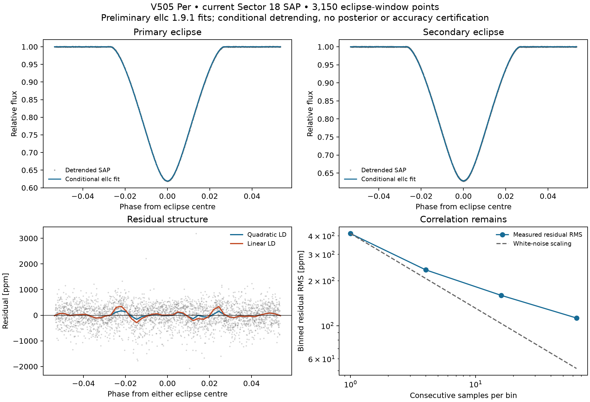

# Realistic analysis workloads and CPU evidence

These three systems are case studies, not a representative survey. The retained
foreground investigation used a separate read-only archive of published
`990586a98ff83533ab37e514af549f9c0d6955e2`, CPU-only JAX, four-core affinity and
Nice 19. It made no GPU allocation. The continuing Roche/GPU program and demanding
1e-4 controls remain in [the main progress report](ada_progress.md).

## Cases and exact current products

| Case | Paper model and needed features | Current full device-state scope |
| --- | --- | --- |
| V505 Per, TIC348517784 | Circular detached, TESS, quadratic LD, eclipse-window trends and finite exposure | Current ELISa linear/log/square-root LD differs from quadratic; blackbody/linear-LD runs are explicit pilot models |
| AI Phe, TIC102069549 | Eccentric detached, TESS; Run A used spheres, power-2 LD, third light and celerite trends | Eccentricity remains unsupported by the bounded device-state path; original-CPU-physics/device-integration is a distinct route |
| NT Aps, TIC402227266 | Overcontact, q≈.31, TESS; nonzero LC eccentricities in the paper | Outside current circular-detached/q bounds; preserve requested features and explicit CPU/fallback semantics |

[Southworth's V505 analysis](https://arxiv.org/html/2106.04323v1) used Sector18
120s SAP with QUALITY=0, JKTEBOP v41, circularity, zero third light, shared
quadratic LD (u1 fitted, u2=.23 fixed), and local straight-line trends. Its
14,805 retained points and 0.49mmag scatter describe that paper's reduction.
Our linear-LD/blackbody Roche pilot is a different model and selection.

[Maxted et al.'s AI Phe analysis](https://arxiv.org/html/2003.09295v2) includes
multiple independently specified runs. Run A used PDCSAP, ellc1.8.5 and the
features listed above; Run S used SAP. Keep e≈.1875 and P=24.5924d. The paper's
separately measured 33ppm interpolation difference is not a universal accuracy
allowance for another model, phase grid or likelihood.

[The NT Aps study](https://www.cambridge.org/core/journals/publications-of-the-astronomical-society-of-australia/article/spectroscopic-and-photometeric-study-of-nt-aps-a-lowactivity-w-umatype-contact-binary/049F9FA672A61DB1C39A19E3FBD6BB51)
used ELISa and describes 200 light-curve MCMC steps at 5-degree discretization;
the longer ephemeris chains are a different analysis. Table5 retains small
nonzero LC eccentricities (.008/.011). Exact flux reduction, LD/atmospheres and
exposure kernel remain incompletely pinned. Spot trials are not proof of absent
activity. This is a contrast case, not an inference-convergence oracle.

The [curated machine report](ada_validation/analysis-workloads-20261117.json)
pins downloaded bytes, MAST URI, SHA256, pipeline/release, cadence, flags, flux
columns and time headers. Current products are:

| Target | Filename | Pipeline / release | Rows / QUALITY=0 |
| --- | --- | --- | --- |
| V505 | tess2019306063752-s0018-0000000348517784-0162-s_lc.fits | spoc-5.0.97-20230811 /73 |17,554 /14,851 |
| AI Phe | tess2018234235059-s0002-0000000102069549-0121-s_lc.fits | spoc-5.0.11-20200915 /42 |19,737 /18,298 |
| NT Aps | tess2023153011303-s0066-0000000402227266-0260-a_fast-lc.fits | spoc-5.0.96-20230729 /92 |124,245 /92,752 |

V505 has14,666 QUALITY=0 rows with finite valid times and positive finite SAP
flux/errors. Do not substitute these into the paper's selection silently. AI Phe
also has a different current crowding value. NT Aps' nearby TIC402227264 is a
different Gaia source; a first cone-search match is insufficient. Sector38/39
600s TESS-SPOC/QLP products are distinct from the chosen SPOC20s Sector66 file.

Use [MAST's API](https://mast.stsci.edu/api/v0/) and exact product URIs, rather
than cadence labels alone. Times are BTJD/TDB with BJDREFI=2457000. These pilots
use a **nominal 120s box**, not a reconstructed frame/deadtime kernel. The 120s
products record 2s frames, INT_TIME1.98s, NUM_FRM60, DEADC.792; the 20s NT Aps
product has NUM_FRM10 and DEADC.99. Do not equate live time with response width.

## Original ELISa CPU and JAX CPU on V505 observation times

All 3,150 declared current SAP eclipse-window points are retained. Each call
constructs a fresh binary and returns complete host curves and the original
Gaussian density, including eight physically changing proposals. The seed uses
published scales but blackbody/custom linear u=.4, no third light, an 8-degree
Roche mesh, approximate equivalent-volume radius matching, and no detrending.
It is not an adequate real-data fit or a reproduction of the published model.

| CPU path | BLAS/OpenMP threads | First full call s | Median eight changed calls s | Process wall s |
| --- | --- | --- | --- | --- |
| Original serial |1|2.505|2.301|36.389|
| JAX CPU hybrid |1|4.559|3.273|54.466|
| Original serial |4|2.417|2.244|35.500|
| JAX CPU hybrid |4|4.519|3.231|53.785|
| Original four processes |1 each|1.152|1.262|19.047|

Original four-process curves/densities are bit-identical to serial, including
feature controls. Cross-path maximum flux/density differences are1.11e-15 and
2.33e-8, inside unchanged2e-12/3e-13 curve and1e-6 density gates. JAX CPU is
slower on this workload; it remains a separate improvement candidate. Its
one-thread median spans include2.25s CPU orientation/coverage and1.00s CPU
execution of device integration, not measured GPU transfers. These separate
backend processes share machine load; first calls retain filesystem/Numba
caches. XLA can use the available four cores independently of BLAS thread counts.

| Feature change from seed | Original serial s | Original four processes s | JAX CPU s | Max curve change ppm |
| --- | --- | --- | --- | --- |
| Mesh8→4 degrees |5.028|2.489|7.207|240|
|120s exposure1→3 midpoint samples |6.892|3.050|9.749|48.6|
| Irradiation on, two iterations |2.326|1.256|4.857|495|

These are finite feature changes at fixed seed, not fitted sensitivities or
convergence certificates. Exposure averaging occurs on raw flux **before**
normalization. Irradiation includes first-call compilation. No atmosphere,
spot, eccentricity or contact costs on these actual systems are inferred.

## Preliminary ellc fits and retained accuracy failures

The separate pinned ellc 1.9.1 pilot fits the same 3,150 current SAP points after
weighted out-of-eclipse straight-line trends per eclipse window. Trends are
conditioned on; their uncertainty is not propagated. Six parameters vary:
radius sum/ratio, surface brightness ratio, inclination, shared u1 and epoch
phase shift. Period/third light stay fixed; no irradiation or spots are included.

| Fit variant | Full optimizer s | Actual residual/Jacobian callbacks | Median full callback s | RMS ppm |
| --- | --- | --- | --- | --- |
| Sphere, quadratic LD, default grid,3 exposure samples |7.729|37|.2046|413.6|
| Sphere, quadratic LD, fine grid,3 samples |43.120|102|.4215|412.7|
| Sphere, quadratic LD, fine grid,7 samples |56.743|57|.9935|412.7|
| Sphere, quadratic LD, default grid,1 sample |5.837|84|.0684|413.4|
| Sphere, linear LD, default grid,3 samples |11.593|56|.2066|427.6|
| Roche+gravity darkening, quadratic LD,default grid,3 samples |16.288|59|.2761|419.2|

All optimizers reported success. A sequential 32-proposal fit-centred batch with
complete densities took6.636s; the whole pilot process took152.717s. These are
neither equivalent-model speed ratios against ELISa nor posterior draws.
Linear rather than quadratic LD shifts inclination +.01918deg and radius sum
-.0002399. Removing exposure averaging shifts radius ratio -.0007560; default→fine
spatial refinement shifts it +.0004534. These are raw shifts, not significance
estimates. Roche+gravity darkening is a combined physical change.

Independent refinements at fixed fine-grid/7-sample fitted parameters retain:

| Finite pair | Max curve change ppm | D using formal errors | D at sigma1e-4 |
| --- | --- | --- | --- |
| Default→fine grid,3 samples |56.2|6.415|9.085|
|3→7 samples, fine grid |16.0|1.050|1.532|
| Fine→very-fine grid,7 samples |24.0|1.752|2.588|
|7→15 samples, very-fine grid |1.61|.110|.161|

**Every pair fails D<=.1.** This is the retained conservative project diagnostic,
not a universal astronomy standard. Optimizer success and small pointwise
changes do not certify numerical accuracy. Adjacent fit residual correlation
is about .117 and binned RMS exceeds white-noise scaling. Formal errors near 166ppm
do not establish final parameter errors. No MCMC, posterior agreement or ESS/sec
result is claimed.



[Standalone PDF](ada_validation/v505-preliminary-analysis.pdf). Figure and all
retained reports/code/library/input hashes were verified against the foreground
47-artifact manifest. Raw FITS/NPZ, papers and operational logs remain private.

## Runnable CPU benchmark and next analysis controls

`scripts/benchmark_v505_cpu.py` requires the exact pinned V505 FITS file and
rejects a different hash/time system. Download that MAST URI through the archive
download API into a local data directory; the SHA256 is in the machine report.
Use the private CPU-only environment, explicit FP64, one process and declared
thread/affinity settings. Example arguments:

```text
python scripts/benchmark_v505_cpu.py --fits DATA/tess2019306063752-s0018-0000000348517784-0162-s_lc.fits --path original_cpu --proposals 8 --features --output original.json
python scripts/benchmark_v505_cpu.py --fits DATA/tess2019306063752-s0018-0000000348517784-0162-s_lc.fits --path original_cpu --processes 4 --proposals 8 --features --output parallel.json
python scripts/benchmark_v505_cpu.py --fits DATA/tess2019306063752-s0018-0000000348517784-0162-s_lc.fits --path jax_cpu_hybrid --proposals 8 --features --output jax.json
```

Set JAX_PLATFORMS=cpu **before** starting the JAX CPU command. Fresh reproduction
checks on all 3,150 points and two proposals match retained original arrays and
serial/four-process outputs bit for bit; JAX CPU curve/density differences pass
the original gates. Those smoke costs are not substituted for the retained
eight-proposal benchmark. The ellc fits/refinement remain separately retained
foreground evidence, not a newly adapted public fitter.

Promising follow-ups are controlled batched detached eclipse-window models,
fine reflected detached systems with tiled donor sums, and conditional nuisance
analyses with a fairly cached/vectorized CPU baseline. Label simpler geometry
explicitly. Keep exposure, LD/atmospheres, trends, crowding, irradiation and
spatial/time grids separate; refit matched data/priors and assess parameter
stability and correlated residuals. Long checkpointable samplers need mixing,
autocorrelation and effective-sample uncertainty before ESS/sec comparisons.
Future-hardware benefits remain hypotheses; algorithm changes and CPU bridges
must be measured separately. All GPU work retains registered bounded units and the current user-authorized
checkpoint-hold verification policy. The supervisor resumes production only
after genuine completion.
